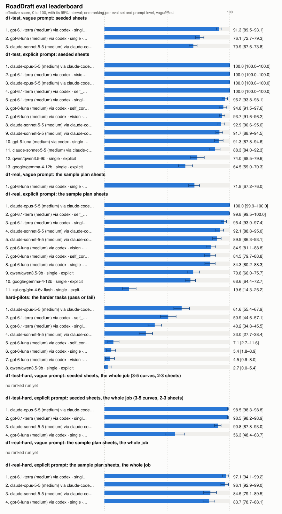

# RoadDraft CAD Engine

The headless 2D CAD application under the RoadDraft RL environment (see
[RoadDraft_Build_Plan.md](RoadDraft_Build_Plan.md), section 5). It gives an AI
agent — and a human through the same interface — a real drafting program:
model space + sheets, layers, styles, blocks, viewports, and title blocks,
with **every element exposed as JSON** and **every mutation flowing through a
serializable command bus**.

No CAD license required; Python only.

## Leaderboard

RoadDraft ranks models on its **eval sets**: drafting and annotation tasks drawn from seeded and real plan
sheets, each scored by the verifier in `roaddraft.eval` (the harness, the sets and the rules are in
[RoadDraft_Eval_Plan.md](RoadDraft_Eval_Plan.md)). Each set is its own ranking. The block below is
generated by `scripts/make_leaderboard.py` from the published runs under `benchmarks/runs/`.

<!-- d1-leaderboard:begin -->
Vague prompts only: the request in a sentence, the board's focus. The explicit-prompt board was retired on 2026-11-16; its rows are listed in [RETIRED.md](benchmarks/runs/RETIRED.md).

Track D closed on 2026-11-16: what the board found is written up in `docs/Track_D_Findings.md`. Still to come: GPT-6 Astra's remaining sets, appended as they finish (`d1-real` was added on 2026-11-22).



### Overall: every set, vague prompt

**Best model overall 74.8/100 ± 2.2 (claude-opus-5-5 (medium) via claude-code · single · vague), the weighted mean of its 5 set scores.**

| # | Model · mode · prompt | Effort | Overall | ± | `d1-test` ×1 | `d1-real` ×2 | `hard-pilots` ×2 | `d1-test-hard` ×1 | `d1-real-hard` ×2 | Sets |
|---:|---|---|---:|---:|---:|---:|---:|---:|---:|---:|
| 1 | claude-opus-5-5 (medium) via claude-code · single · vague | medium | **74.8** | 2.2 | 95.5 | 86.7 | 40.2 | 93.7 | 77.6 | 5 of 5 |
| 2 | gpt-6.1-terra (medium) via codex · single · vague | medium | **71.0** | 2.0 | 92.8 | 90.5 | 28.6 | 92.9 | 72.1 | 5 of 5 |
| 3 | claude-sonnet-5-5 (medium) via claude-code · single · vague | medium | **53.8** | 1.9 | 76.0 | 75.1 | 24.1 | 54.5 | 50.8 | 5 of 5 |
| 4 | gpt-6-luna (medium) via codex · single · vague | medium | **46.3** | 1.7 | 76.1 | 71.8 | 2.7 | 43.2 | 51.0 | 5 of 5 |
| 5 | google/gemma-4-12b · single · vague | thinking on | **32.9** | 1.5 | 67.2 | 59.0 | 0.0 | 3.0 | 37.5 | 5 of 5 |
| 6 | qwen/qwen3.5-9b · single · vague | default | **32.5** | 1.7 | 62.6 | 59.6 | 0.9 | 9.4 | 33.5 | 5 of 5 |
|  | Qwen/Qwen3.6-35B-A3B · single · vague | thinking on (default) | – | – | 76.3 | – | 8.0 | – | – | 2 of 5 |
|  | google/gemma-4-31B-it · single · vague | thinking on | – | – | 80.1 | – | 1.8 | – | – | 2 of 5 |
|  | gpt-6-astra (medium) via codex · single · vague | medium | – | – | 96.6 | 88.3 | – | – | – | 2 of 5 |
|  | mistralai/Mistral-Small-4-119B-2603-NVFP4 · single · vague | high | – | – | 64.0 | – | 2.7 | – | – | 2 of 5 |
|  | nvidia/NVIDIA-Nemotron-3.5-Super-VL-120B-A12B-NVFP4 · single · vague | thinking on | – | – | 82.4 | – | 4.5 | – | – | 2 of 5 |
|  | openai/gpt-oss-120b · single · vague | medium (default) | – | – | 70.3 | – | 3.4 † | – | – | 2 of 5 |
|  | qwen/qwen3.5-9b · single · vague · system extra conventions-v1@89b9a471 | default | – | – | 64.3 | 65.3 | – | – | – | 2 of 5 |
|  | zai-org/glm-4.6v-flash · single · vague | default | – | – | 25.2 | 13.6 | – | – | – | 2 of 5 |
|  | glm-5.3 · single · vague | default | – | – | 66.5 | – | – | – | – | 1 of 5 |
|  | google/gemma-4-26B-A4B-it · single · vague | thinking on | – | – | – | – | 0.9 | – | – | 1 of 5 |

Overall = the weighted mean of the model's effective scores on the 5 sets below, each set's weight beside its name (Robert, 2026-11-13: the real plan sheets and the hard pilots count double the seeded sheets); ± is the sets' 95% half-widths combined with the same weights (root-sum-square). A model ranks here only with a full-set run on every set; cost-subset runs are other tasks and do not count, so a model short of a set is listed unranked with the sets it has. † a text-only `hard-pilots` row, scored on its text pilots alone.

### `d1-test`: seeded sheets

**Best model 96.6/100 on d1-test with the vague prompt (gpt-6-astra (medium) via codex · single · vague, 95% CI 96.1–97.1, hard-fail 0%).**

| # | Model · mode · prompt | Effort | Effective | 95% CI | Rubric | Hard-fail | Clean | Invalid calls | Cost / sheet | Tasks × k | Run |
|---:|---|---|---:|---|---:|---:|---:|---:|---:|---|---|
| 1 | gpt-6-astra (medium) via codex · single · vague | medium | **96.6** | 96.1–97.1 | 96.6 | 0% | 64% | 0% | – | 100 × 1 | `e3-d1-test-gpt-6-astra-codex-medium-single-vague-v3` |
| 2 | claude-opus-5-5 (medium) via claude-code · single · vague | medium | **95.5** | 93.6–96.9 | 95.5 | 0% | 66% | 0% | $0.371 | 100 × 1 | `e3-d1-test-claude-opus-5-5-claude-code-medium-single-vague-v3` |
| 3 | gpt-6.1-terra (medium) via codex · single · vague | medium | **92.8** | 90.7–94.8 | 92.8 | 0% | 58% | 0% | – | 100 × 1 | `e3-d1-test-gpt-6.1-terra-codex-medium-single-vague-v3` |
| 4 | nvidia/NVIDIA-Nemotron-3.5-Super-VL-120B-A12B-NVFP4 · single · vague | thinking on | **82.4** | 78.5–85.9 | 85.3 | 4% | 42% | 0% | – | 100 × 1 | `e3-d1-test-nemotron-3.5-super-vl-single-vague-v3` |
| 5 | google/gemma-4-31B-it · single · vague | thinking on | **80.1** | 77.1–82.7 | 80.7 | 1% | 35% | 0% | – | 100 × 1 | `e3-d1-test-gemma-4-31b-single-vague-v3` |
| 6 | Qwen/Qwen3.6-35B-A3B · single · vague | thinking on (default) | **76.3** | 73.4–79.1 | 77.6 | 2% | 22% | 0% | – | 100 × 1 | `e3-d1-test-qwen3.6-35b-a3b-single-vague-v3` |
| 7 | gpt-6-luna (medium) via codex · single · vague | medium | **76.1** | 72.7–79.3 | 77.8 | 3% | 31% | 1% | – | 100 × 1 | `e3-d1-test-gpt-6-luna-codex-medium-single-vague-v3` |
| 8 | claude-sonnet-5-5 (medium) via claude-code · single · vague | medium | **76.0** | 74.1–77.8 | 76.0 | 0% | 23% | 0% | $0.181 | 100 × 1 | `e3-d1-test-claude-sonnet-5-5-claude-code-medium-single-vague-v3` |
| 9 | openai/gpt-oss-120b · single · vague | medium (default) | **70.3** | 65.0–75.5 | 75.5 | 8% | 39% | 2% | – | 100 × 1 | `e3-d1-test-gpt-oss-120b-single-vague-v3` |
| 10 | google/gemma-4-12b · single · vague | thinking on | **67.2** | 63.6–70.7 | 72.3 | 9% | 32% | 2% | – | 100 × 1 | `e3-d1-test-gemma-4-12b-q8-lms-single-vague-v3` |
| 11 | glm-5.3 · single · vague | default | **66.5** | 62.5–70.2 | 71.5 | 9% | 22% | 2% | $0.042 | 100 × 1 | `e3-d1-test-glm-5.3-single-vague-v3` |
| 12 | qwen/qwen3.5-9b · single · vague · system extra conventions-v1@89b9a471 | default | **64.3** | 57.5–70.9 | 69.7 | 7% | 33% | 0% | – | 100 × 1 | `e3-d1-test-qwen3.5-9b-q4km-lms-single-vague-t0-pin1` |
| 13 | mistralai/Mistral-Small-4-119B-2603-NVFP4 · single · vague | high | **64.0** | 58.6–69.4 | 69.8 | 10% | 27% | 1% | – | 100 × 1 | `e3-d1-test-mistral-small-4-single-vague-v3` |
| 14 | qwen/qwen3.5-9b · single · vague | default | **62.6** | 57.7–67.6 | 66.3 | 6% | 31% | 0% | – | 100 × 1 | `e3-d1-test-qwen3.5-9b-q4km-lms-single-vague-v3` |
| 15 | zai-org/glm-4.6v-flash · single · vague | default | **25.2** | 21.3–29.4 | 26.8 | 7% | 14% | 0% | – | 100 × 1 | `e3-d1-test-glm-4.6v-flash-q4km-lms-single-vague-v3` |

Notes on `d1-test`:

- Every row on this set ran on the pinned run code (3b7e7fe9; the Runpod rows ad6bf5e3), from before the seeded documents carried the title block's four names and date (designed by, drawn by, checked by, date: 234773ec, 2026-11-12). A vague prompt does not state them, so a drafter had nothing to read them from and left them blank or made them up. The rows stay ranked: the blank fields cost a row 0.3 to 0.95 points on the 19 tasks with a title block, and with each row's shortfall added back the order did not change (checked 2026-11-13, before GPT-6 Astra's row, which leads by 1.1).
- gpt-6-astra (medium) via codex · single · vague (`e3-d1-test-gpt-6-astra-codex-medium-single-vague-v3`): as of 2026-11-25 GPT-6 Astra has two finished sets, this one and `d1-real` (88.3, finished 2026-11-22). Its `d1-test-hard` run stopped at 55 of 100 on the ChatGPT account's weekly limit (not published) and can resume when the limit resets on Nov 27; `d1-real-hard` and `hard-pilots` are not queued. It has no overall score until all five sets are in.

### `d1-real`: the sample plan sheets

**Best model 90.5/100 on d1-real with the vague prompt (gpt-6.1-terra (medium) via codex · single · vague, 95% CI 87.9–93.1, hard-fail 1%).**

| # | Model · mode · prompt | Effort | Effective | 95% CI | Draft | Letter | Sheet | Notes | Rubric | Hard-fail | Clean | Invalid calls | Cost / sheet | Tasks × k | Run |
|---:|---|---|---:|---|---:|---:|---:|---:|---:|---:|---:|---:|---:|---|---|
| 1 | gpt-6.1-terra (medium) via codex · single · vague | medium | **90.5** | 87.9–93.1 | 97.0 ± 3.8 (n 25) | 88.2 ± 6.6 (n 25) | 88.1 ± 4.9 (n 25) | 88.9 ± 4.2 (n 25) | 91.0 | 1% | 52% | 0% | – | 100 × 1 | `e3-d1-real-gpt-6.1-terra-codex-medium-single-vague-v3` |
| 2 | gpt-6-astra (medium) via codex · single · vague | medium | **88.3** | 84.2–92.2 | 96.0 ± 6.0 (n 25) | 78.0 ± 12.5 (n 25) | 86.9 ± 4.8 (n 25) | 92.5 ± 3.6 (n 25) | 91.1 | 4% | 61% | 0% | – | 100 × 1 | `e3-d1-real-gpt-6-astra-codex-medium-single-vague-v3` |
| 3 | claude-opus-5-5 (medium) via claude-code · single · vague | medium | **86.7** | 82.8–90.3 | 100.0 ± 0.0 (n 25) | 71.0 ± 11.5 (n 25) | 88.2 ± 5.3 (n 25) | 87.6 ± 7.5 (n 25) | 89.3 | 4% | 48% | 0% | $0.763 | 100 × 1 | `e3-d1-real-claude-opus-5-5-claude-code-medium-single-vague-v3` |
| 4 | claude-sonnet-5-5 (medium) via claude-code · single · vague | medium | **75.1** | 70.9–79.1 | 85.0 ± 7.5 (n 25) | 68.1 ± 8.2 (n 25) | 73.1 ± 5.4 (n 25) | 74.2 ± 11.5 (n 25) | 78.1 | 5% | 25% | 0% | $0.329 | 100 × 1 | `e3-d1-real-claude-sonnet-5-5-claude-code-medium-single-vague-v3` |
| 5 | gpt-6-luna (medium) via codex · single · vague | medium | **71.8** | 67.2–76.0 | 85.0 ± 7.5 (n 25) | 74.8 ± 4.6 (n 25) | 71.3 ± 6.6 (n 25) | 56.0 ± 13.6 (n 25) | 75.0 | 6% | 22% | 1% | – | 100 × 1 | `e3-d1-real-gpt-6-luna-codex-medium-single-vague-v3` |
| 6 | qwen/qwen3.5-9b · single · vague · system extra conventions-v1@89b9a471 | default | **65.3** | 58.7–71.2 | 80.0 ± 14.0 (n 25) | 75.5 ± 11.4 (n 25) | 60.9 ± 9.6 (n 25) | 44.7 ± 12.1 (n 25) | 68.0 | 4% | 26% | 0% | – | 100 × 1 | `e3-d1-real-qwen3.5-9b-q4km-lms-single-vague-t0-pin1` |
| 7 | qwen/qwen3.5-9b · single · vague | default | **59.6** | 54.3–64.6 | 95.5 ± 4.5 (n 25) | 53.0 ± 11.0 (n 25) | 49.3 ± 9.8 (n 25) | 40.8 ± 13.3 (n 25) | 61.2 | 7% | 29% | 0% | – | 100 × 1 | `e3-d1-real-qwen3.5-9b-q4km-lms-single-vague-v3` |
| 8 | google/gemma-4-12b · single · vague | thinking on | **59.0** | 54.1–64.2 | 100.0 ± 0.0 (n 25) | 53.2 ± 9.1 (n 25) | 57.1 ± 10.5 (n 25) | 25.8 ± 14.2 (n 25) | 62.7 | 9% | 30% | 2% | – | 100 × 1 | `e3-d1-real-gemma-4-12b-q8-lms-single-vague-v3` |
| 9 | zai-org/glm-4.6v-flash · single · vague | default | **13.6** | 8.5–19.2 | 20.0 ± 16.0 (n 25) | 7.8 ± 8.8 (n 25) | 23.1 ± 9.0 (n 25) | 3.4 ± 5.1 (n 25) | 13.6 | 0% | 6% | 0% | – | 100 × 1 | `e3-d1-real-glm-4.6v-flash-q4km-lms-single-vague-v3` |

Question groups (`tasks.types.REAL_GROUPS`, the real-sheet counterpart of the probe board's tiers; `d1-real` draws 25 tasks a group): Draft = draft linework (`real-draw-alignment`); Letter = letter alignment data (`real-stationing`, `real-bearings`, `real-callouts`, `real-curve-table`, `real-alignment-data`); Sheet = produce the sheet (`real-attach-reference`, `real-title-block`, `real-sheet-setup`, `real-annotate-sheet`, `real-plan-sheet`); Notes = notes and dimensions (`real-construction-callouts`). Each cell is the effective mean over the row's tasks in that group ± its 95% half-width, with the number of tasks it rests on.

**Cost subset `cost5` on `d1-real`, vague prompt: partial runs, to save cost.** 60 of the set's 100 tasks, 5 of each task type (every task of a smaller type), the fixed draw in `benchmarks/tasksets/cost-subsets.json`; only Runpod runs rank here, and only when they hold every task of the subset with none in error or unfinished. Each full run of the set is re-scored on the same 60 tasks so the rows compare; a subset score is not comparable with a full-set score above.

| # | Model · mode · prompt | Effort | Effective | 95% CI | Tasks × k | Scored as | Run |
|---:|---|---|---:|---|---|---|---|
| 1 | gpt-6.1-terra (medium) via codex · single · vague | medium | **88.7** | 84.7–92.2 | 60 × 1 | full run, re-scored on the subset's 60 | `e3-d1-real-gpt-6.1-terra-codex-medium-single-vague-v3` |
| 2 | gpt-6-astra (medium) via codex · single · vague | medium | **85.0** | 78.8–90.3 | 60 × 1 | full run, re-scored on the subset's 60 | `e3-d1-real-gpt-6-astra-codex-medium-single-vague-v3` |
| 3 | claude-opus-5-5 (medium) via claude-code · single · vague | medium | **82.4** | 76.8–87.5 | 60 × 1 | full run, re-scored on the subset's 60 | `e3-d1-real-claude-opus-5-5-claude-code-medium-single-vague-v3` |
| 4 | google/gemma-4-31B-it · single · vague | thinking on | **76.8** | 72.2–81.2 | 60 × 1 | subset run (60 of 100) | `e3-d1-real-gemma-4-31b-single-vague-cost5-v3` |
| 5 | claude-sonnet-5-5 (medium) via claude-code · single · vague | medium | **72.8** | 68.4–76.9 | 60 × 1 | full run, re-scored on the subset's 60 | `e3-d1-real-claude-sonnet-5-5-claude-code-medium-single-vague-v3` |
| 6 | Qwen/Qwen3.6-35B-A3B · single · vague | thinking on (default) | **70.5** | 65.5–75.2 | 60 × 1 | subset run (60 of 100) | `e3-d1-real-qwen3.6-35b-a3b-single-vague-cost5-v3` |
| 7 | qwen/qwen3.5-9b · single · vague · system extra conventions-v1@89b9a471 | default | **64.2** | 56.5–71.2 | 60 × 1 | full run, re-scored on the subset's 60 | `e3-d1-real-qwen3.5-9b-q4km-lms-single-vague-t0-pin1` |
| 8 | google/gemma-4-12b · single · vague | thinking on | **55.5** | 49.5–61.2 | 60 × 1 | full run, re-scored on the subset's 60 | `e3-d1-real-gemma-4-12b-q8-lms-single-vague-v3` |
| 9 | qwen/qwen3.5-9b · single · vague | default | **53.2** | 46.3–59.7 | 60 × 1 | full run, re-scored on the subset's 60 | `e3-d1-real-qwen3.5-9b-q4km-lms-single-vague-v3` |
| 10 | zai-org/glm-4.6v-flash · single · vague | default | **12.9** | 7.6–18.1 | 60 × 1 | full run, re-scored on the subset's 60 | `e3-d1-real-glm-4.6v-flash-q4km-lms-single-vague-v3` |

### `hard-pilots`: the harder tasks (pass or fail)

**Best model 40.2/100 on hard-pilots with the vague prompt (claude-opus-5-5 (medium) via claude-code · single · vague, 95% CI 33.9–46.4, hard-fail 60%).**

| # | Model · mode · prompt | Effort | Effective | 95% CI | Rubric | Hard-fail | Clean | Invalid calls | Cost / sheet | Tasks × k | Run |
|---:|---|---|---:|---|---:|---:|---:|---:|---:|---|---|
| 1 | claude-opus-5-5 (medium) via claude-code · single · vague | medium | **40.2** | 33.9–46.4 | 85.8 | 60% | 40% | 0% | $1.20 | 112 × 1 | `e3-hard-pilots-claude-opus-5-5-claude-code-medium-single-vague-v3` |
| 2 | gpt-6.1-terra (medium) via codex · single · vague | medium | **28.6** | 23.2–33.9 | 80.3 | 71% | 29% | 0% | – | 112 × 1 | `e3-hard-pilots-gpt-6.1-terra-codex-medium-single-vague-v3` |
| 3 | claude-sonnet-5-5 (medium) via claude-code · single · vague | medium | **24.1** | 18.8–28.6 | 69.0 | 76% | 24% | 0% | $0.643 | 112 × 1 | `e3-hard-pilots-claude-sonnet-5-5-claude-code-medium-single-vague-v3` |
| 4 | Qwen/Qwen3.6-35B-A3B · single · vague | thinking on (default) | **8.0** | 4.5–12.5 | 45.5 | 92% | 8% | 0% | – | 112 × 1 | `e3-hard-pilots-qwen3.6-35b-a3b-single-vague-v3` |
| 5 | nvidia/NVIDIA-Nemotron-3.5-Super-VL-120B-A12B-NVFP4 · single · vague | thinking on | **4.5** | 1.8–8.0 | 43.8 | 96% | 4% | 1% | – | 112 × 1 | `e3-hard-pilots-nemotron-3.5-super-vl-single-vague-v3` |
| 6 | openai/gpt-oss-120b · single · vague · text only (89 of 112 pilots) | medium (default) | **3.4** | 1.1–6.7 | 35.9 | 97% | 3% | 2% | – | 89 × 1 | `e3-hard-pilots-gpt-oss-120b-single-vague-text-v3` |
| 7 | gpt-6-luna (medium) via codex · single · vague | medium | **2.7** | 0.0–5.4 | 39.8 | 97% | 3% | 1% | – | 112 × 1 | `e3-hard-pilots-gpt-6-luna-codex-medium-single-vague-v3` |
| 8 | mistralai/Mistral-Small-4-119B-2603-NVFP4 · single · vague | high | **2.7** | 0.0–5.4 | 30.2 | 97% | 3% | 1% | – | 112 × 1 | `e3-hard-pilots-mistral-small-4-single-vague-v3` |
| 9 | google/gemma-4-31B-it · single · vague | thinking on | **1.8** | 0.0–4.5 | 40.9 | 98% | 2% | 0% | – | 112 × 1 | `e3-hard-pilots-gemma-4-31b-single-vague-v3` |
| 10 | qwen/qwen3.5-9b · single · vague | default | **0.9** | 0.0–2.7 | 25.4 | 99% | 1% | 0% | – | 112 × 1 | `e3-hard-pilots-qwen3.5-9b-q4km-lms-single-vague-v3` |
| 11 | google/gemma-4-26B-A4B-it · single · vague | thinking on | **0.9** | 0.0–2.7 | 28.0 | 99% | 1% | 1% | – | 112 × 1 | `e3-hard-pilots-gemma-4-26b-a4b-single-vague-v3` |
| 12 | google/gemma-4-12b · single · vague | thinking on | **0.0** | 0.0–0.0 | 26.9 | 100% | 0% | 3% | – | 112 × 1 | `e3-hard-pilots-gemma-4-12b-q8-lms-single-vague-v3` |

**Cost subset `cost5` on `hard-pilots`, vague prompt: partial runs, to save cost.** 66 of the set's 112 tasks, 5 of each task type (every task of a smaller type), the fixed draw in `benchmarks/tasksets/cost-subsets.json`; only Runpod runs rank here, and only when they hold every task of the subset with none in error or unfinished. Each full run of the set is re-scored on the same 66 tasks so the rows compare; a subset score is not comparable with a full-set score above.

| # | Model · mode · prompt | Effort | Effective | 95% CI | Tasks × k | Scored as | Run |
|---:|---|---|---:|---|---|---|---|
| 1 | claude-opus-5-5 (medium) via claude-code · single · vague | medium | **48.5** | 42.4–56.1 | 66 × 1 | full run, re-scored on the subset's 66 | `e3-hard-pilots-claude-opus-5-5-claude-code-medium-single-vague-v3` |
| 2 | gpt-6.1-terra (medium) via codex · single · vague | medium | **36.4** | 30.3–42.4 | 66 × 1 | full run, re-scored on the subset's 66 | `e3-hard-pilots-gpt-6.1-terra-codex-medium-single-vague-v3` |
| 3 | claude-sonnet-5-5 (medium) via claude-code · single · vague | medium | **30.3** | 24.2–36.4 | 66 × 1 | full run, re-scored on the subset's 66 | `e3-hard-pilots-claude-sonnet-5-5-claude-code-medium-single-vague-v3` |
| 4 | Qwen/Qwen3.6-35B-A3B · single · vague | thinking on (default) | **9.1** | 3.0–15.2 | 66 × 1 | full run, re-scored on the subset's 66 | `e3-hard-pilots-qwen3.6-35b-a3b-single-vague-v3` |
| 5 | nvidia/NVIDIA-Nemotron-3.5-Super-VL-120B-A12B-NVFP4 · single · vague | thinking on | **6.1** | 1.5–10.6 | 66 × 1 | full run, re-scored on the subset's 66 | `e3-hard-pilots-nemotron-3.5-super-vl-single-vague-v3` |
| 6 | gpt-6-luna (medium) via codex · single · vague | medium | **4.5** | 0.0–9.1 | 66 × 1 | full run, re-scored on the subset's 66 | `e3-hard-pilots-gpt-6-luna-codex-medium-single-vague-v3` |
| 7 | openai/gpt-oss-120b · single · vague · text only (51 of 66 pilots) | medium (default) | **3.9** | 0.0–7.8 | 51 × 1 | subset run, its 51 text pilots (no image pilot run) | `e3-hard-pilots-gpt-oss-120b-single-vague-cost5-text-v3` |
| 8 | google/gemma-4-31B-it · single · vague | thinking on | **3.0** | 0.0–7.6 | 66 × 1 | full run, re-scored on the subset's 66 | `e3-hard-pilots-gemma-4-31b-single-vague-v3` |
| 9 | mistralai/Mistral-Small-4-119B-2603-NVFP4 · single · vague | high | **3.0** | 0.0–6.1 | 66 × 1 | full run, re-scored on the subset's 66 | `e3-hard-pilots-mistral-small-4-single-vague-v3` |
| 10 | google/gemma-4-26B-A4B-it · single · vague | thinking on | **1.5** | 0.0–4.5 | 66 × 1 | full run, re-scored on the subset's 66 | `e3-hard-pilots-gemma-4-26b-a4b-single-vague-v3` |
| 11 | qwen/qwen3.5-9b · single · vague | default | **1.5** | 0.0–4.5 | 66 × 1 | full run, re-scored on the subset's 66 | `e3-hard-pilots-qwen3.5-9b-q4km-lms-single-vague-v3` |
| 12 | google/gemma-4-12b · single · vague | thinking on | **0.0** | 0.0–0.0 | 66 × 1 | full run, re-scored on the subset's 66 | `e3-hard-pilots-gemma-4-12b-q8-lms-single-vague-v3` |

Notes on `hard-pilots`:

- Pass or fail on 112 pilots at one sample each: the leading row's 95% interval is 33.9 to 46.4, a half-width of 6.2 points, over the 5-point target the leading rows of the four D1 sets meet. It is left so; a set of 112 pass-or-fail tasks cannot reach 5 points at k = 1.
- google/gemma-4-12b · single · vague (`e3-hard-pilots-gemma-4-12b-q8-lms-single-vague-v3`): eight pilots ended on the provider's 30-minute turn limit and were rerun once (the stall rule); four did so again and stand as fails (p01-redraw-alignment-cflpnp, p01-redraw-alignment-wfl20, p10-typical-fdot9132, p10-typical-wfl05). Four more episodes were rerun after an engine or harness error. The final record is 96 submits and 16 budget stops (8 context, 4 turn limit, 3 clock, 1 faults), with no pass.

### `d1-test-hard`: seeded sheets, the whole job (3-5 curves, 2-3 sheets)

**Best model 93.7/100 on d1-test-hard with the vague prompt (claude-opus-5-5 (medium) via claude-code · single · vague, 95% CI 93.1–94.3, hard-fail 0%).**

| # | Model · mode · prompt | Effort | Effective | 95% CI | Rubric | Hard-fail | Clean | Invalid calls | Cost / sheet | Tasks × k | Run |
|---:|---|---|---:|---|---:|---:|---:|---:|---:|---|---|
| 1 | claude-opus-5-5 (medium) via claude-code · single · vague | medium | **93.7** | 93.1–94.3 | 93.7 | 0% | 6% | 0% | $1.09 | 100 × 1 | `e3-d1-test-hard-claude-opus-5-5-claude-code-medium-single-vague-v3` |
| 2 | gpt-6.1-terra (medium) via codex · single · vague | medium | **92.9** | 90.7–94.3 | 92.9 | 0% | 11% | 0% | – | 100 × 1 | `e3-d1-test-hard-gpt-6.1-terra-codex-medium-single-vague-v3` |
| 3 | claude-sonnet-5-5 (medium) via claude-code · single · vague | medium | **54.5** | 49.4–59.5 | 72.5 | 23% | 0% | 0% | $0.584 | 100 × 1 | `e3-d1-test-hard-claude-sonnet-5-5-claude-code-medium-single-vague-v3` |
| 4 | gpt-6-luna (medium) via codex · single · vague | medium | **43.2** | 37.8–48.4 | 54.7 | 21% | 0% | 3% | – | 100 × 1 | `e3-d1-test-hard-gpt-6-luna-codex-medium-single-vague-v3` |
| 5 | qwen/qwen3.5-9b · single · vague | default | **9.4** | 6.4–12.7 | 37.7 | 65% | 0% | 0% | – | 100 × 1 | `e3-d1-test-hard-qwen3.5-9b-q4km-lms-single-vague-v3` |
| 6 | google/gemma-4-12b · single · vague | thinking on | **3.0** | 1.2–5.2 | 52.9 | 90% | 0% | 2% | – | 100 × 1 | `e3-d1-test-hard-gemma-4-12b-q8-lms-single-vague-v3` |

**Cost subset `cost5` on `d1-test-hard`, vague prompt: partial runs, to save cost.** 25 of the set's 100 tasks, 5 of each task type (every task of a smaller type), the fixed draw in `benchmarks/tasksets/cost-subsets.json`; only Runpod runs rank here, and only when they hold every task of the subset with none in error or unfinished. Each full run of the set is re-scored on the same 25 tasks so the rows compare; a subset score is not comparable with a full-set score above.

| # | Model · mode · prompt | Effort | Effective | 95% CI | Tasks × k | Scored as | Run |
|---:|---|---|---:|---|---|---|---|
| 1 | claude-opus-5-5 (medium) via claude-code · single · vague | medium | **94.4** | 92.9–95.7 | 25 × 1 | full run, re-scored on the subset's 25 | `e3-d1-test-hard-claude-opus-5-5-claude-code-medium-single-vague-v3` |
| 2 | gpt-6.1-terra (medium) via codex · single · vague | medium | **90.2** | 82.0–95.0 | 25 × 1 | full run, re-scored on the subset's 25 | `e3-d1-test-hard-gpt-6.1-terra-codex-medium-single-vague-v3` |
| 3 | claude-sonnet-5-5 (medium) via claude-code · single · vague | medium | **51.1** | 41.2–61.4 | 25 × 1 | full run, re-scored on the subset's 25 | `e3-d1-test-hard-claude-sonnet-5-5-claude-code-medium-single-vague-v3` |
| 4 | gpt-6-luna (medium) via codex · single · vague | medium | **47.2** | 38.7–55.0 | 25 × 1 | full run, re-scored on the subset's 25 | `e3-d1-test-hard-gpt-6-luna-codex-medium-single-vague-v3` |
| 5 | Qwen/Qwen3.6-35B-A3B · single · vague | thinking on (default) | **41.7** | 29.1–54.2 | 25 × 1 | subset run (25 of 100) | `e3-d1-test-hard-qwen3.6-35b-a3b-single-vague-cost5-v3` |
| 6 | qwen/qwen3.5-9b · single · vague | default | **13.4** | 8.4–18.1 | 25 × 1 | full run, re-scored on the subset's 25 | `e3-d1-test-hard-qwen3.5-9b-q4km-lms-single-vague-v3` |
| 7 | google/gemma-4-12b · single · vague | thinking on | **3.3** | 0.0–8.0 | 25 × 1 | full run, re-scored on the subset's 25 | `e3-d1-test-hard-gemma-4-12b-q8-lms-single-vague-v3` |

Notes on `d1-test-hard`:

- Every row on this set ran on the pinned run code (3b7e7fe9; the Runpod row ad6bf5e3), from before the seeded documents carried the title block's four names and date (234773ec, 2026-11-12). 80 of the 100 tasks letter a title block and every model left the four fields blank on all of them: 1.3 to 1.55 points a row, which reorders nothing. The rows stay ranked.

### `d1-real-hard`: the sample plan sheets, the whole job

**Best model 77.6/100 on d1-real-hard with the vague prompt (claude-opus-5-5 (medium) via claude-code · single · vague, 95% CI 72.7–82.3, hard-fail 7%).**

| # | Model · mode · prompt | Effort | Effective | 95% CI | Letter | Sheet | Job | Rubric | Hard-fail | Clean | Invalid calls | Cost / sheet | Tasks × k | Run |
|---:|---|---|---:|---|---:|---:|---:|---:|---:|---:|---:|---:|---|---|
| 1 | claude-opus-5-5 (medium) via claude-code · single · vague | medium | **77.6** | 72.7–82.3 | 81.9 ± 11.7 (n 20) | 91.7 ± 4.2 (n 41) | 60.6 ± 9.3 (n 39) | 83.0 | 7% | 1% | 0% | $0.958 | 100 × 1 | `e3-d1-real-hard-claude-opus-5-5-claude-code-medium-single-vague-v3` |
| 2 | gpt-6.1-terra (medium) via codex · single · vague | medium | **72.1** | 66.7–77.0 | 78.9 ± 17.3 (n 20) | 92.2 ± 3.9 (n 41) | 47.5 ± 8.3 (n 39) | 74.9 | 4% | 8% | 0% | – | 100 × 1 | `e3-d1-real-hard-gpt-6.1-terra-codex-medium-single-vague-v3` |
| 3 | gpt-6-luna (medium) via codex · single · vague | medium | **51.0** | 47.8–54.4 | 60.3 ± 7.0 (n 20) | 69.1 ± 3.6 (n 41) | 27.3 ± 6.4 (n 39) | 54.3 | 7% | 0% | 2% | – | 100 × 1 | `e3-d1-real-hard-gpt-6-luna-codex-medium-single-vague-v3` |
| 4 | claude-sonnet-5-5 (medium) via claude-code · single · vague | medium | **50.8** | 47.2–54.0 | 60.9 ± 6.5 (n 20) | 65.2 ± 4.1 (n 41) | 30.4 ± 6.8 (n 39) | 56.1 | 11% | 0% | 0% | $0.465 | 100 × 1 | `e3-d1-real-hard-claude-sonnet-5-5-claude-code-medium-single-vague-v3` |
| 5 | google/gemma-4-12b · single · vague | thinking on | **37.5** | 34.8–40.2 | 51.6 ± 3.7 (n 20) | 45.8 ± 4.8 (n 41) | 21.6 ± 4.6 (n 39) | 39.3 | 7% | 0% | 3% | – | 100 × 1 | `e3-d1-real-hard-gemma-4-12b-q8-lms-single-vague-v3` |
| 6 | qwen/qwen3.5-9b · single · vague | default | **33.5** | 30.6–36.2 | 50.9 ± 6.1 (n 20) | 42.5 ± 4.8 (n 41) | 15.0 ± 3.8 (n 39) | 34.2 | 3% | 0% | 0% | – | 100 × 1 | `e3-d1-real-hard-qwen3.5-9b-q4km-lms-single-vague-v3` |

Question groups (`tasks.types.REAL_GROUPS`, the real-sheet counterpart of the probe board's tiers; `d1-real` draws 25 tasks a group): Letter = letter alignment data (`real-stationing`, `real-bearings`, `real-callouts`, `real-curve-table`, `real-alignment-data`); Sheet = produce the sheet (`real-attach-reference`, `real-title-block`, `real-sheet-setup`, `real-annotate-sheet`, `real-plan-sheet`); Job = the whole job (`real-sheet-job`, `real-annotate-job`). Each cell is the effective mean over the row's tasks in that group ± its 95% half-width, with the number of tasks it rests on.

**Cost subset `cost5` on `d1-real-hard`, vague prompt: partial runs, to save cost.** 25 of the set's 100 tasks, 5 of each task type (every task of a smaller type), the fixed draw in `benchmarks/tasksets/cost-subsets.json`; only Runpod runs rank here, and only when they hold every task of the subset with none in error or unfinished. Each full run of the set is re-scored on the same 25 tasks so the rows compare; a subset score is not comparable with a full-set score above.

| # | Model · mode · prompt | Effort | Effective | 95% CI | Tasks × k | Scored as | Run |
|---:|---|---|---:|---|---|---|---|
| 1 | claude-opus-5-5 (medium) via claude-code · single · vague | medium | **72.2** | 60.5–83.1 | 25 × 1 | full run, re-scored on the subset's 25 | `e3-d1-real-hard-claude-opus-5-5-claude-code-medium-single-vague-v3` |
| 2 | gpt-6.1-terra (medium) via codex · single · vague | medium | **59.2** | 48.3–70.4 | 25 × 1 | full run, re-scored on the subset's 25 | `e3-d1-real-hard-gpt-6.1-terra-codex-medium-single-vague-v3` |
| 3 | Qwen/Qwen3.6-35B-A3B · single · vague | thinking on (default) | **50.6** | 46.3–55.6 | 25 × 1 | subset run (25 of 100) | `e3-d1-real-hard-qwen3.6-35b-a3b-single-vague-cost5-v3` |
| 4 | claude-sonnet-5-5 (medium) via claude-code · single · vague | medium | **47.6** | 39.7–55.0 | 25 × 1 | full run, re-scored on the subset's 25 | `e3-d1-real-hard-claude-sonnet-5-5-claude-code-medium-single-vague-v3` |
| 5 | gpt-6-luna (medium) via codex · single · vague | medium | **47.4** | 42.0–52.6 | 25 × 1 | full run, re-scored on the subset's 25 | `e3-d1-real-hard-gpt-6-luna-codex-medium-single-vague-v3` |
| 6 | google/gemma-4-12b · single · vague | thinking on | **38.3** | 34.6–42.1 | 25 × 1 | full run, re-scored on the subset's 25 | `e3-d1-real-hard-gemma-4-12b-q8-lms-single-vague-v3` |
| 7 | qwen/qwen3.5-9b · single · vague | default | **26.9** | 22.2–32.2 | 25 × 1 | full run, re-scored on the subset's 25 | `e3-d1-real-hard-qwen3.5-9b-q4km-lms-single-vague-v3` |

The full board, with the runs not ranked and why: [benchmarks/runs/LEADERBOARD.md](benchmarks/runs/LEADERBOARD.md). Generated by `scripts/make_leaderboard.py`; do not edit by hand.
<!-- d1-leaderboard:end -->

The 33 **capability probes** of Track P are not the eval. They were a quick read on what models of
different sizes can do with the tool surface, and that board was closed on 2026-10-27 with eleven rows:
[benchmarks/leaderboard/TRACK_P.md](benchmarks/leaderboard/TRACK_P.md), labelled as the probe board. The
probes themselves are described in the Find-probes, Drafting-probes and Tier sections further down.

## Structure: the AutoCAD / MicroStation mental model

The document is organized the way both production platforms are, so workflows
learned here transfer (PRD section 4):

| RoadDraft | AutoCAD / Civil 3D | MicroStation / ORD |
|---|---|---|
| Model space (US survey feet) | Model space | Design model |
| Sheet (inches) + border/title block (`standard`, `caltrans`, `none`) | Paper-space layout | Sheet model |
| Viewport (scale = feet/inch, view twist) | Layout viewport (MVIEW) | Referenced view / named boundary |
| Layer | Layer | Level |
| Block | Block (INSERT) | Cell |
| Text style | Text style | Text style |
| Reference (basefile: path, placement, true scale, level display, symbology, clip) | Xref (XATTACH / XCLIP) | Reference attachment |
| Command + aliases | Command line (`LINE`, `ERASE`…) | Key-in (`place line`…) |

Design geometry lives in model space at real-world coordinates; annotation and
sheet composition live on sheets in paper inches; viewports window model space
onto paper at a plot scale (1"=50' → `feet_per_inch: 50`). Commands carry
C3D-style and ORD-style aliases (`LINE`, `place line`) for the command line;
an eval episode only ever shows a model the tools' own names.

## Roadway drafting commands

Beyond the 2D primitives, the bus carries roadway-semantic actions:

- `annotate_stationing` — the stationing engine. Give it connected
  line/polyline/arc entities (the centerline), a begin station, and an
  interval; it computes length along tangents and curves, draws 7 ft ticks,
  letters the station numbers the Caltrans way (the whole number at each
  500 ft, the ones digit elsewhere, below the line), keeps labels upright, and
  letters BC/EC/PCC square to the line reading bottom to top (`24+05.27 BC`). `chain=true` follows the elements joined end to end from
  any one of them; `start_point` says where the begin station is known (an
  end, or any point along the path), and the stations run on from the end
  nearer it (`reverse` turns them round).
- `attach_reference` / `detach_reference` / `modify_reference` /
  `reload_references` — external basefiles (AutoCAD xref / MicroStation
  reference attachment): the host stores path + offset/rotation/scale plus
  display settings, the basefile's model geometry renders under every space
  and sheet viewport, reloads from disk, exports to DXF on bound
  `<NAME>$<layer>` layers, and is never copied into the host document.
  The MicroStation reference dialog is covered: relative paths resolve
  against the host file's folder; `true_scale` converts the basefile's
  declared `model_units` into the host space's units (a metric survey lands
  at the right size in a survey-foot host, 1"=50' on a sheet is
  `scale: 1/600`); `levels_off` hides basefile levels per attachment;
  `symbology` overrides color / linetype / lineweight or grays the whole
  attachment out; `clip` (boundary polygon) and `masks` (mask polygons) clip
  the geometry itself, so render, DXF, extents and `hit_test` agree.
  `hit_test` locates reference elements (`SURVEY:LN-001`, read-only) and
  `get_entity` reads them back in host coordinates. `model` attaches the
  basefile's design model or one of its sheet models (border and title
  block included); `nest_depth` turns on live nesting, so the basefile's own
  references display too (`SURVEY:UTIL:LN-001`, levels `UTIL$layer`), with
  circular attachments skipped.
- `place_dimension` — dimensioning: `linear` (along one axis), `aligned`
  (the true distance between two points), `angular`, `radius`, `diameter`
  and `arc_length`. What the document stores is the *measurement* — the
  points, the arc, and where the dimension line was dragged to — so the
  number is derived, never typed: move a measured point and the text
  follows. Name what to measure rather than computing points (`of_entity`
  for one entity end to end or a curve's own centre/radius,
  `from_entity`/`to_entity` for two, two lines for the angle between them),
  and reference geometry works as a target. See
  [Dimensioning](#dimensioning) below.
- **Coordinate geometry and editing** — `draw_traverse` (lines and curves
  by bearing and distance, closure reported), `offset_entity` (AutoCAD
  OFFSET / MicroStation Copy Parallel, chains included), `fillet` (the curve
  between two lines, trimmed to it), `measure along=` (distance along a line,
  chain or alignment and square off it), and `key_points` / `snap` (object
  snaps: endpoints, intersections, alignment PIs/BCs/ECs). See
  [Coordinate geometry, offsets, fillets and snaps](#coordinate-geometry-offsets-fillets-and-snaps).
- **The modify toolbox, COGO points, labels and hatching** — `trim` /
  `extend`, `break_entity` / `join_entities` / `explode_entities`,
  `chamfer`, `lengthen`, `copy_entities` / `rotate_entities` /
  `mirror_entities` / `scale_entities` / `array_entities`; polylines with
  arc segments; `draw_station_offset` (linework by station and offset);
  `create_points` / `place_point_table`; `label_segments` (bearings and
  distances, or L1/C1 tags with line and curve tables); `place_along`
  (measure / divide); `hatch`; and the `area` query, with `get_entity`
  reading off lengths, bearings and curve data. See
  [Editing, points, labels and hatching](#editing-points-labels-and-hatching).
- **Design model (Phase 1)** — `create_alignment` / `modify_alignment` /
  `delete_alignment`, `create_profile` / `delete_profile`, `draw_alignment`,
  `place_label`, `place_curve_table`, `import_landxml`, plus
  `annotate_stationing alignment=NAME`: alignments and profiles live in the
  document as design data (not linework), and every tick, label, and table
  drawn from them records the design anchor it came from. See
  [Design model](#design-model-phase-1) below.

## The load-bearing decision: the command bus

Every state change is a named JSON command (PRD section 5.1):

- **Validated** against a JSON Schema; invalid calls return *teaching errors*
  (what's wrong + the schema + a working example).
- **Atomic**: a failed command restores the pre-command snapshot.
- **Journaled**: the command log is the action trajectory; `save_journal` +
  `Session.replay_journal` reproduce the document deterministically.
- **Undoable**: `undo`/`redo` are themselves journaled commands.
- **Feedback-rich**: every result carries a diff (`created/modified/deleted`)
  plus warnings (text overlap, off-sheet placement, viewport outside the
  usable area) — dense learning signal.

## Quickstart

```bash
python3 -m venv .venv
.venv/bin/pip install -e ".[dev]"     # add ,desktop for the app window
.venv/bin/pytest                      # 1009 tests
.venv/bin/python examples/demo_plan_sheet.py   # drafts a full plan sheet
.venv/bin/python examples/caltrans_l2/build_all.py  # rebuilds a real Caltrans sheet
.venv/bin/python -m roaddraft.tasks 42         # generates a D1 task + reference solution
```

The demo drafts C-101 (ANSI D) from a design-model alignment: centerline
drawn from the alignment, pavement edges from station/offset queries,
alignment-mode stationing (ticks, labels, BC/EC), anchored bearing and
mid-curve callouts, the curve data table, north arrow, notes, filled title
block — then renders PNG/PDF, exports DXF and LandXML, and proves the
journal replays byte-identically (26 commands).

### A real plan sheet, rebuilt

`examples/caltrans_l2/` recreates a published Caltrans plan sheet — 03-3H5404
sheet 6, "LAYOUT", Route 70 PM 46.0/47.0 — as the two-file plan set the
platform is built around: a design model file that owns the `SR70` alignment,
the roadway linework, the stationing and the existing ground, and a sheet file
that owns **no geometry at all** and composes sheet L-2 over a clipped
reference to it at 1"=50' with a 6.457° view twist. Its four curves are
rebuilt from the sheet's own CURVE DATA table and BC/EC stations, so the plan's
every printed station comes back out of the design model; its fourteen
station-and-offset callouts are aimed through that model rather than at typed
points; its BC, EC and PCC stations read bottom to top, as the published sheet
letters them. The builders live in the package (`roaddraft.probes.l2`), because
the tier-3 probes start from this sheet. See
[examples/caltrans_l2/README.md](examples/caltrans_l2/README.md).

### Drive it as an agent (JSON in, JSON out)

```python
from roaddraft import Session

s = Session(project_name="SR 100")
s.manifest()                          # every command & query: schema + example + aliases
s.execute("create_layer", {"name": "align_MAIN", "color": "black", "lineweight_mm": 0.5})
s.execute("draw_line", {"space": "model", "start": [1000, 1000], "end": [1600, 1000],
                        "layer": "align_MAIN"})
s.execute("create_sheet", {"name": "C-101", "size": "ANSI_D"})
s.execute("create_viewport", {"sheet": "C-101", "center_paper": [17, 12],
                              "width_in": 31, "height_in": 18,
                              "model_center": [1300, 1000], "feet_per_inch": 50})
s.query("get_document_state", {"detail": "full"})   # the entire file as JSON
s.query("render_sheet", {"sheet": "C-101", "include_base64": True})  # vision obs
```

Nothing is hidden from the model: full state (`get_document_state`), per-sheet
state with what each viewport can see (`get_sheet_state`), entity lookups,
extents, the journal, and the self-describing manifest (`list_commands`).

## Design model (Phase 1)

Roadway design lives in the document as **data**, separate from the linework
drawn from it — the Civil 3D alignment / ORD geometry-model idea:

```python
s.execute("create_alignment", {"name": "ALIGN-1", "begin_station": "10+00",
                               "pis": [[1000, 1000], [1814.359354, 1000, 800],
                                       [2433.012702, 1357.179677]],
                               "equations": [{"back": "20+00", "ahead": "25+00"}]})
s.execute("create_profile", {"name": "PROF-1", "alignment": "ALIGN-1",
                             "pvis": [[1000, 100], [2000, 120, 400], [2500, 90]]})
s.execute("draw_alignment", {"alignment": "ALIGN-1", "layer": "align_MAIN"})
s.execute("annotate_stationing", {"space": "model", "alignment": "ALIGN-1"})
s.execute("place_label", {"space": "model", "anchor": "PC-1"})        # "16+00.00 BC", square to the line
s.execute("place_label", {"space": "model", "anchor": "T-2"})         # N 60°00'00" E 500.00', above the tangent
s.execute("place_label", {"space": "model", "anchor": "MC-1"})        # the curve number in a bubble
s.execute("place_label", {"space": "C-101", "anchor": "MC-1", "kind": "curve_data"})
s.execute("place_curve_table", {"space": "C-101", "position": [24, 8.5]})
s.query("get_design_data", {"kind": "curves"})     # Δ, R, T, L, E, M, C, bearings, stations
s.query("station_to_xy", {"station": "18+00", "offset": 25})
s.query("xy_to_station", {"point": [1300, 1012]})  # -> 13+00.00, 12.00' LT
```

- **Alignments** are PI-based (`[x, y]` at BEGIN/END, `[x, y, R]` interior)
  or built from CoordGeom elements; the engine compiles tangents and circular
  curves, checks that curves fit their tangents, and carries a begin station
  plus **station equations** (`STA 20+00 BK = STA 25+00 AH`, gaps and
  overlaps). Every station in the API is a *display* station (`1600` or
  `"16+00"`); results carry the raw value and the printed text.
- **Profiles** are PVIs with symmetric parabolic vertical curves; the engine
  validates fit/overlap and reports PVC/PVT, grades, A, K, and high/low points.
- **Anchors** name design points: `BEGIN`, `END`, `PC-n`, `PT-n`, `PI-n`,
  `MC-n`, `T-n`, `EQ-n` (`BC-n`/`EC-n` name the PC/PT), or a station (`18+00`, `1800`), optionally with an
  offset (`PC-1@16`, `18+00@25L`, right positive). `place_label` resolves the
  anchor, infers the label kind (`station`, `pc`, `pt`, `pi`, `mc`, `pcc`,
  `prc`, `bearing`, `begin`, `end`, `equation`, `curve_data`, `custom`),
  writes the conventional wording, places the text on the conventional side
  with the conventional offset, keeps it upright (text square to the line reads
  bottom to top, as Caltrans letters BC and EC), and — on a sheet — maps it
  through the viewport that shows the point. The text entity records an
  `anchor` (`alignment`, `ref`, `kind`, `station`, `offset`, `side`,
  `label_offset`, `rotation`, `viewport`, `content_auto`, `placed_by`): the
  verifier's contract. `resolve_anchor` is the dry run.
- **Anchor provenance**: the bus stamps `anchor.placed_by` with the command
  that created the entity (`draw_alignment`, `annotate_stationing`,
  `place_label`, `place_curve_table`), and nothing else writes it —
  `modify_entity` drops a supplied `placed_by` and keeps the entity's own, so
  an anchor bolted onto hand-placed text carries no provenance while a real
  label survives a rename, a move or a layer fix. A verifier can then tell
  drafted work from decorated work.
- **Reading a referenced design** — a plan set keeps the design in one file and
  the sheets in another that references it, so the sheet file owns no alignments
  at all. `list_alignments include_references=true` lists them as
  `DESIGN:SR-100`, and `station_to_xy`, `xy_to_station`, `resolve_anchor` and
  `get_design_data` all accept that name, so "where is station 25+00" and "where
  is the PC of the first curve" work from the sheet file. **Points come back in
  host coordinates** — they land on the geometry as drawn even when the
  attachment is moved, turned or scaled — while stations, lengths, radii and
  bearings stay as designed, because those describe the road rather than this
  sheet; a `placement` block reports the mapping so the difference is never
  hidden. Reading is not owning: `draw_alignment`, `draw_offset`, `place_label`,
  `modify_alignment` and `delete_alignment` all refuse a referenced alignment
  and say to call it out instead.
- **Finding things** (`find_entities`) selects by what something *is* — layer,
  type, design anchor, text content, a bounding box, or what a given sheet
  shows — instead of dumping the document and filtering downstream:
  `{anchor: {kind: "offset", offset: [-12, 12]}, visible_on: "C-102"}` is the
  pavement edges that sheet displays. It searches attachments too, so it is how
  to locate geometry in a sheet file whose design is referenced in, and the
  basefile's anchors travel through, so a pavement edge announces itself as
  ±12 ft of `SR-100`. Every row carries **a point that is on the entity**;
  `point_on_entity` gives the same for `start`/`mid`/`end` or any fraction,
  with the direction it runs there.
- **Callouts** (`place_callout target_entity="DESIGN:AR-003" at="mid"`) place an
  arrowhead, a leader, a shoulder and text as ordinary entities — the way a
  drafter annotates geometry that has no design model of its own. Name the
  entity and the engine computes the tip; that matters most on curves, where
  the midpoint of an arc's endpoints sits 15.5 ft off the arc on the demo
  alignment. A raw `target=[x,y]` still works, and the result says what the tip
  actually landed on (`DESIGN:AR-007 (arc on rd_ES, 20.00' LT of
  SR-100)`) — worth reading, because roadway linework runs parallel a few feet
  apart, so a hand-computed point that misses usually lands on the *wrong* line
  rather than on nothing. A station and offset is a target too:
  `target_anchor="586+57.73@20.83L" alignment="DESIGN:SR70"` takes the anchor
  grammar (`PC-1`, `18+00@12R`, `{station, offset}`), because most plan callouts
  point at a place on the alignment where there is no entity to find. A
  referenced alignment is read, not owned, so the callout carries no anchor.
- **Callouts on the sheet.** Plan annotation belongs in paper space, where it
  neither scales nor turns with the view — but what it points at is in the
  model, usually in a referenced basefile, and only *seen* on the sheet through
  a viewport. So `place_callout space="C-102"` still takes a model
  `target_entity` or `target_anchor`, and the engine carries the tip through
  the viewport's centre, scale and twist (`viewport=` picks one; otherwise the
  first that shows the target, as `place_label` does). `at` then runs along
  **the part of the entity that sheet shows**: a pavement edge runs the length
  of the project and a sheet shows one stretch of it, so on the demo project
  the first curve is 62 % on C-102 and 38 % on C-101, and `mid` lands on a
  visible point of each. Asking for something the sheet does not show is a
  fault that names the sheets that do. `find_entities visible_on=` keeps only
  what the viewports really show (a twisted window is not its bounding box) and
  gives each row the `sheet_point` the tip will land on, so the text can be put
  clear of the linework.
- **Model ↔ sheet** (`model_to_sheet`, `sheet_to_model`) convert between model
  feet and paper inches through a viewport, so nobody re-derives one by hand;
  `sheet_to_model` also names the nearest entity under that spot on the paper.
  `station_to_xy`, `resolve_anchor` and `point_on_entity` take a `sheet` and
  answer in paper inches as well. A raw `target` on a sheet is checked the same
  way — against the design the tip is looking at through the viewport, not
  against whatever lettering sits nearby on the paper. The Caltrans L-2 rebuild
  places its 14 station-and-offset callouts by `target_anchor` on a viewport
  twisted −6.457°; the tips agree with the example's own independent trig to
  1e-13 in.
- **Constant offsets** (`draw_offset offsets=[-12, 12]`) draw pavement edges,
  shoulders and right of way as anchored lines and arcs. Offsets are feet, right
  of the direction of stationing positive (`"12L"` says the side out loud), so a
  24 ft pavement is `[-12, 12]`. The offset is exact, not a polyline
  approximation: tangents shift sideways keeping direction and length, curves
  keep their center and change radius (`R + offset × sign`, so a 800 ft left
  curve offsets to 812 ft outside / 788 ft inside), and because the radial
  lines at the PC and PT are shared the pieces meet end to end with no fillet.
  An offset that reaches the center of a curve is a teaching error.
- **Alignment-mode stationing** (`annotate_stationing alignment=NAME`) walks
  the true stations through the equations, so ticks and labels are anchored
  and equation-aware; the original entity-chain mode is unchanged.
- **LandXML 1.2** in and out (`import_landxml`, `export_landxml`): alignments
  with Line/Curve geometry and station equations, profiles with PVI/ParaCurve;
  units (USSurveyFoot / foot / meter) are converted; spirals are rejected
  with a teaching error.
- **Tasks**: `python -m roaddraft.tasks SEED [--equations] [--curves N]`
  generates a deterministic D1 plan-sheet task — a brief (design pre-seeded,
  deliverable, the frozen v1 drafting spec), the verifier ground truth computed by
  the same label functions, and the reference solution (15 commands) whose
  document matches the truth exactly and whose journal replays. Task ids
  pin the generator version and the spec hash. The AASHTO-derived standards
  tables and the drafting spec were frozen as v1 on 2026-10-16 after PE review.
- **Annotation scales** (AutoCAD annotation scale / Civil 3D drawing scale):
  the document carries a scale list (`1"=10'` … `1"=500'`, editable with
  `add_annotation_scale` / `delete_annotation_scale`), a current scale, and
  paper-unit defaults (0.10 in text, 0.20 in ticks, 0.32 in label offsets;
  `set_annotation_defaults`). With `set_annotation_scale 50` on, stationing
  and labels that omit sizes are drafted at paper size × scale (5 / 10 / 16 ft)
  and stamped `annotative`; `set_annotation_scale 100` then re-sizes every
  annotative model entity for the new plot scale — text heights from their
  paper heights, ticks about their midpoints, design-anchored labels re-placed
  at their paper offset through the design model, plain text about its
  insertion point. `adopt=true` stamps pre-existing annotation; `off` restores
  the fixed feet defaults. `create_viewport` warns when a viewport's plot
  scale differs from the annotation scale; `list_annotation_scales` reports
  the list and sizes. The GUI has the scale selector in the status bar.

## Dimensioning

A dimension is a measurement, not a picture of one. `place_dimension` stores
what is being measured and derives the linework — extension lines, dimension
line, arrowheads, the number — every time it is drawn, which is what keeps
the text and the geometry from drifting apart:

```python
s.execute("place_dimension", {"space": "model", "kind": "linear",
                              "from_entity": "LN-003", "to_entity": "LN-005",
                              "line_point": [1450, 1000], "layer": "V-ANNO-DIMS"})
# -> linear dimension DM-001 ("24.00'") placed in model space, measured vertically
s.execute("modify_entity", {"id": "DM-001", "changes": {"p2": [1450, 1020]}})
# -> the dimension now reads 32.00'
```

**What to measure.** Give the points (`p1`/`p2`, `center`, `radius`), or name
the geometry and let the engine find them: `of_entity` dimensions a line,
polyline or arc end to end, or reads an arc/circle's own centre and radius;
`from_entity`/`to_entity` (with `from_at`/`to_at`: `start|mid|end` or a
fraction) measure between points that are genuinely *on* each entity, curves
included; and two lines handed to an angular dimension are intersected for
the vertex. Ids come from `find_entities` and `hit_test`, so geometry seen
through a reference attachment (`SURVEY:LN-001`) can be dimensioned like
anything else.

**`line_point` is where the dimension line goes** — the point a drafter
drags to — and it is also how the command says which measurement was meant,
exactly as dragging does in AutoCAD: clear above or below a pair of points is
a horizontal dimension and out to the side a vertical one (two points
separated along one axis only are simply measured that way); on an angular
dimension it picks which of the four angles between the rays is being called
out; on a radius or diameter it is where the text sits, inside the circle
drawing across it and outside drawing a leader.

**Appearance** follows the annotation scale. One number — the text height —
sizes the whole dimension: arrowheads, text gap and extension line offsets
default to fixed multiples of it (AutoCAD's DIMASZ / DIMGAP / DIMEXO /
DIMEXE), and each can be overridden. `set_annotation_scale` re-sizes the
annotation for a new plot scale *without moving the measured points*, so the
reading never changes. Text sits above the dimension line and reads left to
right; arrowheads sit inside the extension lines and flip outside, with a
warning, when the text will not fit. `arrow` selects `arrow`, `tick` (the
oblique civil slash), `dot` or `none`.

**The number** reads `120.00'` by default, `12'-6"` with
`unit_format: "feet_inches"`, or bare with `decimal`; an angular dimension
reads DMS (`28°15'30"`). `prefix`/`suffix` wrap it (radius, diameter and arc
length come with `R=`, `Ø` and `L=`), `precision` sets the decimals, and
`text` overrides the value outright (`""` hides it). `measure_scale` is
AutoCAD's DIMLFAC: on a sheet, set it to the viewport's plot scale to
dimension in model feet — which is exactly what the viewport transform does
for you when a model-space dimension is shown on paper, so the same
dimension reads `24.00'` in model space and through a 1"=50' viewport.

**`measure`** is the read-only half (AutoCAD's DIST / MEASUREGEOM): the
distance, dx/dy, bearing and azimuth between two points or entities, or one
entity's own length, radius and sweep — formatted with the same string
`place_dimension` would draw.

## Coordinate geometry, offsets, fillets and snaps

The drafting tools that work from a description or from linework already
drawn. None of them asks for a coordinate worked out by hand.

**Bearings and distances go in as written.** A course is a quadrant bearing
(`N 45°30'15" E`, `S45-30-15W`, `N45E`), an azimuth, a deflection from the
course before (`40 L`, `25°00'00" RT`, or a number, right positive) or an
angle right from the backsight, and a distance; a curve course is a radius,
a turn and one of delta / length / chord, tangent to the course before unless
`chord_bearing` places it, as a deed calls a non-tangent curve. Courses are
objects, or one line of text each:

```python
s.execute("create_alignment", {"name": "ELM-AVE", "begin_station": "10+00",
    "start": [1000, 3000],                       # N 3000, E 1000
    "legs": ["S 80°00'00\" E 800", "40 L 700 R=500", "25 R 600 R=700"]})
# -> PIs BEGIN [1000.00, 3000.00], PI-2 [1787.85, 2861.08] R=500,
#    PI-3 [2394.06, 3211.08] R=700, END [2991.78, 3263.37]
s.execute("draw_traverse", {"space": "model", "start": [0, 0], "close": True,
    "polyline": True, "legs": ["N 0 E 100", "90 R 100", "90 R 100.02", "90 R 99.97"]})
# -> ...; misses its start by 0.036' (N 56°18'36" W), precision 1:11,094
```

A leg of `create_alignment` runs PI to PI, and its `radius` is the curve at
the PI where it starts -- where the alignment deflects -- which is how a
report describes a layout. `draw_traverse` draws lines and arcs (or one
polyline), starting at a point or carrying on from the end of an entity in
its direction (`start: "LN-003"`); `traverse` computes the same points
without drawing, which is the forward computation (point + bearing +
distance -> point).

**`offset_entity`** copies a line, polyline, arc or circle parallel to itself:
`distance` with `side` (left/right of the direction it runs) or `toward` (a
point on that side), `through` a point, or several signed `offsets` at once
(`[-12, 12]`, `"12L"`). Several entities that join end to end are offset as
one path: tangent joints meet exactly (a drawn alignment's line-arc-line
chain offsets to exactly `draw_offset`'s edges), corners are mitred or, with
`join: "round"`, rounded, and a piece too short for the distance drops out
with its neighbours joined across it, as AutoCAD does. Reference elements
can be copied into the host. The copies are plain linework; `draw_offset`
stays the way to draw offsets tied to an alignment.

**`fillet`** rounds the corner between two lines with a tangent curve and
trims or extends both to it -- a curb return in one call. `keep` says which
part of each line stays when they cross (the GUI passes the clicks); radius
0 makes a sharp corner; a radius too big to fit is refused with the largest
one that does. The answer gives the tangent points, delta, T and L.

**Measuring along and square off.** `measure` with `along` -- an entity, a
list of entities that join end to end, or an alignment (`SR-100`,
`DESIGN:SR-100`) -- projects each point square onto it: how far along (the
station, on an alignment) and how far off, left or right; with two points,
the distance between them along it and across it (MicroStation's Measure
Distance *Along Element* and *Perpendicular*).

**Object snaps.** `key_points` lists the exact points of entities --
endpoints and vertices, midpoints, centers, quadrants, insertion points,
dimension nodes, the intersections between them -- and of alignments, whose
BEGIN, PIs, BCs, ECs, radius points and END have no entity at them (each
carries the anchor that names it, ready for `place_callout target_anchor`).
`snap` returns the best one near a rough point, the way a cursor snaps, with
perpendicular and tangent from a `from` point; on a sheet it snaps through
the viewport to the model and its references and answers in paper inches.

## Editing, points, labels and hatching

The rest of a drafting toolbox, each answered in words a reader checks
against the plan.

**Trim and extend.** `trim` cuts each target where other linework crosses
it and removes the part at `at` -- a point on the part to cut away, where a
drafter clicks (or `keep`, a point on the part to keep). The cutting edges are
every line, polyline, arc and circle in the space, references included,
unless `boundaries` names them; `extend_boundaries` counts an edge where it
would cross if it ran on. A circle cut twice becomes an arc; design linework
keeps its anchor, re-stationed. `extend` runs a line straight on (an arc round
its circle, a polyline's last segment either way) to the nearest edge. The
cul-de-sac probe's trap -- edges drawn the full length, through the bulb -- is
two calls with no square root anywhere:

```python
s.execute("draw_offset", {"alignment": "OAK-CT", "offsets": ["14L", "14R"]})
s.execute("trim", {"targets": [{"id": "LN-002", "at": end},     # end = the END point
                               {"id": "LN-003", "at": end}],
                   "boundaries": ["CI-001"]})                     # the 45 ft bulb
# -> LN-002 trimmed at CI-001: 42.77' cut away ... (they stop at 13+57.23)
```

**Break, join, explode, chamfer, lengthen.** `break_entity` splits at a point
or cuts out the part between two (a circle becomes an arc, a closed polyline
opens); `join_entities` makes collinear lines one line, arcs on one circle one
arc (or the circle), and anything that meets end to end one polyline;
`explode_entities` takes polylines, blocks, dimensions, tables, points and
hatches apart; `chamfer` cuts a corner at two distances or a distance and an
angle; `lengthen` changes a length by `delta`, to a `total`, by `percent` or
`to` a point.

**Polylines hold arcs.** A polyline segment may be an arc, stored the
DXF/LWPOLYLINE way as a bulge (tan(sweep/4), positive counter-clockwise), so a
joined line-arc-line centerline is one polyline that measures, offsets,
snaps (arc midpoints and centers), clips, renders and exports exactly.
`draw_polyline` takes `bulges`.

**Copy, rotate, mirror, scale, array.** Each can leave the original and make
copies (`copy_entities` repeats a displacement `count` times). Rotation is an
angle, or one direction turned onto another (`from_direction` two corners of
a building, `to_direction` `"N 30°00'00\" E"`); scale is a factor or one
length onto another; mirror keeps text reading left to right and turns blocks
over (`mirrored`, a negative X scale in DXF). `array_entities` repeats in rows
and columns, round a center, or along a path -- a line, a chain or an
alignment, every so many feet or a count, each copy turned to the path.
Copies are drawing, not design: no anchor, and points get new numbers.

**Station and offset.** `draw_station_offset` draws through
station-and-offset points of an alignment (`"30+00@12R"`, `"PC-1@12L"`),
following the alignment exactly wherever consecutive points share an offset
(arcs on its curves, anchored like `draw_offset`) and straight where the
offset changes. The turn-lane probe is one call:

```python
s.execute("draw_station_offset", {"alignment": "SR-100", "layer": "rd_EP",
    "points": ["30+00@12R", "31+20@24R", "36+00@24R", "36+00@12R"]})
```

**COGO points.** `create_points` sets numbered points with an elevation and
a description -- from a list, from a point file's text (`PNEZD` and the other
column orders), or on the ends and vertices of linework -- each drawn as a
marker with its label; they are annotative, `snap` lands on them (node),
`find_entities type=point` finds them, and `place_point_table` lists them
(`points: "1-20, 25"`).

**Bearings and distances on right of way.** `label_segments` letters each
line with its bearing over its distance and each curve with radius and delta
over length -- or, with `style: "tags"`, sets L1 / C1 tags and places a LINE
TABLE and a CURVE TABLE of the full geometry. Given a sheet as `space` it
letters model linework through the viewports, in paper inches, numbering only
what the sheet shows; `order_along` numbers in station order along an
alignment, referenced ones included. The tier-3 row-data probe is one call.

**Marks along a path.** `place_along` sets a block or COGO points every so
many feet (AutoCAD MEASURE) or a count of them (DIVIDE) along a line, a chain
or an alignment, on it or offset square to it -- on an alignment at round
stations, blocks turned to the path: delineators every 200 ft 2 ft outside the
edge.

**Hatching and areas.** `hatch` fills an area solid or with an AutoCAD
pattern (ANSI31, AR-CONC, GRAVEL, EARTH ...; scale the AutoCAD way, default
the annotation scale), screened with `opacity`. The boundary is the entities
named (closed ones, or ones that join into closed loops; a loop inside
another is an island), a polygon of points, or a point inside: the engine
traces the linework around it, turning at every crossing, dangling lines
walked out and back and dropped, closed shapes inside left as islands --
AutoCAD's pick-a-point hatch. DXF export writes a real HATCH with the pattern
definition. The `area` query measures the same boundaries without drawing:
square feet, square yards and acres, perimeter, centroid. `get_entity` now
returns `properties` -- what LIST reads off an entity: a line's length and
bearing, a curve's radius, delta, length, chord and tangent, a polyline's
segments and area, a point's northing and easting, a hatch's area.

### Drive it as an agent — MCP mode (natural language)

`roaddraft-mcp` serves the whole command surface to any MCP client as tools, so
an agent can be told *"draft a 2,000 ft alignment from station 10+00 with a
1,200 ft curve, then draw 12 ft pavement edges"* and work it out through the
same bus a human uses.

**Claude Code finds it on its own in this repository.** The checked-in
[`.mcp.json`](.mcp.json) registers the server as `roaddraft` through
`${CLAUDE_PROJECT_DIR:-.}`, so the file is the same on every machine and
carries nobody's path: the project folder when Claude Code sets that variable,
otherwise a path relative to the server's working directory, which is the
project (the CLI bundled with the desktop app, 2.1.289, does not set it and
spawns the bare `${CLAUDE_PROJECT_DIR}` form as a literal, which fails).
Claude Code asks once per project to approve it; from then on
the tools are there as `mcp__roaddraft__<tool>` (`claude mcp list` shows the
state, `claude mcp reset-project-choices` asks again). The server starts on a
new document; `open_document` opens one, and `save_document` keeps the work.

**Every other client is one command.** The server's own command line is the
registration: `--config CLIENT` prints it for exactly the server invocation the
other flags describe, with the venv's executable and every path absolute, and
`--write` merges it into the client's file beside the servers already there (a
file in your home folder is backed up first). Paths with spaces are quoted;
this repository's own path has one.

```bash
.venv/bin/roaddraft-mcp --config lmstudio --write          # ~/.lmstudio/mcp.json
.venv/bin/roaddraft-mcp --config claude-desktop --write    # claude_desktop_config.json
.venv/bin/roaddraft-mcp --config codex --write             # [mcp_servers.roaddraft] in ~/.codex/config.toml
.venv/bin/roaddraft-mcp --config claude-code --doc /path/to/SR-100.sheets.rdoc.json --autosave --name roaddraft-sheets
```

The last one is a second server for Claude Code pointed at an existing document
(this is how a sheet file with the model referenced in gets annotated); its
output also names the `claude mcp add --scope user` line for a registration
that follows you across projects. Clients: `claude-code` (the project
`.mcp.json`), `claude-desktop`, `lmstudio`, `codex`, `cursor`, `vscode`
(`.vscode/mcp.json`) and `json`, the bare entry for anything else with an
`mcpServers` table. `python -m roaddraft.probes setup` prints the same line
for a probe's fresh project.

- **103 tools**: 66 commands + 36 queries straight from `Session.manifest()` —
  the same descriptions, JSON Schemas and worked examples the REPL and the web
  GUI use, so there is no second copy to drift — plus `open_document`.
- **`--autosave`** writes the document, and its journal beside it, back to the
  file it was opened from after every command. An agent is asked to do a
  drafting job, not to remember to save; without this its work is in memory and
  gone when the client hangs up. It stays with the opened file even if the agent
  saves a copy elsewhere, which real models do. **`--trace FILE`** appends one
  JSON line per tool call — queries and faults included, which the journal does
  not keep — so a run can be read back for what the agent tripped on rather than
  taken from what it says it did. Each line carries the full result the agent
  was shown, so a trace converts straight into a training conversation
  (`python -m roaddraft.trajectories convert`).
- **`--root DIR`** holds every file a tool reads or writes inside DIR, links
  followed: a document opened, a reference attached, LandXML imported, a render,
  an export, a save. A path that leads out (absolute, through `..`, or by a
  link) is refused with a tool error, and paths in results are shown relative
  to the working directory instead of absolute. The probe runner sets it to the
  episode's run folder, so a benchmarked model cannot open the reference
  solutions kept elsewhere in the repository. Without it nothing is held.
- **Faults teach instead of failing**: a bad call comes back as a tool error
  carrying the message, the hint, the schema and a valid example, so the model
  corrects itself rather than guessing.
- **Renders come back as images** (`render_sheet`, `render_model`), so an agent
  can look at the sheet it just drew.
- Everything still goes through the bus: validated, atomic, journaled,
  undoable. An agent session leaves the same replayable journal a human one
  does.
- `--only` / `--exclude` trim the surface; `--list-tools` prints it.

Protocol is newline-delimited JSON-RPC 2.0 on stdio, implemented on the
standard library (the official MCP SDK needs Python 3.10 and this runs on 3.9).

### Find-probes — can an agent locate the right thing?

`roaddraft.probes` holds four small sets of capability probes. The find-probes
are for the skill an agent needs before anything else: finding the object it
was asked about and putting the work on it. Deliberately *not* the scored benchmark in
`RoadDraft_Eval_Plan.md` — no rubric, no spec hash, no task ids.

```bash
python -m roaddraft.probes list
python -m roaddraft.probes setup edge-curve-c102 --out /tmp/probe --force
python -m roaddraft.probes score edge-curve-c102 --doc /tmp/probe/SR-100.sheets.rdoc.json
```

`setup` writes a fresh copy of the SR-100 project, prints the instruction to
give the model and the `claude mcp add` line that points at it; `score` grades
the document the model leaves behind. Scoring diffs against the untouched
fixture and asks one question — did the work land within 1 ft of the thing it
was supposed to land on — so a callout composed by hand out of `draw_line` and
`place_text` scores exactly like one from `place_callout`. Aim is what is being
measured, not vocabulary.

`python -m roaddraft.probes selftest` runs a scripted solution for every probe,
scores the file it saves, and checks that the untouched project fails, which is
what keeps the checks honest. `pc-by-station` is the one that needs a *referenced* design: a PC is
not an entity, so there is nothing to find — only a station to ask for.

Aim is always judged in the model, in feet: a leader tip drawn on a sheet is
carried back through the viewport it sits in before it is measured, so
paper-space and model-space work are held to the same 1 ft (0.02 in at
1" = 50'). The two `-paper` probes are the T2 shape — `edge-c102-paper` by
entity, `sta-offset-c101-paper` by station and offset — and additionally
require the callout to be on the sheet itself; a correct callout drawn in the
model does not satisfy them.

### Drafting-probes — can an agent draft from a description?

The other half of the job: nothing is there yet, and an engineer says what to
draw, the way engineers say it — northings and eastings, bearings and
distances, deflections, stations and offsets, lane and shoulder widths.

```bash
python -m roaddraft.probes list --tag draft
python -m roaddraft.probes setup draft-turn-lane --out /tmp/probe --force
```

Eight probes, each built around one way of getting it wrong: a swapped northing
and easting (`draft-tangent-ne`), lines from PI to PI that are neither the road
nor an alignment (`draft-pi-curve`), a bearing and a deflection to turn into
coordinates (`draft-bearing-distance`), an 8 ft shoulder drawn 8 ft from the
centerline instead of 20 (`draft-edges-shoulders`), a turn lane whose edge runs
on past its stations (`draft-turn-lane`), pavement edges through a cul-de-sac
bulb (`draft-cul-de-sac`), a building turned off-axis on a layer that does not
exist yet (`draft-building`), and the whole job in one instruction
(`draft-roadway`). Each starts from its own document — a blank design file, the
SR-100 centerline, or the full SR-100 model — and `setup` hands over the right one.

They judge what was drafted, not how. An alignment counts if the design model
carries one that *runs where it was described*, whether it was built from PIs
or from elements. Linework counts if it *lies where it should*: the expected
path is sampled every few feet and each sample needs added linework within
0.5 ft, on the layer that was asked for — so an edge from `draw_offset` scores
like one composed of lines and arcs by hand, and a curve faked with chords does
not. Where a description says where something stops, the check also looks past
the end for linework that should not be there. `tests/test_probes_drafting.py`
spends most of its effort proving that each trap fails and says why.

Runs of both sets by real models — Fable 5.1 and Haiku 4.5 through an MCP
bridge, gpt-oss:120b through Ollama as a native MCP client — are kept under
`benchmarks/probe_runs/`, one folder per run: the writeup, the rig that drove
it, every tool call as the server saw it, and the documents the models left
behind, which is what was scored. See its README.

### Run a model through it — one native MCP runner for every vendor

`roaddraft.runners` is the client the research plan's Phase A calls for: the
same tools, the same words and the same budgets for every model, so the
leaderboard rows are comparable. It sets up a fresh project per probe, starts
`roaddraft-mcp` on it with autosave, a trace and `--root` on the run folder, hands the server's tools and
instructions to the model, runs the tool-calling loop to the model's final
report, and leaves the run folder the scorers read — the layout the rigs under
`benchmarks/probe_runs/` left (`project/`, `trace.jsonl`, `transcript.json`,
`report.txt`, `prompt.txt`, `run.json`). Only the backend is vendor-specific:

```bash
# the bare Anthropic API: ANTHROPIC_API_KEY in the environment, billed per token
python -m roaddraft.runners run --backend anthropic --model claude-haiku-4-5 \
    --out benchmarks/probe_runs/2026-10-07-native --label haiku --tag tier2 --repeat 3
# Claude Code in headless mode, on a subscription: a signed-in CLI, no key
python -m roaddraft.runners run --backend claude-code --model claude-haiku-4-5 \
    --out benchmarks/probe_runs/2026-10-07-native --label haiku-cc --claude-bin /path/to/claude line-data
# anything OpenAI-compatible: LM Studio (with its reload guard), Ollama, vLLM, a fine-tuned checkpoint
python -m roaddraft.runners run --backend openai --model qwen3.5-9b --lms-context 65536 \
    --out benchmarks/probe_runs/2026-10-07-native --label qwen --budget 60
python -m roaddraft.runners score benchmarks/probe_runs/2026-10-07-native/runs/haiku
```

- **`anthropic`** speaks the Messages API over plain HTTP (the current SDK
  needs Python 3.10): each MCP tool's JSON Schema as `input_schema`, the
  server's instructions as the system prompt, a top-level `cache_control` so
  the 22k-token tool list is read from cache every turn after the first, the
  assistant's content echoed back verbatim with its thinking blocks. `--effort`
  and `--vision` (renders go in as images) are the only knobs.
- **`claude-code`** runs `claude -p` with the probe's server in an MCP config
  and the harness pared back as far as the CLI allows: `--system-prompt` is the
  server's instructions, `--tools ""` removes every built-in tool so the server
  is the whole world, `--restricted` ignores the user's settings, the tools are
  pre-allowed so nothing prompts. The model calls them natively as
  `mcp__roaddraft__<tool>`. What remains of the harness is why these rows carry
  `runner: claude-code`. The CLI must be signed in (`claude login`, or `claude
  setup-token`); the copy bundled with the desktop app is not, and a run on it
  ends each probe with that error in `run.json` rather than crashing.
- **`openai`** is the LM Studio rig's runner generalised: function tools, tool
  results as `role: tool`, a model's `reasoning_content` kept in the transcript
  and not sent back, text-only. `--lms-context N` switches on the LM Studio
  guard that reloads the model at that context when the engine dies.

`--budget MIN` is wall clock per probe, checked between turns; `--max-turns`
caps the loop; `--repeat K` writes `LABEL-r1` .. `LABEL-rK`; a probe with a
report already is skipped unless `--force`. `score` diffs each left-behind
document against a fresh start, as the rigs' `score_runs.py` did, and reads
the §3.2 measures off the trace: calls, faults and the invalid-call rate,
recovery (a fault followed within three calls by a success of the same tool),
the longest run of one fault, renders looked at and whether a change
followed, design queries asked before the first change, and from `run.json`
the turns, seconds, tokens and list-price cost. `run.json` also pins what the
episode ran on: the engine commit and any files under `src/` changed past it,
and digests of the tool surface and the server's instructions.
`tests/test_runners.py` drives each backend with a fake model against the
real server.

```bash
python -m roaddraft.runners leaderboard            # benchmarks/leaderboard/: TRACK_P.md, track_p.json, track_p.svg, cards/
python -m roaddraft.runners leaderboard --check    # exit 1 while those files differ from what the run folders give
```

`leaderboard` is the research plan's Track P board, and nobody edits its
files. It re-scores every episode the native runner left under
`benchmarks/probe_runs/<run>/runs/<label>-rN/`, groups them by model, and
ranks a row once all 33 probes have k = 3 attempts that count. Ties break on
the hard-fail rate (probes failed on every attempt), then the invalid-call
rate, then cost per task. An attempt the infrastructure ended is excluded; an
attempt the budget ended is a failure. Each row's class, runner and effort are
on the board (the `--effort` level the run set; for an open-weight model on the
openai backend, which sends no level, the thinking switch its request set; else
the model's default, marked `(default)`, as `roaddraft.effort` records it from
the model's chat template or Codex's model catalog), its 95% interval comes
from a seeded bootstrap, and its model card
carries the §3.2 measures, the pins and every probe's attempts. Single runs
without `--repeat`, and the earlier rigs' folders, are listed with the reason
they are not rows. `tests/test_leaderboard.py` covers the rules.

### Tier-2 probes — harder, one gap each

For the agents that pass the first seventeen. Six probes, each aimed at
something the first two sets do not measure: the scope of a job that spans
sheets, legibility, geometry between two alignments, QA of an existing
drawing, and a design carried through to a plotted sheet.

```bash
python -m roaddraft.probes list --tag tier2
```

| probe | opens | asks for | the trap |
|---|---|---|---|
| `sheet-set-callouts` | sheets | every edge and shoulder and the named centerline on all three sheets, title blocks numbered | stopping after one sheet; `CENTERLINE` instead of `SR-100` |
| `station-callouts` | sheets | a callout on every even station C-101 shows, text reading the station | fifteen calls without drift; `1100` for `11+00` |
| `clean-callouts` | sheets | three callouts with text clear of linework, clear of each other, inside the border | text dropped beside the tip lands on the shoulder line |
| `draft-intersection-corner` | intersection | a 50 ft curb return at the open corner, curbs trimmed to it | the wrong corner; an arc centred on the corner; curbs left running |
| `draft-fix-the-drawing` | flawed | find and fix three planted mistakes, touch nothing else | fixing by adding; relayering one piece and not the other; orphaned leaders |
| `draft-roadway-sheets` | blank | the whole roadway, then a 1" = 100' sheet that shows all of it | a viewport that misses an end; the wrong scale; a sheet with no title block |

Two checks carry the new weight. `tier2.callouts` pairs each text with the
chain of lines leaving it and finds the tip, so a check can ask what *this*
callout says and where *it* points — for `place_callout`'s three pieces and for
a hand-drawn line alike. `tier2.paper_linework` samples everything a reader
sees on a sheet in paper inches, the model through each viewport included,
and `clean-callouts` wants 0.05 in of air between text and any of it. Aim is
still 1 ft and linework 0.5 ft; a curb trimmed by moving its endpoint scores
like one deleted and redrawn. The design notes behind the set are in
`docs/Probes_Tier2_Proposal.md`. First run, 2026-10-04: Qwen3.5-9B, which
passes 8 of the 9 find-probes, gets 0 of 6 here, each on the gap it was
built to measure (`benchmarks/probe_runs/2026-10-04-lmstudio-tier2/`).

### Tier-3 probes — a layout's line and curve data

What every Caltrans layout must carry for its station lines (PPM 2-2.5):
bearings and distances of the tangents, the stations of the curve points, curve
data, stationing, equations — and the work around them. Ten probes; every sheet
file here *references* its design, so the engine's labelers (`place_label`,
`place_curve_table`, `annotate_stationing`) refuse it and an agent either
composes the lettering from `get_design_data` or copies the design into the
sheet file first.

```bash
python -m roaddraft.probes list --tag tier3
```

| probe | opens | asks for | the trap |
|---|---|---|---|
| `line-data` | sheets | bearing and length of every tangent, above the line, parallel | PI-to-PI lengths; the back bearing; text across the edge of pavement |
| `curve-points` | sheets | every BC and EC station, square to the line, reading bottom to top | upright-folded text reading top to bottom; `24+05` for `24+05.27` |
| `curve-data` | sheets | a CURVE DATA table (No., R, Δ, T, L) per sheet for the curves it shows, numbered bubbles | both curves on every sheet; numbering restarted; E or M as T |
| `stationing` | sheets | Caltrans stationing on C-102: 7 ft ticks, ones digits, whole numbers at 500s, below | `26+00` lettering; labels above; 7 in ticks |
| `width-dims` | sheets | 8' 12' 12' 8' across the road at 17+00, every number readable | a paper dimension reading `0.24`; four numbers piled at one station |
| `row-data` | sheets-row | right of way tagged L1…/C1… with LINE and CURVE TABLES | the centerline's radius; the visible length; a jog left untagged |
| `equation-data` | sheets-eq | an equation, the tangent it falls on, the next BC | 1290.35' from stations for a 1240.36' tangent; the BC without the equation |
| `qa-alignment-data` | sheets-qa | find and fix five planted errors, touch nothing else | fixing by adding; missing the restarted curve number |
| `l2-match-lines` | l2 | both match lines on Caltrans L-2, square to the turned line | vertical lines; square to the model, not the sheet |
| `l2-alignment-data` | l2 | L-2's stripped alignment data, curves numbered 2 to 5 | the design's C-1..C-4; lettering parallel to the model; EC at the PCC |

The checks read the sheet **as it plots** (`probes.plotted`): paper space and
the sheet file's own model space through each viewport, text as oriented boxes,
tables by their rows and dimensions by their measured points — so the copy
route and the compose route score alike. They read **values, not spellings**
(`probes.notation`): `N71°33'54"E` and `N 71-33-54 E` are the bearing
`N 71°33'54" E`; `1581.14'` fails wherever it is written. The words are the
standard's: BC, EC, PCC, BK, AH. `tests/test_probes_tier3.py` proves each trap
fails with a message saying why and each alternate route passes; it builds L-2
once (about 20 s) and caches it. The design notes are in
`docs/Probes_Tier3_Proposal.md`.

### The reference solutions, as finished projects

Every probe's scripted solution drafts through the command bus, with the
commands an agent sends over MCP, and is kept as a finished project in
`benchmarks/probe_references/<probe>/`: the start project with the document
the agent is handed completed under its own name (open it in RoadDraft; it
reads its design through the reference beside it), the journal of every
command the solution ran, the sheets plotted to PDF, and a DXF for AutoCAD,
Civil 3D or MicroStation. Each is scored the way a model's document is, read
back from disk against a fresh start; the folder's README lists the verdicts.

```bash
python -m roaddraft.probes reference --out benchmarks/probe_references
python -m roaddraft.probes reference curve-data --out /tmp/refs
```

`tests/test_probes_reference.py` fails when a probe has no kept reference or
its reference no longer passes. The run deliverables in
`benchmarks/probe_runs/` keep each `<probe>.reference.pdf` beside the same
solution as a project, `<probe>.reference/`.

### The solves as conversations — trajectories

A scripted solution is also a demonstration: the sequence of questions and
commands that drafts the answer. `roaddraft.trajectories` runs one through
the MCP server with tracing on, the way a model's run is recorded, and keeps
it as a conversation in the tool-calling shape (system = the MCP server's
instructions, user = the rules and the task as `probes.prompting` hands them
to a model, one assistant turn per tool call, the tool's text as the server
returned it, a report), with the queries in it, which the journal does not
keep. The server's `--trace` carries every result, and the conversation is
converted from the trace file, so a model's run converts the same way.

```bash
python -m roaddraft.trajectories audit                      # what each solve asks, sends, and reads directly
python -m roaddraft.trajectories record --out benchmarks/trajectories/probe_solves
python -m roaddraft.trajectories convert --runs benchmarks/probe_runs/2026-10-06-haiku-t2-t3a/runs/haiku \
    --out /tmp/haiku-conversations                          # a model's run folders, one conversation each
python -m roaddraft.trajectories convert line-data --trace runs/haiku/line-data/trace.jsonl \
    --report runs/haiku/line-data/report.txt --document runs/haiku/line-data/project/SR-100.sheets.rdoc.json \
    --out /tmp/line-data                                     # one trace
```

The recorder audits the one thing a script can do that a model cannot: read
the document object (`session.doc`) instead of asking a query. A conversation
with no such read is **faithful**, every number in it came through the tool
surface; the find and draft solves are held to that in
`tests/test_trajectories.py`, and `benchmarks/trajectories/probe_solves/README.md`
lists which Tier 2 and 3 solves still read the plotted sheet directly. A
trace written before the server kept results in it (the runs through Oct 6
2026) holds arguments and outcomes only; `convert` replays such a trace on a
fresh start, and because the engine is deterministic the replay reproduces
the document the model left (checked with `--document`), so every past run
turns into a conversation with the results the model saw.

The 33 fixed probes are the test set, so a training set cannot be their
solutions. **Probe families** (`probes/families.py`) are the same kinds of
task with their particulars drawn from a seed: a station-and-offset callout
on one of the sheets, an alignment from northing and easting, bearings,
distances, deflections and radii, lanes and shoulders from widths. An
instance is an ordinary probe named `family@seed`, reachable wherever a
probe id is, and its solve says its arithmetic as it goes, so the recorded
conversation shows the work. No instance repeats a fixed probe.

```bash
python -m roaddraft.probes families                        # the families, with seed 0 of each
python -m roaddraft.probes setup draft-alignment@17 --out /tmp/p
python -m roaddraft.trajectories record --out benchmarks/trajectories/families/draft-alignment \
    --family draft-alignment --seeds 0-99
```

### Score an agent — the eval harness (`roaddraft.eval`)

The probes above say whether an agent *can* do a thing; the harness scores
how well it drafts a whole task. An episode opens a task's starting document
in a `Session`, hands the agent the task text and the tool definitions (the
D1 whitelist, from the manifest), executes its tool calls on the session —
every call a step against the budgets (150 steps, 8 turns in a row in which
every call fails, 45 minutes; `run_check` 3 uses in the self-correct mode,
none in single; for a model, the context window it is served at,
`--context-tokens`) — and
when it submits, or a budget trips, verifies the document against the ground
truth at the prompt level and writes one trajectory file: header, turns, the
replayable journal, the verify report, the audit, the end record. Each
episode works in a fresh temporary folder holding the task's files and the
renders, and every file a tool reads or writes (a reference attached or
loaded, a render) must resolve inside it, links followed — the hold
`roaddraft-mcp --root` puts on a probe run — so nothing else on disk is in
reach; results show the folder's paths relative to it.

```
.venv/bin/python -m roaddraft.eval run --taskset d1-dev --agent oracle        # 50/50 = 100: the harness loses nothing
.venv/bin/python -m roaddraft.eval run --taskset d1-dev --agent scripted --agent null --level vague
.venv/bin/python -m roaddraft.eval taskset [--write]                           # the manifests: stale when the spec moved
.venv/bin/python -m roaddraft.eval verify results/<run>/episodes/<episode>.jsonl   # re-score from the journal block
.venv/bin/python -m roaddraft.eval human start --task D1-... --out /tmp/play   # a playtest: drawing + PROMPT.md
.venv/bin/python -m roaddraft.eval human score /tmp/play                       # -> benchmarks/expert/<task_id>/
```

Four agents ship with E2: `oracle` replays the reference solution through the
loop and scores 100 (the permanent test); `null` submits at once and scores 0;
`scripted` drafts only layers, linework, stationing and the sheet (65 on a
whole plan sheet, 38 over the mixed d1-dev set); `replay` runs any saved
journal through the loop, which is how a human playtest or an old episode is
re-scored. Task sets are manifests under `benchmarks/tasksets/`: `d1-dev`
(seeds 1-50, every dial mixed), `d1-test` (seeds 1000-1099, held out,
balanced over curves and equations), `d1-variance` (20 of `d1-test` for k = 5),
and two on the redrafted sample plan sheets: `d1-real` (100 held-out tasks, 25 in
each of four question groups, the real-sheet counterpart of the probe board's
tiers: draft linework, letter alignment data, produce the sheet, notes and
dimensions, with the twelve real types sharing their group's quota and every
agency drawn; `tasks.types.REAL_GROUPS`) and `d1-real-dev` (24 tasks, two of
each type, on three Caltrans sheets `d1-real` never uses, for smoke runs), and `hard-pilots`,
the 33 harder-task pilots run as probe tasks: each on its own sample-sheet project with
the MCP server's tools, graded pass (100) or fail (0) by its own check
(`src/roaddraft/eval/probe_tasks.py`, `docs/Probes_Pilots.md`).
Prompt level and mode are run dimensions. The tools always carry their own
names: the eval measures readiness for RoadDraft itself (no renamed skins). Runs go under `results/`
(gitignored) and resume by skipping any episode file with an end record.

#### Models: the LLM agents

```
.venv/bin/python -m roaddraft.eval run --taskset d1-dev --model fake-oracle                               # offline: 100
.venv/bin/python -m roaddraft.eval run --taskset d1-dev --limit 5 --model claude-sonnet-5-5 --cost-cap 10 # ANTHROPIC_API_KEY
.venv/bin/python -m roaddraft.eval run --taskset d1-dev --limit 5 --model google/gemma-4-e4b --lms-context 65536
.venv/bin/python -m roaddraft.eval run --taskset d1-test --model claude-sonnet-5-5 --provider claude-code --effort high  # a signed-in claude
.venv/bin/python -m roaddraft.eval run --taskset d1-test --model gpt-6.1-sol --provider codex --effort medium --concurrency 1
.venv/bin/python -m roaddraft.eval run ... --dry-run     # the matrix, and the cost projected from measured episodes
```

`--model` runs a model as an LLM agent through a provider (`eval/providers/`,
standard-library HTTP, no vendor SDK): `anthropic` is the Messages API with
adaptive thinking (its summary kept in the trajectory), `effort` under
`output_config` (default `high`), tool choice left at auto, top-level prompt
caching and no server-side fallbacks, so a refusal ends the episode as a
refusal; `openai` is any OpenAI-compatible endpoint (LM Studio, Ollama,
vLLM, Runpod) with the Track P runner's streaming and LM Studio guards;
`fake` is scripted turns for the tests, and `fake-oracle` replays the
reference solution through the whole LLM stack and scores 100. The system
prompt (`eval/prompts/system_neutral.md`) gives the role, how the engine
works and the episode's budgets, and every tool keeps its own name: the eval
tests readiness for RoadDraft, and readiness for other CAD software would be
built the same way.
A model that stops talking without calling `submit` has submitted (recorded
as implicit); one cut off at the output limit is asked to go on twice, then
ends as a budget (`output_limit`), like a conversation past its context
(`context`). Usage is recorded per turn and priced from the dated
`eval/prices.json` into the end record; `--cost-cap` lets no new episode
start once the run has spent it.
Two rules keep the serving stack out of the score (harness e3-v3,
2026-11-03). A one-item list where a tool's schema takes one value is read
as the value: LM Studio's Gemma 4 template sent `kind: ["curves"]` in a
quarter of the Q8_0 file's calls, the same weights under vLLM never did;
the note reaches the model in the result's warnings and the call counts as
repaired, not invalid (the run report says how many). The faults budget
counts turns rather than calls: a model that sends sixteen copies of one
failing call in a turn has seen none of their errors, so that turn is one
failure in a row, and any call that succeeds resets the count. The 45-minute
clock (120 on a pilot set, behind its 200,000 tokens) is a backstop behind
the 60,000 output tokens, sized so the slowest stack in use reaches the token
budget first; no hosted or CLI row ever reached the 20 or 30 minutes before it.
The serving stack's own stalls are the runner's business, not a rule: a
stream that sends no chunk at all is given up after 300 seconds of silence
and the engine reloaded and asked once more (2026-11-04), as a flood of
empty chunks has been since Oct 28; neither changes what a turn may do, so
e3-v3 stands.

`--provider claude-code` and `--provider codex` are the frontier's route
on a subscription, with no API key: the Track P backends' headless CLIs
(`claude -p`, `codex exec --json`) run the whole episode, and the harness is
their MCP server. The CLI starts a small stdio bridge (`eval/bridge.py`) as
its one server; the bridge forwards every tool call over a local socket to
the episode loop (`eval/agents/cli.py`), which runs it through the same
whitelist, dialect, budgets, result cap and file confinement as an API row
and sends the result back, a render's image included in the vision mode. The
CLI is pared back as on Track P (the eval's system prompt in place of its
own, every built-in tool off, the user's settings ignored, the bridge's tools
pre-allowed), so the words the model gets are the harness's; what the CLI
keeps of its own (its context handling, retries and parallel calls) is why
the row reads `model via claude-code` on the board. A CLI that stops without
calling `submit` has submitted; one that is not signed in, or stopped by an
account limit, ends the episode as an error, not a score. The CLI's own
event stream and stderr are kept under `results/<run>/cli/`. A priced
model's cost is notional (the subscription paid; the table says what the
tokens would have cost); Codex models have no price row. The CLIs are asked
for by name only: a `gpt-*` id still means an OpenAI-compatible endpoint.
`--claude-bin`, `--claude-arg`, `--max-budget-usd`, `--codex-bin` and
`--codex-arg` are as on the Track P runner; Codex on a Plus account answers
parallel runs with 429s, so `--concurrency 1`.

#### The run report and the D1 leaderboard

```
.venv/bin/python -m roaddraft.eval report results/<run>              # -> results/<run>/report/
.venv/bin/python -m roaddraft.eval report results/<run> --reverify   # re-score every episode with today's verifier
.venv/bin/python -m roaddraft.eval report results/<run> --publish    # -> benchmarks/runs/<run>/
.venv/bin/python scripts/make_leaderboard.py [--check]                # -> benchmarks/runs/LEADERBOARD.md + the block below
```

`report` turns a run folder into `leaderboard.md`, `summary.json`,
`per_check.csv`, `taxonomy.csv` and `episodes.csv`. A row is one model ×
effort × mode × prompt level. The headline is the effective score
(0 on a hard fail, else the rubric score), averaged per task over its samples
and then over tasks, with a 95% bootstrap interval over tasks stratified by
task type. Rubric score, hard-fail and clean-sheet rates, steps,
invalid-call and recovery rates, `run_check` use and the score change after
the last check, and cost per sheet (from the dated price table) sit beside
it. Below the rows are the per-check credit, the failure taxonomy (finding
codes rolled up to completeness, value, anchoring, placement, legibility,
standards and sheet setup, plus tool use and termination), the paired gaps
(explicit − vague, self-correct − single, vision − self-correct), the split by task
type and sheet count, and how many tasks would bring the interval under ±5.
Only a run on `d1-test`, `d1-real` or `hard-pilots` under a frozen spec, scored by one
verifier throughout, is ranked, each set on its own board. A draft-spec or dev-set run reports normally but
publishes only with `--allow-unrankable`, and is listed with the reason it
is not ranked. A `hard-pilots` run is held to its task ids rather than the set's hash (each id
carries the hash of its task text, so the set may grow without unranking earlier rows, while a
changed or removed text shows as an id the set no longer has); its verifier version is the pilot
checks' source hash (`probe_tasks.check_version`); and it ranks only when it covers every task of
the current set, a run on part of the set being published as partial and listed, not ranked.

The board is at the top of this README, under [Leaderboard](#leaderboard), and in full, with the runs not ranked and why, in [benchmarks/runs/LEADERBOARD.md](benchmarks/runs/LEADERBOARD.md).

### Drive it as a human — GUI (PRD M3 thin viewer)

```bash
.venv/bin/pip install -e ".[dev,desktop]"         # once: pywebview, for the window
.venv/bin/roaddraft-desktop --project "SR 100"    # in a window of its own
.venv/bin/roaddraft-web --project "SR 100"        # or in your browser
```

…or double-click `RoadDraft.command` in Finder (`RoadDraft.command --browser`
for the browser). The desktop window runs the same server inside the app, on
a free loopback port, and both end when the window closes: nothing to start
first, nothing left running. Closing it over unsaved changes asks Save /
Don't Save / Cancel first, the title bar names the drawing ("— Edited" while
it has unsaved changes), Open and Save As use the window's own macOS panels,
and it logs to `~/Library/Logs/RoadDraft/roaddraft.log`. The app bundle is
built from a separate environment, `.venv-build` (uv's Python 3.13 with
PyInstaller, apart from the development `.venv`); `scripts/build_env.sh`
makes or refreshes it. The icons come from the artwork in
`packaging/icon/`: `packaging/make_icons.py` cuts its rounded square out of
the black, sets it on Apple's icon grid, and writes the app and `.rdraft`
document icons to `build/icons/` (the window also shows the app icon in the
Dock when run from `.venv`). Either way the page
is a **Civil 3D-style workspace**: a ribbon (Home / Modify / Insert / Annotate / View /
Output) whose panels carry Civil 3D's groupings — Palettes, Draw, Create
Design, Modify, Measure, Layers, Annotation; Transform, Cut & Join, Corners &
Parallels, Inquiry; Block, Reference, Sheet; Labels & Tables, Survey & Right of
Way, Fill; Navigate, Display; Print, Export, Document — each command with its own SVG icon and
a highlighted selected state; a **Toolspace** tree (Layers / Sheets /
References, Prospector-style); a quick-access bar (new/open/save/save
as/undo/redo);
AutoCAD-style **Model/layout tabs at bottom-left**; the docked command line;
and a status bar with coordinate readout and an **ORTHO** toggle (F8). Model
space renders on the AutoCAD dark canvas (black/white linework flips to
light; sheets stay white paper) — toggle in View ▸ Display.

- **Design tools**: the **Alignment** tool (key G) lays an alignment out by
  PI — click PIs in order (curves of the last radius used preview as you go,
  a PI circled red where one would not fit), press Enter, name it and give
  the interior PIs a radius, or 0 to lay out tangents only and add curves
  later. Clicking a drawn alignment (or its Toolspace row, or **Edit
  Alignment…**) selects the alignment itself, Civil 3D style: drag a
  triangle to move a PI, a curve's circle to change its radius (onto the PI
  to remove it), a hollow square in a corner to add a curve, or one on a leg
  to add a PI; the Properties panel lists every PI's X, Y and radius, with ✕
  to delete one. Each edit is one `modify_alignment` (angle points allowed,
  `redraw` on) that redraws the centerline on its own layer, so one Undo
  takes it back; labels and stationing anchored to the alignment are named
  in a warning, to re-run. The **Toolspace ▸ Alignments** node lists every
  alignment with its station range and curve count (draw / delete glyphs);
  the Station tool, with nothing picked, stations an alignment on Enter;
  **Annotate ▸ Label** opens the anchored-label form (alignment, anchor, kind,
  side, rotation, content); **Curve Table** and **Output ▸ LandXML** are one
  click.
- **Drawing tools** (ribbon or keys V/H/L/P/C/A/T/S/M/E/I/X): Select
  (hit-test pick — the entity itself lights up with a glow traced along its
  actual geometry, not a box, and its grips appear; Delete to erase), Pan, Line, Polyline, Circle
  (center+radius point), 3-point Arc, Text, **Station**, **Move** (entity →
  base point → destination, with the true shape as the drag ghost),
  **Erase** (click to delete), **Insert Block**
  (pick from the document's block library), and **Edit Text** — with
  crosshair, rubber-band previews, Shift/ORTHO constraint, wheel zoom (true
  re-render at the new window, not pixel scaling), and a live coordinate
  readout in feet/inches. Every click emits the same journaled command an AI
  would send.
- **Drafting aids**: **OSNAP** (status bar, F3; ▾ picks the modes) snaps
  every pick -- drawing tools, grips, measuring -- to endpoints, midpoints,
  centers, intersections, perpendicular/tangent from the last point, and
  alignment PIs/BCs/ECs, with AutoCAD's yellow marker naming what it found;
  on a sheet it snaps through the viewport to the referenced design. While a
  tool waits for a point the command line takes one: `x,y`, `N 3000 E 1000`,
  `@dx,dy`, `@100<45`, a course (`N 45°30' E 250`, `40 L 250` turned from
  the last segment), or a bare distance along the cursor. **Brg & Dist**
  (key B) draws a traverse from a dialog of courses, carrying on from a
  snapped line end; **Offset** (O: pick, Shift-pick to chain, click the
  side; type a distance or T for through); **Fillet** (F: type a radius,
  click the two lines on the parts to keep); **Measure ▸ Distance** (D) and
  **Along / Square Off** (pick a line, curve or drawn alignment -- stations,
  then -- and click points), each leaving its measurement drawn until Esc.
  A station and offset typed for a point (`30+00@12R`, `STA 30+00 OFF 12R`)
  is placed on the alignment.
- **Modify tab**: Move, Copy, Rotate, Mirror, Scale, Array; Trim (click the
  part to cut, Shift-click the part to keep), Extend, Break, Join, Explode,
  Lengthen; Offset, Fillet, Chamfer; Distance, Area, List. Copy, rotate,
  mirror and scale take the selected entity or a pick-then-Enter selection,
  then a base point, with a ghost of the result following the cursor; typing
  a tool's name (`trim`, `co`, `ro`...) starts it, and numbers typed while a
  tool runs set its distance, angle, factor or pattern. **Annotate** carries
  Points, Brg / Dist Labels, Line & Curve Table, Point Table, Place Along,
  Sta / Offset, Hatch and Area.
- **Properties panel**: selecting an entity docks an AutoCAD-style
  Properties palette under the Toolspace — Layer, Color (named colors, a
  custom picker, or back to ByLayer), and Linetype dropdowns plus the
  entity's own fields (line endpoints with live length/angle, circle/arc
  center-radius-angles, text content/height/rotation/justification/style,
  block position/scale/rotation, table title/text height). Each change
  applies instantly and the panel re-syncs from the document.
- **Grips**: a selected entity shows AutoCAD's grips — small blue squares on
  the points that can be edited. Drag one, or click it to pick it up (it
  turns red and follows the cursor) and click again to set it; Esc lets go. A
  line gets both endpoints plus a midpoint that moves the whole line; a
  polyline gets every vertex plus hollow midpoint grips that *add* one; a
  circle gets its center and four quadrant grips that re-radius it; an arc
  gets center, radius and end-angle grips; text, blocks and tables get their
  insertion point; a dimension gets the points it measures and the place its
  line was dragged to — move a measured point and the number re-derives. A
  dashed ghost of the real shape shows the edit before it lands, Shift/ORTHO
  constrains the drag, and the grab radius is the same few pixels at any
  zoom. Every grip commits the same journaled `modify_entity` the Properties
  panel sends, so it validates and undoes identically; reference elements are
  read-only and get none.
- **Editing**: double-click any entity with the Select tool (or select it and
  press Enter) for the full in-place editor. Text gets
  a full editor — multiline content, height, rotation, justification, style,
  layer; tables get a cell editor (headers and rows as `A | B | C` lines);
  everything else gets a generic Properties form covering every field,
  including clearing color/linetype back to ByLayer. All edits flow through
  the journaled `modify_entity` command, which validates geometry, enums,
  positive dimensions, row/column consistency, and field names with teaching
  errors — a bad edit can never corrupt the document.
- **The Station tool** is the roadway feature: click one centerline element
  and the elements chained to it end to end highlight with it (where the
  linework branches the chain stops and says so; Shift-click carries it on).
  Then click the point on the chain whose station you know — an end, or
  anywhere along it — and type that station; the stations run on from the
  end nearer the point, or the other way if you ask. The
  `annotate_stationing` command walks the path and generates perpendicular
  ticks, Caltrans station numbers below the line, and BC/EC/PCC labels square
  to the line at the curve points.
- **References panel**: attach basefiles (other RoadDraft documents) as
  xrefs / reference attachments — toggle display, gray-out, detach, reload;
  status, resolved path and true-scale factor per attachment; expand a row
  for per-level display toggles. Insert ▸ Reference ▸ Clip picks a polygon
  and applies it as a clip boundary or mask; the Select tool locates
  reference elements read-only.
- **Output ▸ Print…** (or Ctrl/Cmd+P) opens the plot dialog over `print_pdf`:
  what to print (the space you are in, model space, one sheet, all sheets),
  paper, orientation, scale, whether a model print takes the current view or
  the extents, and monochrome. The log says what each page was plotted at.
- **File ▸ New / Open… / Save / Save As…** (the quick-access bar, Output ▸
  Document, or ⌘N / ⌘O / ⌘S / ⇧⌘S from anywhere, the command line
  included). Open and Save As show the standard macOS file dialogs. The
  title bar names the file and marks unsaved changes with ●, and opening
  or starting a drawing over unsaved work asks Save / Don't Save / Cancel
  first. A drawing's files follow it: exports, the journal and any relative
  path typed on the command line land beside the drawing. A drawing that has
  never been saved keeps them in `~/Documents/RoadDraft`. `--out-dir`
  sends exports somewhere else.
- Model/sheet tabs, layer manager, log with teaching errors, exports
  (DXF/PDF/journal), and an AutoCAD-style command bar speaking the same
  grammar as the terminal REPL (`help` lists everything).

The server is stdlib-only (no framework), binds to 127.0.0.1, serves the same
`Session` over `/api/execute`, `/api/query`, `/api/line`, and
`/api/manifest`, opens and saves drawings over `/api/file`, streams change
events over SSE, and renders any space at
`/render/<ref>.png` (with pixel→coordinate metadata headers) — so it doubles
as the first slice of the M2 session server: an agent can drive the same HTTP
surface a human sees. Open a saved document with
`roaddraft-web project.rdraft`.

### Build the Mac app

```bash
scripts/build_app.sh                 # -> dist/RoadDraft.app, about 70 MB
```

One script does the whole build: it makes or refreshes `.venv-build`, rebuilds
the icons, and runs PyInstaller on `packaging/RoadDraft.spec`. The app carries
its own Python and opens like any Mac app, so drag it to Applications. Built
and signed for local use on this Mac, it opens here without a Gatekeeper
prompt; another Mac needs it signed with a Developer ID and notarized. The
first launch builds matplotlib's font list (about 10 s, kept in
`~/Library/Caches/RoadDraft`); later launches are ready in about a second.
`.rdraft` files show RoadDraft's document icon in Finder but open from inside
the app (File ▸ Open): RoadDraft declares the type without claiming to open it.

### Drive it as a human — terminal REPL (PRD 5.4)

```bash
.venv/bin/roaddraft --project "SR 100"
```

```
RD [model]> mklayer align_MAIN color=black lineweight_mm=0.5
RD [model]> line 1000,1000 1600,1000
RD [model]> sheet C-101 size=ANSI_D
RD [model]> viewport sheet=C-101 center_paper=17,12 width_in=31 height_in=18 model_center=1300,1000 feet_per_inch=50
RD [model]> space C-101
RD [C-101]> text 1,20.5 "GENERAL NOTES:" height=0.15
RD [C-101]> titleblock C-101 project="SR 100" sheet_title="ROADWAY PLAN"
RD [C-101]> render C-101 open
RD [C-101]> journal session.jsonl        # a replayable expert trajectory
RD [C-101]> space model
RD [model]> alignment ALIGN-1 1000,1000 1814.359354,1000,800 2433.012702,1357.179677 begin_station=10+00
RD [model]> drawalign ALIGN-1 layer=align_MAIN
RD [model]> station alignment=ALIGN-1
RD [model]> label PC-1
RD [model]> label T-2 kind=bearing
RD [model]> sta2xy 16+00 ALIGN-1        design curves        anchor MC-1
RD [model]> space C-101
RD [C-101]> curvetable 24,8.5 ALIGN-1
RD [C-101]> print paper=ANSI_B scale=1:2 open   # half-size check print of this sheet
RD [C-101]> print model paper=ANSI_D scale=50   # the design at 1"=50'
RD [C-101]> landxml                      # export the design as LandXML
RD [C-101]> annoscale 100                # 1"=100': re-size annotative model annotation
RD [C-101]> annoscales                   # the scale list, paper defaults, model sizes
```

`help` lists everything; `help <command>` prints any command's schema and
example. The REPL is a thin skin over the same `Session` — human sessions are
recorded trajectories, and the playtest rule holds: if a PE can't draft a
100-score sheet with these tools, the action space is broken, not the model.

## Outputs

- **PNG** — sheets render at true paper size (WYSIWYG text heights); the
  vision observation for agents. `render_model` renders design space.
- **PDF** — two ways out. `export_pdf` dumps every sheet at its own paper
  size; `print_pdf` is the **plot dialog**: print one space (a sheet or a
  window of model space), a set of sheets, or the lot, onto the paper you
  choose at the scale you choose — fit-to-page, a half-size set
  (`scale="1:2"` on a D sheet lands exactly on ANSI_B), or a true plot scale
  in model space (`scale=50` is 1"=50'), with margins, portrait/landscape and
  monochrome. A plot that would run off the paper fails with the scale that
  would fit, and the result says what each page was plotted at.
- **DXF** — real layers/linetypes/lineweights, blocks, paper-space layouts,
  and viewports (scale and twist); opens in AutoCAD/Civil 3D and
  MicroStation. DXF is a render target — the JSON document is the truth.
- **LandXML 1.2** (`export_landxml`) — alignments and profiles for Civil 3D / ORD.
- **The document itself** (`save_document`) and its **journal** (`save_journal`).

### The document file

A drawing is `Document.to_dict()` serialized as JSON. Two file shapes carry it:

| | | |
|---|---|---|
| `.rdraft` | the application document | what a person saves, sends and (once the desktop build lands) double-clicks — the extension RoadDraft registers with the OS as its own filetype |
| `.rdoc.json` | the open interchange form | plain JSON, diffable in git; task fixtures, probe fixtures and `examples/output/` stay here |

They hold identical bytes today, and a reader picks between them by **content,
not extension** — so a renamed or extension-less file still opens, and either
shape can be attached as a reference from the other. `save_document` appends
`.rdraft` to a path that carries neither, and returns the path it wrote.

They are separate names because the application document is meant to grow a zip
container (document + journal + embedded references + thumbnail, so a project
travels as one file) while the interchange form is not: a container would cost
the line-by-line diffs the fixtures rely on. Every read and write goes through
`document/fileformat.py`, so that change lands in one file.

## Layout

```
src/roaddraft/
  core/        units (stations, US survey ft), colors, geometry + viewport transform
  design/      pure roadway math: alignments (PIs, curves, station equations),
               profiles (PVIs, vertical curves), anchors, label placement/wording
  adapters/    LandXML 1.2 reader/writer (stdlib XML only)
  document/    entities (+ design anchors, dimensions), layers/styles/blocks,
               sheets/viewports, references (+ clipping), the Document (+ the
               design model), dimgeom (how a dimension is drawn),
               fileformat (what a drawing is on disk: .rdraft / .rdoc.json)
  commands/    JSON schemas, handlers (+ design_, annotation_, dimension_handlers),
               the command bus
  render/      shared border/title block templates (standard, Caltrans plan
               sheet, none), matplotlib PNG/PDF, ezdxf DXF
  api/         Session (execute/query/manifest) + the shared command-line grammar
  cli/         the terminal REPL
  web/         the GUI: stdlib HTTP/SSE server + single-file browser UI
  desktop/     the GUI in a window of its own (pywebview), its log and close guard
  tasks/       standards + drafting spec (frozen v1), the seeded D1 task generator,
               ground truth, and the reference solution (python -m roaddraft.tasks)
  verify/      the verifier: a deterministic 0-100 for a drafted task against
               its ground truth (python -m roaddraft.verify)
  eval/        the harness: the episode loop, budgets, the tool whitelist,
               four non-LLM agents, trajectories, task sets, the runner
               (python -m roaddraft.eval)
  probes/      capability probes (find, drafting, tier 2, tier 3), their fixture
               documents, the plotted-sheet reader and the notation parsers;
               l2/ builds Caltrans sheet L-2 (python -m roaddraft.probes)
tests/         1009 tests: geometry, design math, commands, dimensions,
               determinism, LandXML, renders, DXF, web server, tasks
examples/      demo_plan_sheet.py — a full sheet drafted from the design model;
               caltrans_l2/ — a published Caltrans plan sheet rebuilt as a
               model file + a sheet file that references it;
               generate_task.py — task seed 42 end to end
benchmarks/    knowledge/ — reference standards behind the drafting spec (Caltrans PPM text + page index; see its README)
               probe_runs/ — real-model probe runs: writeups, rigs, traces and the documents scored (see its README)
               probe_references/ — every probe's scripted solution as a finished project: document, journal, PDF, DXF
               tasksets/ — the manifests the harness runs: d1-dev / d1-test / d1-variance (seed, dials, task id), d1-real / d1-real-dev (sheet, alignment, type, task id), hard-pilots (probe, family, task id)
               expert/ — human playtests: the saved drawing, its journal and verify report, the replayed episode
results/       harness runs (gitignored): one trajectory file per episode, run.json, summary.json
scripts/       build_knowledge.py — rebuilds the knowledge base from the raw PDFs
```

## What this is not (yet)

Phase 1 (the design model, anchored labels, LandXML, and the D1 task
generator) is in. Still to come, on top of this bus:

- **LLM agents and the leaderboard (E3, E4)**: the verifier (`roaddraft.verify`,
  E1) and the harness (`roaddraft.eval`, E2: episode loop, budgets, whitelist,
  oracle / null / scripted / replay agents, trajectories, task sets, runner) are
  in; the provider-driven agent, the report generator and the
  published leaderboard are next — see `RoadDraft_Eval_Plan.md`.
- **Spirals** (`"spiral"` is reserved and rejected everywhere), asymmetric
  vertical curves, **profile views** on sheets, station-offset labels, match
  lines and multi-sheet sets (D2/D3).
- ~~**PE review** of the DRAFT standards tables and drafting spec before any
  published task set~~ — done: spec v1 frozen 2026-10-16; task ids carry the
  spec hash so any correction mints new ids under a new version.
