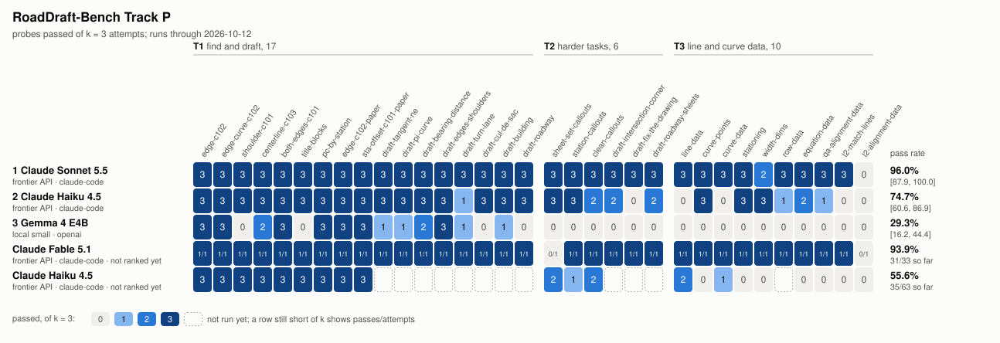

# RoadDraft-Bench Track P: the probe leaderboard

*Generated by `python -m roaddraft.runners leaderboard` from the run folders under `benchmarks/probe_runs`. Do not edit by hand: change a run or the generator and generate again; `--check` fails while this file is out of date.*

The 33 probes in three tiers (T1 find and draft, 17; T2 harder tasks, 6; T3 line and curve data, 10), k = 3 attempts each, every model through the one native MCP runner, `roaddraft.runners`. Every episode is re-scored from the document it left on disk against the current probe checks. Runs through 2026-10-08; the ranked rows are from `2026-10-08-k3`. Probe set `sha256:e661a033f57c`.

## Ranked

| rank | model | class | runner | pass rate [95% CI] | T1 (17) | T2 (6) | T3 (10) | hard-fail | invalid calls | cost / task | attempts | card |
|---|---|---|---|---|---|---|---|---|---|---|---|---|
| 1 | Claude Haiku 4.5 | frontier API | runners · claude-code (Claude Code headless) | 58.6% [42.4, 73.7] | 46/51 (90%) | 8/18 (44%) | 4/30 (13%) | 27% (9/33) | 6.4% | $0.11 | 99 (k = 3) | [card](cards/claude-haiku-4-5.md) |

- Engine commit not recorded (episodes from before run.json carried pins): Claude Haiku 4.5.

## Not ranked yet

None.

## Run folders not on the board

| run folder | episodes | what it was | why not |
|---|---|---|---|
| `2026-09-19` | 18 | Find-probes driven by real models — 2026-09-19 | an earlier rig (the shell bridge or its own client), not roaddraft.runners: its episodes carry no run.json and its rows do not compare |
| `2026-09-20-T1` | 16 | Drafting-probes (T1) driven by real models — 2026-09-20 | an earlier rig (the shell bridge or its own client), not roaddraft.runners: its episodes carry no run.json and its rows do not compare |
| `2026-09-22` | 34 | Probe rerun, all 17 probes, after the Sep 20 engine fixes: 2026-09-22 | an earlier rig (the shell bridge or its own client), not roaddraft.runners: its episodes carry no run.json and its rows do not compare |
| `2026-09-24-ollama` | 51 | Probes driven by an Ollama model: gpt-oss:120b-cloud, 2026-09-24 | an earlier rig (the shell bridge or its own client), not roaddraft.runners: its episodes carry no run.json and its rows do not compare |
| `2026-09-29-lmstudio` | 17 | Probes driven by a local model through LM Studio: Qwen3.5-9B, 2026-09-29 | an earlier rig (the shell bridge or its own client), not roaddraft.runners: its episodes carry no run.json and its rows do not compare |
| `2026-10-04-lmstudio-tier2` | 6 | Tier-2 probes, first model: Qwen3.5-9B through LM Studio, 2026-10-04 | an earlier rig (the shell bridge or its own client), not roaddraft.runners: its episodes carry no run.json and its rows do not compare |
| `2026-10-06-haiku-t2-t3a` | 20 | Tier 2 and Tier 3 batch A, Haiku 4.5 (2026-10-06) and Fable 5.1 (2026-10-07) | an earlier rig (the shell bridge or its own client), not roaddraft.runners: its episodes carry no run.json and its rows do not compare |
| `2026-10-07-lmstudio-t3bc` | 24 | Tier-3 batches B and C, the local models through LM Studio, 2026-10-07/08 | an earlier rig (the shell bridge or its own client), not roaddraft.runners: its episodes carry no run.json and its rows do not compare |
| `2026-10-07-runner-smoke` | 2 | 2026-10-07 — the native runner's first live runs (smoke, not a benchmark) | roaddraft.runners, single runs without `--repeat`: Llama 3.1 8B Instruct on 1 probe (0/1 passed), Qwen3.5-9B on 1 probe (1/1 passed). A smoke test of the runner, not a Track P run |
| `2026-10-08-claude-code-smoke` | 1 | 2026-10-08 — the `claude-code` backend's first live run (smoke, not a benchmark) | roaddraft.runners, single runs without `--repeat`: Claude Haiku 4.5 on 1 probe (1/1 passed). A smoke test of the runner, not a Track P run |
| `2026-10-08-runner-guards` | 2 | 2026-10-08 — the LM Studio guards in `roaddraft.runners` (smoke, not a benchmark) | roaddraft.runners, single runs without `--repeat`: Qwen3.5-9B on 1 probe (1/1 passed). A smoke test of the runner, not a Track P run |

## How the board is computed

- **A row** is one model on one backend, mode and effort, in one run folder: every episode the native runner left under `runs/<label>-rN/<probe>/`, the labels `--repeat` writes. A row is ranked once all 33 probes have k = 3 attempts that count; a model with two complete rows ranks on the newer folder. A label without `-rN` is a single run, listed with its folder below the board.
- **Pass rate** is the mean over probes of each probe's passes over its attempts that count. Tiers are the same mean over that tier's probes; the cells show passes over attempts.
- **95% CI**: a bootstrap over probes, then over each probe's attempts, 2,000 resamples, seed 0.
- **Attempts that count**: an episode the model ended (answered, refused) is scored by its probe check from disk. One ended by budget (turns, wall clock, tokens, context, the CLI's spend cap) counts as a failure whatever the document shows. One ended by the infrastructure (a crash, a dead engine, a CLI error) is recorded on the card and excluded, except an error that says the model's own output was unreadable, which is the model's failure.
- **Ties** break on hard-fail rate, then invalid-call rate, then cost per task (a row with no price sorts after one with a price).
- **Hard-fail rate**: the share of probes failed on every attempt. Track P checks are pass or fail with no value findings to disqualify a sheet, so the hard fail here is a probe the model never solves.
- **Invalid calls**: faulted calls over all calls, from each episode's `trace.jsonl`.
- **Cost per task**: the mean list-price cost of an episode; for Claude Code runs the CLI's own figure.
- **Class** is frontier API, hosted open-weight, local small or RQ3 checkpoint; **runner** is the `roaddraft.runners` backend and what it talked to.
- The model cards carry the research plan's §3.2 measures, the pins (engine commit, tool-surface and instruction digests, budgets) and every probe's attempts.
