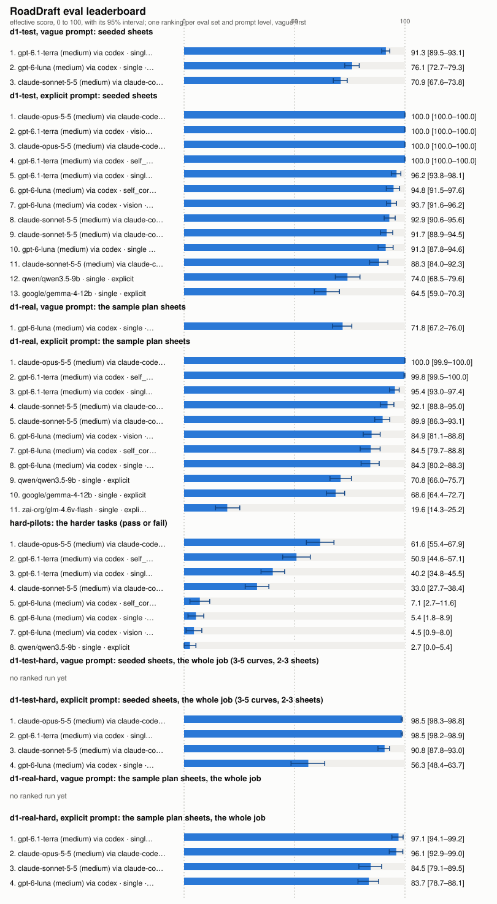

# RoadDraft eval leaderboard

The benchmark board: every published run on the eval sets, scored by the verifier (`roaddraft.eval`), one ranking per set. The 33 capability probes of Track P are a separate board, closed 2026-10-27: [the probe board](../leaderboard/TRACK_P.md).

## `d1-test`: seeded sheets

**Best model 100.0/100 on d1-test (claude-opus-5-5 (medium) via claude-code · vision · explicit, 95% CI 100.0–100.0, hard-fail 0%).**

| # | Model · mode · prompt | Effort | Effective | 95% CI | Rubric | Hard-fail | Clean | Invalid calls | Cost / sheet | Tasks × k | Run |
|---:|---|---|---:|---|---:|---:|---:|---:|---:|---|---|
| 1 | claude-opus-5-5 (medium) via claude-code · vision · explicit | medium | **100.0** | 100.0–100.0 | 100.0 | 0% | 96% | 0% | $0.410 | 100 × 1 | `e3-d1-test-claude-opus-5-5-claude-code-medium-vision` |
| 2 | gpt-6.1-terra (medium) via codex · vision · explicit | medium | **100.0** | 100.0–100.0 | 100.0 | 0% | 94% | 0% | – | 100 × 1 | `e3-d1-test-gpt-6.1-terra-codex-medium-vision` |
| 3 | claude-opus-5-5 (medium) via claude-code · self_correct · explicit | medium | **100.0** | 100.0–100.0 | 100.0 | 0% | 96% | 0% | $0.371 | 100 × 1 | `e3-d1-test-claude-opus-5-5-claude-code-medium-self_correct` |
| 4 | gpt-6.1-terra (medium) via codex · self_correct · explicit | medium | **100.0** | 100.0–100.0 | 100.0 | 0% | 94% | 0% | – | 100 × 1 | `e3-d1-test-gpt-6.1-terra-codex-medium-self_correct` |
| 5 | gpt-6.1-terra (medium) via codex · single · explicit | medium | **96.2** | 93.8–98.1 | 96.2 | 0% | 82% | 0% | – | 100 × 1 | `e3-d1-test-gpt-6.1-terra-codex-medium-single` |
| 6 | claude-sonnet-5-5 (medium) via claude-code · vision · explicit | medium | **92.9** | 90.6–95.6 | 92.9 | 0% | 73% | 0% | $0.201 | 100 × 1 | `e3-d1-test-claude-sonnet-5-5-claude-code-medium-vision` |
| 7 | claude-sonnet-5-5 (medium) via claude-code · self_correct · explicit | medium | **91.7** | 88.9–94.5 | 92.5 | 1% | 78% | 0% | $0.219 | 100 × 1 | `e3-d1-test-claude-sonnet-5-5-claude-code-medium-self_correct` |
| 8 | gpt-6.1-terra (medium) via codex · single · vague | medium | **91.3** | 89.5–93.1 | 91.3 | 0% | 47% | 0% | – | 100 × 1 | `e3-d1-test-gpt-6.1-terra-codex-medium-single-vague` |
| 9 | claude-sonnet-5-5 (medium) via claude-code · single · explicit | medium | **88.3** | 84.0–92.3 | 90.8 | 3% | 69% | 0% | $0.213 | 100 × 1 | `e3-d1-test-claude-sonnet-5-5-claude-code-medium-single` |
| 10 | claude-sonnet-5-5 (medium) via claude-code · single · vague | medium | **70.9** | 67.6–73.8 | 73.1 | 3% | 20% | 0% | $0.159 | 100 × 1 | `e3-d1-test-claude-sonnet-5-5-claude-code-medium-single-vague` |

## `d1-real`: the sample plan sheets

**Best model 100.0/100 on d1-real (claude-opus-5-5 (medium) via claude-code · self_correct · explicit, 95% CI 99.9–100.0, hard-fail 0%).**

| # | Model · mode · prompt | Effort | Effective | 95% CI | Draft | Letter | Sheet | Notes | Rubric | Hard-fail | Clean | Invalid calls | Cost / sheet | Tasks × k | Run |
|---:|---|---|---:|---|---:|---:|---:|---:|---:|---:|---:|---:|---:|---|---|
| 1 | claude-opus-5-5 (medium) via claude-code · self_correct · explicit | medium | **100.0** | 99.9–100.0 | 100.0 ± 0.0 (n 25) | 99.9 ± 0.1 (n 25) | 100.0 ± 0.1 (n 25) | 100.0 ± 0.0 (n 25) | 100.0 | 0% | 98% | 0% | $0.658 | 100 × 1 | `e3-d1-real-claude-opus-5-5-claude-code-medium-self_correct` |
| 2 | gpt-6.1-terra (medium) via codex · self_correct · explicit | medium | **99.8** | 99.5–100.0 | 100.0 ± 0.0 (n 25) | 99.8 ± 0.3 (n 25) | 100.0 ± 0.0 (n 25) | 99.4 ± 0.8 (n 25) | 99.8 | 0% | 97% | 0% | – | 100 × 1 | `e3-d1-real-gpt-6.1-terra-codex-medium-self_correct` |
| 3 | gpt-6.1-terra (medium) via codex · single · explicit | medium | **95.4** | 93.0–97.4 | 100.0 ± 0.0 (n 25) | 99.5 ± 0.3 (n 25) | 95.2 ± 3.6 (n 25) | 87.0 ± 7.8 (n 25) | 96.3 | 1% | 72% | 0% | – | 100 × 1 | `e3-d1-real-gpt-6.1-terra-codex-medium-single` |
| 4 | claude-sonnet-5-5 (medium) via claude-code · self_correct · explicit | medium | **92.1** | 88.8–95.0 | 100.0 ± 0.0 (n 25) | 94.2 ± 1.0 (n 25) | 95.8 ± 3.8 (n 25) | 78.4 ± 11.6 (n 25) | 94.1 | 3% | 68% | 0% | $0.334 | 100 × 1 | `e3-d1-real-claude-sonnet-5-5-claude-code-medium-self_correct` |
| 5 | claude-sonnet-5-5 (medium) via claude-code · single · explicit | medium | **89.9** | 86.3–93.1 | 100.0 ± 0.0 (n 25) | 95.8 ± 1.6 (n 25) | 88.3 ± 7.1 (n 25) | 75.5 ± 11.6 (n 25) | 93.1 | 4% | 58% | 0% | $0.339 | 100 × 1 | `e3-d1-real-claude-sonnet-5-5-claude-code-medium-single` |

Question groups (`tasks.types.REAL_GROUPS`, the real-sheet counterpart of the probe board's tiers; `d1-real` draws 25 tasks a group): Draft = draft linework (`real-draw-alignment`); Letter = letter alignment data (`real-stationing`, `real-bearings`, `real-callouts`, `real-curve-table`, `real-alignment-data`); Sheet = produce the sheet (`real-attach-reference`, `real-title-block`, `real-sheet-setup`, `real-annotate-sheet`, `real-plan-sheet`); Notes = notes and dimensions (`real-construction-callouts`). Each cell is the effective mean over the row's tasks in that group ± its 95% half-width, with the number of tasks it rests on.

## `hard-pilots`: the harder tasks (pass or fail)

No ranked run yet. A row needs a published run on `hard-pilots` that covers every task of the current set (a run on part of it is published as partial and listed among the runs not ranked); each task scores 100 on a pass and 0 on a fail by its own check, whose source hash is the row's verifier version. The pilots that come with a page (23 of 112) need a model that takes images.

## `d1-test-hard`: seeded sheets, the whole job (3-5 curves, 2-3 sheets)

No ranked run yet. A row needs a published run on `d1-test-hard` under a frozen spec (a one-task smoke run first, `--limit 1`).

## `d1-real-hard`: the sample plan sheets, the whole job

No ranked run yet. A row needs a published run on `d1-real-hard` under a frozen spec, with the catalogue it was drawn from validated under the verifier that scores it (`d1-real-dev` first, for a smoke run).

## Published runs that are not ranked

- `e3-d1-variance-gemma-4-12b-single` (d1-variance, 100 episodes): google/gemma-4-12B-it · single · explicit, effort thinking on 69.3 ± 3.0 (20 tasks × 5). Not ranked: run on d1-variance, not a leaderboard set (d1-test, d1-real, hard-pilots, d1-test-hard, d1-real-hard).
- `e3-d1-variance-qwen3.6-35b-a3b-single` (d1-variance, 100 episodes): Qwen/Qwen3.6-35B-A3B · single · explicit, effort thinking on (default) 86.7 ± 2.7 (20 tasks × 5). Not ranked: run on d1-variance, not a leaderboard set (d1-test, d1-real, hard-pilots, d1-test-hard, d1-real-hard).

Each set is its own ranking: `d1-test` is 100 held-out tasks from the seeded generator (one synthetic centerline per task); `d1-real` is 100 held-out tasks on the redrafted sample plan sheets (Caltrans, WFL, CFL, FDOT), 25 in each of four question groups (draft linework, letter alignment data, produce the sheet, notes and dimensions), each group a column beside the blended score; `hard-pilots` is the 112 harder-task pilots on the sample sheets, each graded pass (100) or fail (0) by its own check, with the share of its items done as the rubric column; `d1-test-hard` is 100 held-out seeded whole-sheet jobs (three to five curves on two or three sheets, a station equation on one in five: the plan sheet with its pavement, the alignment created from stated geometry and then drafted, the sheet file lettered through its base drawing); `d1-real-hard` is 100 tasks on the redrafted sheets, every whole job (a sheet drafted from its base files or annotated from blank, construction callouts included) and the heaviest whole-line tasks `d1-real` did not draw. A model's rows on different sets are not averaged.

A run that misses a task of its set, or has an episode that ended in error or never finished, is partial and not scored: it is listed below without a score. The one exception is a cost-subset run (`benchmarks/tasksets/cost-subsets.json`: five tasks of each task type, Runpod runs only, to save cost), ranked in a table of its own under its set beside the full runs re-scored on the same tasks; it too is partial and not scored if it misses a task of the subset or has an episode in error or unfinished.

Effective score: 0 on a hard fail, else the rubric score; per task over its samples, then over tasks; 95% CI a bootstrap over tasks within task type. Rows rank on the effective mean, then hard-fail rate, invalid-call rate and cost. Effort is the level the run set with `--effort`, else what the request body set, else the model's default marked (default), as read from its chat template or catalog (`roaddraft.effort`); plain default is one not looked up. A model run at two efforts is two rows.

_Generated by `scripts/make_leaderboard.py` from `benchmarks/runs/*/summary.json`; do not edit._
