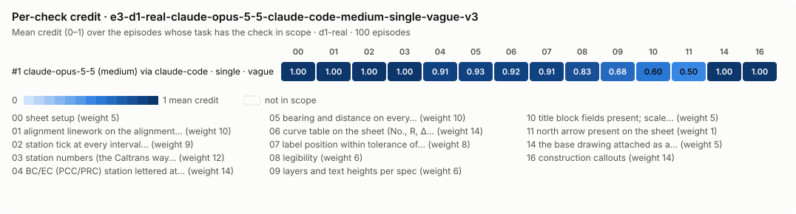

# Run `e3-d1-real-claude-opus-5-5-claude-code-medium-single-vague-v3`

Task set **d1-real** · 100 episodes · spec v1 (sha256:0e07d5e83c0b) · generator real-v1 · verifier d1-verify-v8 · harness e3-v3

## Rows

Effective score: 0 on a hard fail, else the rubric score; per task over its samples, then over tasks. 95% CI: bootstrap over tasks within task type (4,000 resamples, seed 0).

| # | Row | Effort | Effective | 95% CI | Rubric | Hard-fail | Clean | Submit | Steps (med / p90) | Invalid calls | Recovery | run_check | Cost / sheet | Tasks × k |
|---:|---|---|---:|---|---:|---:|---:|---:|---|---:|---:|---:|---:|---|
| 1 | claude-opus-5-5 (medium) via claude-code · single · vague | medium | **86.7** | 82.8–90.3 | 89.3 | 4% | 48% | 100% | 16 / 34 | 0% | 83% | 0.0 | $0.763 | 100 × 1 |

## Per-check credit

Mean credit (0–1) over the episodes whose task has the check in scope; – where none did.

| Check | Weight | #1 |
|---|---:|---:|
| D1-00 sheet setup | 5 | 1.00 |
| D1-01 alignment linework on the alignment… | 10 | 1.00 |
| D1-02 station tick at every interval station… | 9 | 1.00 |
| D1-03 station numbers (the Caltrans way… | 12 | 1.00 |
| D1-04 BC/EC (PCC/PRC) station lettered at… | 14 | 0.91 |
| D1-05 bearing and distance on every tangent… | 10 | 0.93 |
| D1-06 curve table on the sheet (No., R, Δ, T… | 14 | 0.92 |
| D1-07 label position within tolerance of the… | 8 | 0.91 |
| D1-08 legibility | 6 | 0.83 |
| D1-09 layers and text heights per spec | 6 | 0.68 |
| D1-10 title block fields present; scale… | 5 | 0.60 |
| D1-11 north arrow present on the sheet | 1 | 0.50 |
| D1-14 the base drawing attached as a… | 5 | 1.00 |
| D1-16 construction callouts | 14 | 1.00 |

## Failure taxonomy

Share of episodes with at least one finding in the category (findings per episode).

| Category | #1 | Codes |
|---|---:|---|
| completeness | 16% (0.5) | missing_field 37, missing 11 |
| value | 4% (0.1) | wrong_value 5 |
| anchoring | 20% (17.1) | unanchored 1710 |
| placement | 5% (0.1) | misplaced 6 |
| legibility | 24% (0.5) | overlap 36, off_sheet 7, clipped 2 |
| standards | 37% (1.8) | wrong_layer 181 |
| sheet_setup | 0% (0.0) |  |

### Tool use and termination

| | #1 |
|---|---:|
| tool calls | 1861 |
| invalid-call rate | 0% |
| other fault rate | 1% |
| recovery rate | 83% |
| coordinate path share | 0% |
| stopped without calling submit | 2% |
| Δ effective after last run_check | – |
| ended submit | 100 |
| error command_failed | 21 |
| error invalid_params | 3 |

## By question group

The real-sheet types by question type (`tasks.types.REAL_GROUPS`), the way the probe board splits its tiers: effective mean over the group's tasks ± its 95% half-width (bootstrap over tasks within type), and the tasks it rests on.

| Group | Types | #1 |
|---|---|---:|
| draft: draft linework | real-draw-alignment | 100.0 ± 0.0 (n 25) |
| letter: letter alignment data | real-alignment-data, real-bearings, real-callouts, real-curve-table, real-stationing | 71.0 ± 11.5 (n 25) |
| sheet: produce the sheet | real-annotate-sheet, real-attach-reference, real-plan-sheet, real-sheet-setup, real-title-block | 88.2 ± 5.3 (n 25) |
| notes: notes and dimensions | real-construction-callouts | 87.6 ± 7.5 (n 25) |

## By task type and sheet count

| Task type | #1 |
|---|---:|
| real-alignment-data | 73.2 (n 5) |
| real-annotate-sheet | 96.7 (n 5) |
| real-attach-reference | 100.0 (n 5) |
| real-bearings | 72.9 (n 5) |
| real-callouts | 52.9 (n 5) |
| real-construction-callouts | 87.6 (n 25) |
| real-curve-table | 61.5 (n 5) |
| real-draw-alignment | 100.0 (n 25) |
| real-plan-sheet | 93.1 (n 5) |
| real-sheet-setup | 100.0 (n 5) |
| real-stationing | 94.5 (n 5) |
| real-title-block | 51.4 (n 5) |
| 1 sheet | 86.7 (n 100) |

## Interval sizing

The v0.1 target is a 95% half-width under 5 points. Tasks needed assumes the half-width shrinks as 1/√tasks at this row's spread.

| Row | Tasks | Half-width | Unstratified | Within-task SD | Tasks for the target |
|---|---:|---:|---:|---:|---:|
| claude-opus-5-5 (medium) via claude-code · single · vague | 100 | 3.8 | 4.7 | – | 57 |

Prices from the table checked 2026-10-06.

_Generated by `python -m roaddraft.eval report` (e4-v2); do not edit._
