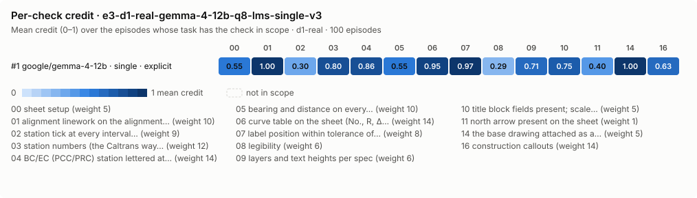

# Run `e3-d1-real-gemma-4-12b-q8-lms-single-v3`

Task set **d1-real** · 100 episodes · spec v1 (sha256:0e07d5e83c0b) · generator real-v1 · verifier d1-verify-v8 · harness e3-v3

## Rows

Effective score: 0 on a hard fail, else the rubric score; per task over its samples, then over tasks. 95% CI: bootstrap over tasks within task type (4,000 resamples, seed 0).

| # | Row | Effort | Effective | 95% CI | Rubric | Hard-fail | Clean | Submit | Steps (med / p90) | Invalid calls | Recovery | run_check | Cost / sheet | Tasks × k |
|---:|---|---|---:|---|---:|---:|---:|---:|---|---:|---:|---:|---:|---|
| 1 | google/gemma-4-12b · single · explicit | thinking on | **68.6** | 64.4–72.7 | 74.3 | 11% | 35% | 100% | 9 / 19 | 4% | 89% | 0.0 | – | 100 × 1 |

Repaired calls (harness e3-v3): a one-item list where the schema takes one value was read as the value, noted to the model in the result's warnings, and is counted here and not as an invalid call: google/gemma-4-12b · single · explicit 11% of its calls.

## Per-check credit

Mean credit (0–1) over the episodes whose task has the check in scope; – where none did.

| Check | Weight | #1 |
|---|---:|---:|
| D1-00 sheet setup | 5 | 0.55 |
| D1-01 alignment linework on the alignment… | 10 | 1.00 |
| D1-02 station tick at every interval station… | 9 | 0.30 |
| D1-03 station numbers (the Caltrans way… | 12 | 0.80 |
| D1-04 BC/EC (PCC/PRC) station lettered at… | 14 | 0.86 |
| D1-05 bearing and distance on every tangent… | 10 | 0.55 |
| D1-06 curve table on the sheet (No., R, Δ, T… | 14 | 0.95 |
| D1-07 label position within tolerance of the… | 8 | 0.97 |
| D1-08 legibility | 6 | 0.29 |
| D1-09 layers and text heights per spec | 6 | 0.71 |
| D1-10 title block fields present; scale… | 5 | 0.75 |
| D1-11 north arrow present on the sheet | 1 | 0.40 |
| D1-14 the base drawing attached as a… | 5 | 1.00 |
| D1-16 construction callouts | 14 | 0.63 |

## Failure taxonomy

Share of episodes with at least one finding in the category (findings per episode).

| Category | #1 | Codes |
|---|---:|---|
| completeness | 20% (1.1) | missing 105, missing_field 4 |
| value | 19% (0.4) | wrong_value 28, wrong_field 14 |
| anchoring | 32% (17.4) | unanchored 1714, duplicate 22 |
| placement | 21% (1.0) | not_visible 61, misplaced 39 |
| legibility | 50% (9.8) | overlap 837, off_sheet 81, upside_down 63, clipped 2 |
| standards | 28% (2.1) | wrong_height 143, wrong_layer 65, wrong_layer_props 4 |
| sheet_setup | 9% (0.1) | not_fitted 9 |

### Tool use and termination

| | #1 |
|---|---:|
| tool calls | 1017 |
| invalid-call rate | 4% |
| other fault rate | 8% |
| recovery rate | 89% |
| coordinate path share | 0% |
| stopped without calling submit | 23% |
| Δ effective after last run_check | – |
| ended submit | 100 |
| error command_failed | 84 |
| error invalid_params | 40 |
| error query_failed | 2 |

## By question group

The real-sheet types by question type (`tasks.types.REAL_GROUPS`), the way the probe board splits its tiers: effective mean over the group's tasks ± its 95% half-width (bootstrap over tasks within type), and the tasks it rests on.

| Group | Types | #1 |
|---|---|---:|
| draft: draft linework | real-draw-alignment | 100.0 ± 0.0 (n 25) |
| letter: letter alignment data | real-alignment-data, real-bearings, real-callouts, real-curve-table, real-stationing | 75.2 ± 6.6 (n 25) |
| sheet: produce the sheet | real-annotate-sheet, real-attach-reference, real-plan-sheet, real-sheet-setup, real-title-block | 68.8 ± 9.4 (n 25) |
| notes: notes and dimensions | real-construction-callouts | 30.4 ± 12.0 (n 25) |

## By task type and sheet count

| Task type | #1 |
|---|---:|
| real-alignment-data | 80.0 (n 5) |
| real-annotate-sheet | 48.2 (n 5) |
| real-attach-reference | 100.0 (n 5) |
| real-bearings | 58.0 (n 5) |
| real-callouts | 93.8 (n 5) |
| real-construction-callouts | 30.4 (n 25) |
| real-curve-table | 76.9 (n 5) |
| real-draw-alignment | 100.0 (n 25) |
| real-plan-sheet | 39.9 (n 5) |
| real-sheet-setup | 81.8 (n 5) |
| real-stationing | 67.1 (n 5) |
| real-title-block | 74.3 (n 5) |
| 1 sheet | 68.6 (n 100) |

## Interval sizing

The v0.1 target is a 95% half-width under 5 points. Tasks needed assumes the half-width shrinks as 1/√tasks at this row's spread.

| Row | Tasks | Half-width | Unstratified | Within-task SD | Tasks for the target |
|---|---:|---:|---:|---:|---:|
| google/gemma-4-12b · single · explicit | 100 | 4.2 | 6.9 | – | 70 |

_Generated by `python -m roaddraft.eval report` (e4-v2); do not edit._
