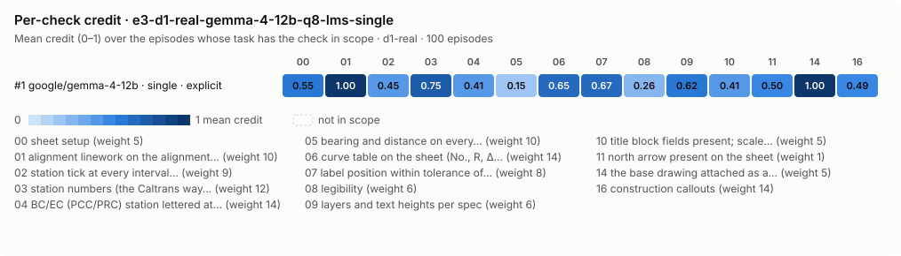

# Run `e3-d1-real-gemma-4-12b-q8-lms-single`

Task set **d1-real** · 100 episodes · spec v1 (sha256:0e07d5e83c0b) · generator real-v1 · verifier d1-verify-v7 · harness e3-v2

## Rows

Effective score: 0 on a hard fail, else the rubric score; per task over its samples, then over tasks. 95% CI: bootstrap over tasks within task type (4,000 resamples, seed 0).

| # | Row | Effort | Effective | 95% CI | Rubric | Hard-fail | Clean | Submit | Steps (med / p90) | Invalid calls | Recovery | run_check | Cost / sheet | Tasks × k |
|---:|---|---|---:|---|---:|---:|---:|---:|---|---:|---:|---:|---:|---|
| 1 | google/gemma-4-12b · single · explicit | thinking on | **55.0** | 50.9–59.6 | 61.6 | 16% | 34% | 85% | 11 / 29 | 21% | 56% | 0.0 | – | 100 × 1 |

## Per-check credit

Mean credit (0–1) over the episodes whose task has the check in scope; – where none did.

| Check | Weight | #1 |
|---|---:|---:|
| D1-00 sheet setup | 5 | 0.55 |
| D1-01 alignment linework on the alignment… | 10 | 1.00 |
| D1-02 station tick at every interval station… | 9 | 0.45 |
| D1-03 station numbers (the Caltrans way… | 12 | 0.75 |
| D1-04 BC/EC (PCC/PRC) station lettered at… | 14 | 0.41 |
| D1-05 bearing and distance on every tangent… | 10 | 0.15 |
| D1-06 curve table on the sheet (No., R, Δ, T… | 14 | 0.65 |
| D1-07 label position within tolerance of the… | 8 | 0.67 |
| D1-08 legibility | 6 | 0.26 |
| D1-09 layers and text heights per spec | 6 | 0.62 |
| D1-10 title block fields present; scale… | 5 | 0.41 |
| D1-11 north arrow present on the sheet | 1 | 0.50 |
| D1-14 the base drawing attached as a… | 5 | 1.00 |
| D1-16 construction callouts | 14 | 0.49 |

## Failure taxonomy

Share of episodes with at least one finding in the category (findings per episode).

| Category | #1 | Codes |
|---|---:|---|
| completeness | 34% (1.8) | missing 134, missing_field 46 |
| value | 21% (0.5) | wrong_value 35, wrong_field 12 |
| anchoring | 31% (17.4) | unanchored 1685, duplicate 53 |
| placement | 21% (1.5) | misplaced 101, not_visible 51 |
| legibility | 42% (55.2) | overlap 5423, upside_down 54, off_sheet 37, clipped 4 |
| standards | 22% (1.8) | wrong_height 147, wrong_layer 37 |
| sheet_setup | 8% (0.1) | not_fitted 7, sheet_missing 2 |

### Tool use and termination

| | #1 |
|---|---:|
| tool calls | 1420 |
| invalid-call rate | 21% |
| other fault rate | 8% |
| recovery rate | 56% |
| coordinate path share | 0% |
| stopped without calling submit | 25% |
| Δ effective after last run_check | – |
| ended budget:faults | 11 |
| ended budget:turn_time | 2 |
| ended budget:wall_clock | 2 |
| ended submit | 85 |
| error budget_exhausted | 2 |
| error command_failed | 111 |
| error invalid_params | 295 |
| error query_failed | 1 |

## By question group

The real-sheet types by question type (`tasks.types.REAL_GROUPS`), the way the probe board splits its tiers: effective mean over the group's tasks ± its 95% half-width (bootstrap over tasks within type), and the tasks it rests on.

| Group | Types | #1 |
|---|---|---:|
| draft: draft linework | real-draw-alignment | 100.0 ± 0.0 (n 25) |
| letter: letter alignment data | real-alignment-data, real-bearings, real-callouts, real-curve-table, real-stationing | 41.9 ± 9.1 (n 25) |
| sheet: produce the sheet | real-annotate-sheet, real-attach-reference, real-plan-sheet, real-sheet-setup, real-title-block | 54.8 ± 9.1 (n 25) |
| notes: notes and dimensions | real-construction-callouts | 23.4 ± 12.4 (n 25) |

## By task type and sheet count

| Task type | #1 |
|---|---:|
| real-alignment-data | 22.8 (n 5) |
| real-annotate-sheet | 9.3 (n 5) |
| real-attach-reference | 100.0 (n 5) |
| real-bearings | 20.0 (n 5) |
| real-callouts | 0.0 (n 5) |
| real-construction-callouts | 23.4 (n 25) |
| real-curve-table | 79.2 (n 5) |
| real-draw-alignment | 100.0 (n 25) |
| real-plan-sheet | 41.8 (n 5) |
| real-sheet-setup | 70.9 (n 5) |
| real-stationing | 87.2 (n 5) |
| real-title-block | 52.2 (n 5) |
| 1 sheet | 55.0 (n 100) |

## Interval sizing

The v0.1 target is a 95% half-width under 5 points. Tasks needed assumes the half-width shrinks as 1/√tasks at this row's spread.

| Row | Tasks | Half-width | Unstratified | Within-task SD | Tasks for the target |
|---|---:|---:|---:|---:|---:|
| google/gemma-4-12b · single · explicit | 100 | 4.4 | 8.3 | – | 77 |

_Generated by `python -m roaddraft.eval report` (e4-v1); do not edit._
