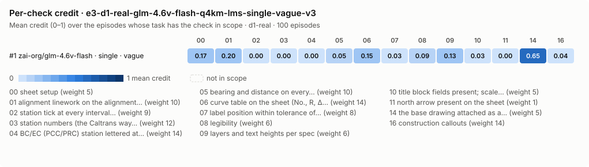

# Run `e3-d1-real-glm-4.6v-flash-q4km-lms-single-vague-v3`

Task set **d1-real** · 100 episodes · spec v1 (sha256:0e07d5e83c0b) · generator real-v1 · verifier d1-verify-v8 · harness e3-v3

## Rows

Effective score: 0 on a hard fail, else the rubric score; per task over its samples, then over tasks. 95% CI: bootstrap over tasks within task type (4,000 resamples, seed 0).

| # | Row | Effort | Effective | 95% CI | Rubric | Hard-fail | Clean | Submit | Steps (med / p90) | Invalid calls | Recovery | run_check | Cost / sheet | Tasks × k |
|---:|---|---|---:|---|---:|---:|---:|---:|---|---:|---:|---:|---:|---|
| 1 | zai-org/glm-4.6v-flash · single · vague | default | **13.6** | 8.5–19.2 | 13.6 | 0% | 6% | 99% | 10 / 41 | 0% | 1% | 0.0 | – | 100 × 1 |

## Per-check credit

Mean credit (0–1) over the episodes whose task has the check in scope; – where none did.

| Check | Weight | #1 |
|---|---:|---:|
| D1-00 sheet setup | 5 | 0.17 |
| D1-01 alignment linework on the alignment… | 10 | 0.20 |
| D1-02 station tick at every interval station… | 9 | 0.00 |
| D1-03 station numbers (the Caltrans way… | 12 | 0.00 |
| D1-04 BC/EC (PCC/PRC) station lettered at… | 14 | 0.00 |
| D1-05 bearing and distance on every tangent… | 10 | 0.05 |
| D1-06 curve table on the sheet (No., R, Δ, T… | 14 | 0.15 |
| D1-07 label position within tolerance of the… | 8 | 0.03 |
| D1-08 legibility | 6 | 0.09 |
| D1-09 layers and text heights per spec | 6 | 0.13 |
| D1-10 title block fields present; scale… | 5 | 0.03 |
| D1-11 north arrow present on the sheet | 1 | 0.00 |
| D1-14 the base drawing attached as a… | 5 | 0.65 |
| D1-16 construction callouts | 14 | 0.04 |

## Failure taxonomy

Share of episodes with at least one finding in the category (findings per episode).

| Category | #1 | Codes |
|---|---:|---|
| completeness | 83% (7.3) | missing 684, missing_field 51 |
| value | 1% (0.0) | wrong_field 1 |
| anchoring | 34% (17.6) | unanchored 1753, duplicate 8 |
| placement | 3% (0.1) | not_visible 7 |
| legibility | 5% (0.3) | overlap 26 |
| standards | 2% (0.0) | wrong_layer 4 |
| sheet_setup | 10% (0.2) | sheet_missing 20, not_fitted 4, viewport_scale 1 |

### Tool use and termination

| | #1 |
|---|---:|
| tool calls | 1880 |
| invalid-call rate | 0% |
| other fault rate | 50% |
| recovery rate | 1% |
| coordinate path share | 16% |
| stopped without calling submit | 3% |
| Δ effective after last run_check | – |
| ended budget:context | 1 |
| ended submit | 99 |
| error command_failed | 759 |
| error nothing_to_redo | 16 |
| error query_failed | 162 |

## By question group

The real-sheet types by question type (`tasks.types.REAL_GROUPS`), the way the probe board splits its tiers: effective mean over the group's tasks ± its 95% half-width (bootstrap over tasks within type), and the tasks it rests on.

| Group | Types | #1 |
|---|---|---:|
| draft: draft linework | real-draw-alignment | 20.0 ± 16.0 (n 25) |
| letter: letter alignment data | real-alignment-data, real-bearings, real-callouts, real-curve-table, real-stationing | 7.8 ± 8.8 (n 25) |
| sheet: produce the sheet | real-annotate-sheet, real-attach-reference, real-plan-sheet, real-sheet-setup, real-title-block | 23.1 ± 9.0 (n 25) |
| notes: notes and dimensions | real-construction-callouts | 3.4 ± 5.1 (n 25) |

## By task type and sheet count

| Task type | #1 |
|---|---:|
| real-alignment-data | 4.7 (n 5) |
| real-annotate-sheet | 0.5 (n 5) |
| real-attach-reference | 65.0 (n 5) |
| real-bearings | 19.0 (n 5) |
| real-callouts | 0.0 (n 5) |
| real-construction-callouts | 3.4 (n 25) |
| real-curve-table | 15.4 (n 5) |
| real-draw-alignment | 20.0 (n 25) |
| real-plan-sheet | 6.0 (n 5) |
| real-sheet-setup | 44.1 (n 5) |
| real-stationing | 0.0 (n 5) |
| real-title-block | 0.0 (n 5) |
| 1 sheet | 13.6 (n 100) |

## Interval sizing

The v0.1 target is a 95% half-width under 5 points. Tasks needed assumes the half-width shrinks as 1/√tasks at this row's spread.

| Row | Tasks | Half-width | Unstratified | Within-task SD | Tasks for the target |
|---|---:|---:|---:|---:|---:|
| zai-org/glm-4.6v-flash · single · vague | 100 | 5.3 | 6.0 | – | 113 |

_Generated by `python -m roaddraft.eval report` (e4-v2); do not edit._
