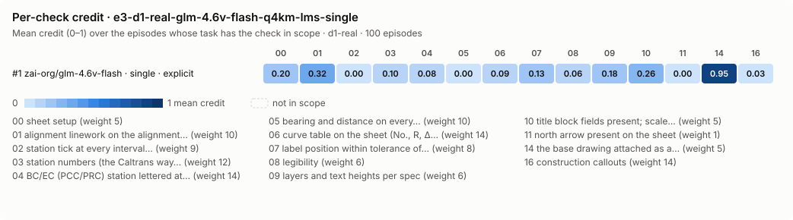

# Run `e3-d1-real-glm-4.6v-flash-q4km-lms-single`

Task set **d1-real** · 100 episodes · spec v1 (sha256:0e07d5e83c0b) · generator real-v1 · verifier d1-verify-v7 · harness e3-v2

## Rows

Effective score: 0 on a hard fail, else the rubric score; per task over its samples, then over tasks. 95% CI: bootstrap over tasks within task type (4,000 resamples, seed 0).

| # | Row | Effort | Effective | 95% CI | Rubric | Hard-fail | Clean | Submit | Steps (med / p90) | Invalid calls | Recovery | run_check | Cost / sheet | Tasks × k |
|---:|---|---|---:|---|---:|---:|---:|---:|---|---:|---:|---:|---:|---|
| 1 | zai-org/glm-4.6v-flash · single · explicit | default | **19.1** | 13.9–24.4 | 20.2 | 2% | 13% | 72% | 10 / 30 | 1% | 2% | 0.0 | – | 100 × 1 |

## Per-check credit

Mean credit (0–1) over the episodes whose task has the check in scope; – where none did.

| Check | Weight | #1 |
|---|---:|---:|
| D1-00 sheet setup | 5 | 0.20 |
| D1-01 alignment linework on the alignment… | 10 | 0.32 |
| D1-02 station tick at every interval station… | 9 | 0.00 |
| D1-03 station numbers (the Caltrans way… | 12 | 0.10 |
| D1-04 BC/EC (PCC/PRC) station lettered at… | 14 | 0.08 |
| D1-05 bearing and distance on every tangent… | 10 | 0.00 |
| D1-06 curve table on the sheet (No., R, Δ, T… | 14 | 0.09 |
| D1-07 label position within tolerance of the… | 8 | 0.13 |
| D1-08 legibility | 6 | 0.06 |
| D1-09 layers and text heights per spec | 6 | 0.18 |
| D1-10 title block fields present; scale… | 5 | 0.26 |
| D1-11 north arrow present on the sheet | 1 | 0.00 |
| D1-14 the base drawing attached as a… | 5 | 0.95 |
| D1-16 construction callouts | 14 | 0.03 |

## Failure taxonomy

Share of episodes with at least one finding in the category (findings per episode).

| Category | #1 | Codes |
|---|---:|---|
| completeness | 78% (6.6) | missing 627, missing_field 34 |
| value | 5% (0.1) | wrong_field 4, wrong_value 3 |
| anchoring | 36% (17.3) | unanchored 1730, duplicate 1 |
| placement | 5% (0.3) | misplaced 24, not_visible 10 |
| legibility | 6% (0.4) | upside_down 17, overlap 16, off_sheet 8 |
| standards | 3% (0.3) | wrong_height 23, wrong_layer 8 |
| sheet_setup | 10% (0.2) | sheet_missing 20, not_fitted 4 |

### Tool use and termination

| | #1 |
|---|---:|
| tool calls | 1372 |
| invalid-call rate | 1% |
| other fault rate | 43% |
| recovery rate | 2% |
| coordinate path share | 28% |
| stopped without calling submit | 2% |
| Δ effective after last run_check | – |
| ended budget:faults | 26 |
| ended budget:wall_clock | 2 |
| ended submit | 72 |
| error budget_exhausted | 27 |
| error command_failed | 494 |
| error invalid_params | 16 |
| error nothing_to_redo | 3 |
| error query_failed | 62 |

## By question group

The real-sheet types by question type (`tasks.types.REAL_GROUPS`), the way the probe board splits its tiers: effective mean over the group's tasks ± its 95% half-width (bootstrap over tasks within type), and the tasks it rests on.

| Group | Types | #1 |
|---|---|---:|
| draft: draft linework | real-draw-alignment | 32.0 ± 18.0 (n 25) |
| letter: letter alignment data | real-alignment-data, real-bearings, real-callouts, real-curve-table, real-stationing | 3.4 ± 4.2 (n 25) |
| sheet: produce the sheet | real-annotate-sheet, real-attach-reference, real-plan-sheet, real-sheet-setup, real-title-block | 39.2 ± 9.5 (n 25) |
| notes: notes and dimensions | real-construction-callouts | 1.8 ± 2.6 (n 25) |

## By task type and sheet count

| Task type | #1 |
|---|---:|
| real-alignment-data | 4.3 (n 5) |
| real-annotate-sheet | 0.7 (n 5) |
| real-attach-reference | 95.0 (n 5) |
| real-bearings | 0.0 (n 5) |
| real-callouts | 0.0 (n 5) |
| real-construction-callouts | 1.8 (n 25) |
| real-curve-table | 0.0 (n 5) |
| real-draw-alignment | 32.0 (n 25) |
| real-plan-sheet | 3.1 (n 5) |
| real-sheet-setup | 46.4 (n 5) |
| real-stationing | 12.5 (n 5) |
| real-title-block | 51.0 (n 5) |
| 1 sheet | 19.1 (n 100) |

## Interval sizing

The v0.1 target is a 95% half-width under 5 points. Tasks needed assumes the half-width shrinks as 1/√tasks at this row's spread.

| Row | Tasks | Half-width | Unstratified | Within-task SD | Tasks for the target |
|---|---:|---:|---:|---:|---:|
| zai-org/glm-4.6v-flash · single · explicit | 100 | 5.2 | 7.2 | – | 110 |

_Generated by `python -m roaddraft.eval report` (e4-v1); do not edit._
