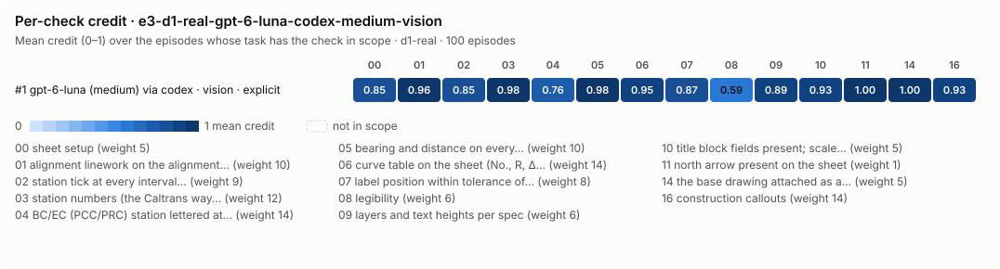

# Run `e3-d1-real-gpt-6-luna-codex-medium-vision`

Task set **d1-real** · 100 episodes · spec v1 (sha256:0e07d5e83c0b) · generator real-v1 · verifier d1-verify-v7 · harness e3-v2

## Rows

Effective score: 0 on a hard fail, else the rubric score; per task over its samples, then over tasks. 95% CI: bootstrap over tasks within task type (4,000 resamples, seed 0).

| # | Row | Effort | Effective | 95% CI | Rubric | Hard-fail | Clean | Submit | Steps (med / p90) | Invalid calls | Recovery | run_check | Cost / sheet | Tasks × k |
|---:|---|---|---:|---|---:|---:|---:|---:|---|---:|---:|---:|---:|---|
| 1 | gpt-6-luna (medium) via codex · vision · explicit | medium | **83.7** | 79.0–88.0 | 86.4 | 4% | 55% | 100% | 11 / 29 | 1% | 65% | 1.2 | – | 100 × 1 |

## Per-check credit

Mean credit (0–1) over the episodes whose task has the check in scope; – where none did.

| Check | Weight | #1 |
|---|---:|---:|
| D1-00 sheet setup | 5 | 0.85 |
| D1-01 alignment linework on the alignment… | 10 | 0.96 |
| D1-02 station tick at every interval station… | 9 | 0.85 |
| D1-03 station numbers (the Caltrans way… | 12 | 0.98 |
| D1-04 BC/EC (PCC/PRC) station lettered at… | 14 | 0.76 |
| D1-05 bearing and distance on every tangent… | 10 | 0.98 |
| D1-06 curve table on the sheet (No., R, Δ, T… | 14 | 0.95 |
| D1-07 label position within tolerance of the… | 8 | 0.87 |
| D1-08 legibility | 6 | 0.59 |
| D1-09 layers and text heights per spec | 6 | 0.89 |
| D1-10 title block fields present; scale… | 5 | 0.93 |
| D1-11 north arrow present on the sheet | 1 | 1.00 |
| D1-14 the base drawing attached as a… | 5 | 1.00 |
| D1-16 construction callouts | 14 | 0.93 |

## Failure taxonomy

Share of episodes with at least one finding in the category (findings per episode).

| Category | #1 | Codes |
|---|---:|---|
| completeness | 14% (0.5) | missing 47, missing_field 3 |
| value | 5% (0.1) | wrong_value 6, wrong_field 1 |
| anchoring | 24% (17.0) | unanchored 1676, duplicate 24 |
| placement | 7% (0.1) | misplaced 9, not_visible 4 |
| legibility | 34% (2.4) | overlap 226, off_sheet 9, clipped 1 |
| standards | 1% (0.2) | wrong_height 16 |
| sheet_setup | 3% (0.0) | not_fitted 3 |

### Tool use and termination

| | #1 |
|---|---:|
| tool calls | 1368 |
| invalid-call rate | 1% |
| other fault rate | 4% |
| recovery rate | 65% |
| coordinate path share | 0% |
| stopped without calling submit | 5% |
| Δ effective after last run_check | +2.6 (n 84) |
| ended submit | 100 |
| error command_failed | 44 |
| error invalid_params | 8 |
| error query_failed | 14 |

## By question group

The real-sheet types by question type (`tasks.types.REAL_GROUPS`), the way the probe board splits its tiers: effective mean over the group's tasks ± its 95% half-width (bootstrap over tasks within type), and the tasks it rests on.

| Group | Types | #1 |
|---|---|---:|
| draft: draft linework | real-draw-alignment | 96.0 ± 6.0 (n 25) |
| letter: letter alignment data | real-alignment-data, real-bearings, real-callouts, real-curve-table, real-stationing | 76.6 ± 9.6 (n 25) |
| sheet: produce the sheet | real-annotate-sheet, real-attach-reference, real-plan-sheet, real-sheet-setup, real-title-block | 95.8 ± 2.9 (n 25) |
| notes: notes and dimensions | real-construction-callouts | 66.4 ± 12.4 (n 25) |

## By task type and sheet count

| Task type | #1 |
|---|---:|
| real-alignment-data | 94.7 (n 5) |
| real-annotate-sheet | 94.9 (n 5) |
| real-attach-reference | 100.0 (n 5) |
| real-bearings | 100.0 (n 5) |
| real-callouts | 20.0 (n 5) |
| real-construction-callouts | 66.4 (n 25) |
| real-curve-table | 77.7 (n 5) |
| real-draw-alignment | 96.0 (n 25) |
| real-plan-sheet | 90.9 (n 5) |
| real-sheet-setup | 100.0 (n 5) |
| real-stationing | 90.7 (n 5) |
| real-title-block | 93.3 (n 5) |
| 1 sheet | 83.7 (n 100) |

## Interval sizing

The v0.1 target is a 95% half-width under 5 points. Tasks needed assumes the half-width shrinks as 1/√tasks at this row's spread.

| Row | Tasks | Half-width | Unstratified | Within-task SD | Tasks for the target |
|---|---:|---:|---:|---:|---:|
| gpt-6-luna (medium) via codex · vision · explicit | 100 | 4.5 | 5.8 | – | 82 |

_Generated by `python -m roaddraft.eval report` (e4-v1); do not edit._
