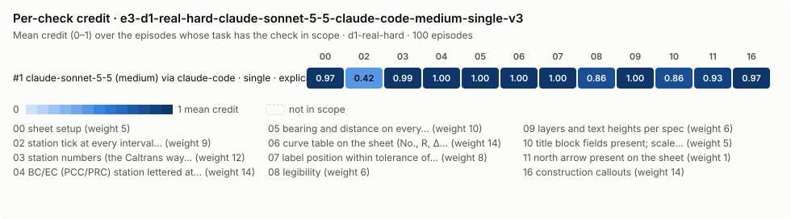

# Run `e3-d1-real-hard-claude-sonnet-5-5-claude-code-medium-single-v3`

Task set **d1-real-hard** · 100 episodes · spec v1 (sha256:0e07d5e83c0b) · generator real-v1 · verifier d1-verify-v8 · harness e3-v3

## Rows

Effective score: 0 on a hard fail, else the rubric score; per task over its samples, then over tasks. 95% CI: bootstrap over tasks within task type (4,000 resamples, seed 0).

| # | Row | Effort | Effective | 95% CI | Rubric | Hard-fail | Clean | Submit | Steps (med / p90) | Invalid calls | Recovery | run_check | Cost / sheet | Tasks × k |
|---:|---|---|---:|---|---:|---:|---:|---:|---|---:|---:|---:|---:|---|
| 1 | claude-sonnet-5-5 (medium) via claude-code · single · explicit | medium | **84.5** | 79.1–89.5 | 92.3 | 9% | 4% | 100% | 22 / 40 | 0% | 37% | 0.0 | $0.578 | 100 × 1 |

## Per-check credit

Mean credit (0–1) over the episodes whose task has the check in scope; – where none did.

| Check | Weight | #1 |
|---|---:|---:|
| D1-00 sheet setup | 5 | 0.97 |
| D1-02 station tick at every interval station… | 9 | 0.42 |
| D1-03 station numbers (the Caltrans way… | 12 | 0.99 |
| D1-04 BC/EC (PCC/PRC) station lettered at… | 14 | 1.00 |
| D1-05 bearing and distance on every tangent… | 10 | 1.00 |
| D1-06 curve table on the sheet (No., R, Δ, T… | 14 | 1.00 |
| D1-07 label position within tolerance of the… | 8 | 1.00 |
| D1-08 legibility | 6 | 0.86 |
| D1-09 layers and text heights per spec | 6 | 1.00 |
| D1-10 title block fields present; scale… | 5 | 0.86 |
| D1-11 north arrow present on the sheet | 1 | 0.93 |
| D1-16 construction callouts | 14 | 0.97 |

## Failure taxonomy

Share of episodes with at least one finding in the category (findings per episode).

| Category | #1 | Codes |
|---|---:|---|
| completeness | 87% (3.0) | missing 228, missing_field 68 |
| value | 11% (0.2) | wrong_value 13, wrong_field 3 |
| anchoring | 58% (23.0) | unanchored 2298 |
| placement | 51% (3.0) | misplaced 305 |
| legibility | 29% (0.6) | overlap 41, off_sheet 19, clipped 2 |
| standards | 0% (0.0) |  |
| sheet_setup | 2% (0.0) | not_fitted 2 |

### Tool use and termination

| | #1 |
|---|---:|
| tool calls | 2521 |
| invalid-call rate | 0% |
| other fault rate | 1% |
| recovery rate | 37% |
| coordinate path share | 4% |
| stopped without calling submit | 1% |
| Δ effective after last run_check | – |
| ended submit | 100 |
| error command_failed | 26 |
| error query_failed | 1 |

## By question group

The real-sheet types by question type (`tasks.types.REAL_GROUPS`), the way the probe board splits its tiers: effective mean over the group's tasks ± its 95% half-width (bootstrap over tasks within type), and the tasks it rests on.

| Group | Types | #1 |
|---|---|---:|
| letter: letter alignment data | real-alignment-data | 82.5 ± 12.0 (n 20) |
| sheet: produce the sheet | real-annotate-sheet, real-plan-sheet | 90.1 ± 4.3 (n 41) |
| job: the whole job | real-annotate-job, real-sheet-job | 79.7 ± 10.8 (n 39) |

## By task type and sheet count

| Task type | #1 |
|---|---:|
| real-alignment-data | 82.5 (n 20) |
| real-annotate-job | 77.0 (n 20) |
| real-annotate-sheet | 93.4 (n 20) |
| real-plan-sheet | 86.9 (n 21) |
| real-sheet-job | 82.6 (n 19) |
| 1 sheet | 84.5 (n 100) |

## Interval sizing

The v0.1 target is a 95% half-width under 5 points. Tasks needed assumes the half-width shrinks as 1/√tasks at this row's spread.

| Row | Tasks | Half-width | Unstratified | Within-task SD | Tasks for the target |
|---|---:|---:|---:|---:|---:|
| claude-sonnet-5-5 (medium) via claude-code · single · explicit | 100 | 5.2 | 5.2 | – | 107 |

Prices from the table checked 2026-10-06.

_Generated by `python -m roaddraft.eval report` (e4-v1); do not edit._
