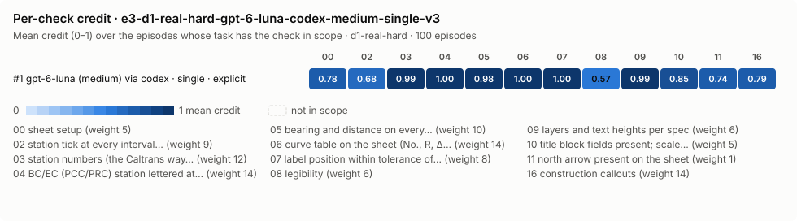

# Run `e3-d1-real-hard-gpt-6-luna-codex-medium-single-v3`

Task set **d1-real-hard** · 100 episodes · spec v1 (sha256:0e07d5e83c0b) · generator real-v1 · verifier d1-verify-v8 · harness e3-v3

## Rows

Effective score: 0 on a hard fail, else the rubric score; per task over its samples, then over tasks. 95% CI: bootstrap over tasks within task type (4,000 resamples, seed 0).

| # | Row | Effort | Effective | 95% CI | Rubric | Hard-fail | Clean | Submit | Steps (med / p90) | Invalid calls | Recovery | run_check | Cost / sheet | Tasks × k |
|---:|---|---|---:|---|---:|---:|---:|---:|---|---:|---:|---:|---:|---|
| 1 | gpt-6-luna (medium) via codex · single · explicit | medium | **83.7** | 78.7–88.1 | 91.3 | 9% | 7% | 100% | 21 / 40 | 1% | 18% | 0.0 | – | 100 × 1 |

## Per-check credit

Mean credit (0–1) over the episodes whose task has the check in scope; – where none did.

| Check | Weight | #1 |
|---|---:|---:|
| D1-00 sheet setup | 5 | 0.78 |
| D1-02 station tick at every interval station… | 9 | 0.68 |
| D1-03 station numbers (the Caltrans way… | 12 | 0.99 |
| D1-04 BC/EC (PCC/PRC) station lettered at… | 14 | 1.00 |
| D1-05 bearing and distance on every tangent… | 10 | 0.98 |
| D1-06 curve table on the sheet (No., R, Δ, T… | 14 | 1.00 |
| D1-07 label position within tolerance of the… | 8 | 1.00 |
| D1-08 legibility | 6 | 0.57 |
| D1-09 layers and text heights per spec | 6 | 0.99 |
| D1-10 title block fields present; scale… | 5 | 0.85 |
| D1-11 north arrow present on the sheet | 1 | 0.74 |
| D1-16 construction callouts | 14 | 0.79 |

## Failure taxonomy

Share of episodes with at least one finding in the category (findings per episode).

| Category | #1 | Codes |
|---|---:|---|
| completeness | 72% (2.0) | missing 132, missing_field 71 |
| value | 18% (0.2) | wrong_value 15, wrong_field 7 |
| anchoring | 63% (23.5) | unanchored 2286, duplicate 60 |
| placement | 38% (2.4) | misplaced 226, not_visible 13 |
| legibility | 64% (2.6) | overlap 181, off_sheet 77, clipped 1, upside_down 1 |
| standards | 2% (0.1) | wrong_height 15 |
| sheet_setup | 18% (0.2) | not_fitted 18 |

### Tool use and termination

| | #1 |
|---|---:|
| tool calls | 2391 |
| invalid-call rate | 1% |
| other fault rate | 7% |
| recovery rate | 18% |
| coordinate path share | 0% |
| stopped without calling submit | 5% |
| Δ effective after last run_check | – |
| ended submit | 100 |
| error command_failed | 156 |
| error invalid_params | 23 |
| error query_failed | 16 |

## By question group

The real-sheet types by question type (`tasks.types.REAL_GROUPS`), the way the probe board splits its tiers: effective mean over the group's tasks ± its 95% half-width (bootstrap over tasks within type), and the tasks it rests on.

| Group | Types | #1 |
|---|---|---:|
| letter: letter alignment data | real-alignment-data | 96.1 ± 1.9 (n 20) |
| sheet: produce the sheet | real-annotate-sheet, real-plan-sheet | 92.5 ± 1.8 (n 41) |
| job: the whole job | real-annotate-job, real-sheet-job | 67.9 ± 11.8 (n 39) |

## By task type and sheet count

| Task type | #1 |
|---|---:|
| real-alignment-data | 96.1 (n 20) |
| real-annotate-job | 63.5 (n 20) |
| real-annotate-sheet | 92.9 (n 20) |
| real-plan-sheet | 92.2 (n 21) |
| real-sheet-job | 72.6 (n 19) |
| 1 sheet | 83.7 (n 100) |

## Interval sizing

The v0.1 target is a 95% half-width under 5 points. Tasks needed assumes the half-width shrinks as 1/√tasks at this row's spread.

| Row | Tasks | Half-width | Unstratified | Within-task SD | Tasks for the target |
|---|---:|---:|---:|---:|---:|
| gpt-6-luna (medium) via codex · single · explicit | 100 | 4.7 | 5.1 | – | 88 |

_Generated by `python -m roaddraft.eval report` (e4-v1); do not edit._
