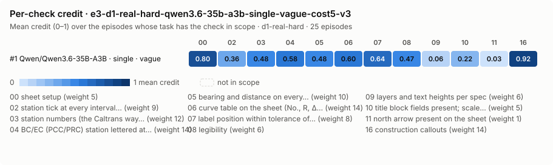

# Run `e3-d1-real-hard-qwen3.6-35b-a3b-single-vague-cost5-v3`

Task set **d1-real-hard** · 25 episodes · spec v1 (sha256:0e07d5e83c0b) · generator real-v1 · verifier d1-verify-v8 · harness e3-v3

## Rows

Effective score: 0 on a hard fail, else the rubric score; per task over its samples, then over tasks. 95% CI: bootstrap over tasks within task type (4,000 resamples, seed 0).

| # | Row | Effort | Effective | 95% CI | Rubric | Hard-fail | Clean | Submit | Steps (med / p90) | Invalid calls | Recovery | run_check | Cost / sheet | Tasks × k |
|---:|---|---|---:|---|---:|---:|---:|---:|---|---:|---:|---:|---:|---|
| 1 | Qwen/Qwen3.6-35B-A3B · single · vague | thinking on (default) | **50.6** | 46.3–55.6 | 52.6 | 12% | 0% | 100% | 34 / 47 | 1% | 54% | 0.0 | – | 25 × 1 |

## Per-check credit

Mean credit (0–1) over the episodes whose task has the check in scope; – where none did.

| Check | Weight | #1 |
|---|---:|---:|
| D1-00 sheet setup | 5 | 0.80 |
| D1-02 station tick at every interval station… | 9 | 0.36 |
| D1-03 station numbers (the Caltrans way… | 12 | 0.48 |
| D1-04 BC/EC (PCC/PRC) station lettered at… | 14 | 0.58 |
| D1-05 bearing and distance on every tangent… | 10 | 0.48 |
| D1-06 curve table on the sheet (No., R, Δ, T… | 14 | 0.60 |
| D1-07 label position within tolerance of the… | 8 | 0.64 |
| D1-08 legibility | 6 | 0.47 |
| D1-09 layers and text heights per spec | 6 | 0.06 |
| D1-10 title block fields present; scale… | 5 | 0.22 |
| D1-11 north arrow present on the sheet | 1 | 0.03 |
| D1-16 construction callouts | 14 | 0.92 |

## Failure taxonomy

Share of episodes with at least one finding in the category (findings per episode).

| Category | #1 | Codes |
|---|---:|---|
| completeness | 100% (16.8) | missing 313, missing_field 108 |
| value | 16% (0.3) | wrong_value 8 |
| anchoring | 92% (19.8) | unanchored 474, duplicate 20 |
| placement | 0% (0.0) |  |
| legibility | 68% (3.7) | overlap 60, upside_down 27, off_sheet 5, clipped 1 |
| standards | 60% (10.3) | wrong_layer 258 |
| sheet_setup | 16% (0.2) | not_fitted 4 |

### Tool use and termination

| | #1 |
|---|---:|
| tool calls | 860 |
| invalid-call rate | 1% |
| other fault rate | 6% |
| recovery rate | 54% |
| coordinate path share | 0% |
| stopped without calling submit | 0% |
| Δ effective after last run_check | – |
| ended submit | 25 |
| error command_failed | 43 |
| error invalid_params | 12 |
| error query_failed | 6 |

## By question group

The real-sheet types by question type (`tasks.types.REAL_GROUPS`), the way the probe board splits its tiers: effective mean over the group's tasks ± its 95% half-width (bootstrap over tasks within type), and the tasks it rests on.

| Group | Types | #1 |
|---|---|---:|
| letter: letter alignment data | real-alignment-data | 65.2 ± 4.5 (n 5) |
| sheet: produce the sheet | real-annotate-sheet, real-plan-sheet | 74.8 ± 4.0 (n 10) |
| job: the whole job | real-annotate-job, real-sheet-job | 19.1 ± 10.3 (n 10) |

## By task type and sheet count

| Task type | #1 |
|---|---:|
| real-alignment-data | 65.2 (n 5) |
| real-annotate-job | 19.3 (n 5) |
| real-annotate-sheet | 71.4 (n 5) |
| real-plan-sheet | 78.2 (n 5) |
| real-sheet-job | 18.9 (n 5) |
| 1 sheet | 50.6 (n 25) |

## Interval sizing

The v0.1 target is a 95% half-width under 5 points. Tasks needed assumes the half-width shrinks as 1/√tasks at this row's spread.

| Row | Tasks | Half-width | Unstratified | Within-task SD | Tasks for the target |
|---|---:|---:|---:|---:|---:|
| Qwen/Qwen3.6-35B-A3B · single · vague | 25 | 4.7 | 11.0 | – | 22 |

_Generated by `python -m roaddraft.eval report` (e4-v2); do not edit._
