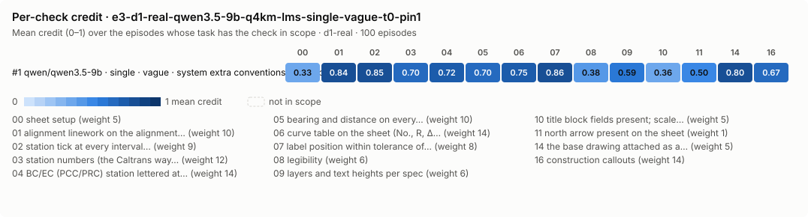

# Run `e3-d1-real-qwen3.5-9b-q4km-lms-single-vague-t0-pin1`

Task set **d1-real** · 100 episodes · spec v1 (sha256:0e07d5e83c0b) · generator real-v1 · verifier d1-verify-v8 · harness e3-v3

## Rows

Effective score: 0 on a hard fail, else the rubric score; per task over its samples, then over tasks. 95% CI: bootstrap over tasks within task type (4,000 resamples, seed 0).

| # | Row | Effort | Effective | 95% CI | Rubric | Hard-fail | Clean | Submit | Steps (med / p90) | Invalid calls | Recovery | run_check | Cost / sheet | Tasks × k |
|---:|---|---|---:|---|---:|---:|---:|---:|---|---:|---:|---:|---:|---|
| 1 | qwen/qwen3.5-9b · single · vague · system extra conventions-v1@89b9a471 | default | **65.3** | 58.7–71.2 | 68.0 | 4% | 26% | 98% | 16 / 34 | 0% | 57% | 0.0 | – | 100 × 1 |

## Per-check credit

Mean credit (0–1) over the episodes whose task has the check in scope; – where none did.

| Check | Weight | #1 |
|---|---:|---:|
| D1-00 sheet setup | 5 | 0.33 |
| D1-01 alignment linework on the alignment… | 10 | 0.84 |
| D1-02 station tick at every interval station… | 9 | 0.85 |
| D1-03 station numbers (the Caltrans way… | 12 | 0.70 |
| D1-04 BC/EC (PCC/PRC) station lettered at… | 14 | 0.72 |
| D1-05 bearing and distance on every tangent… | 10 | 0.70 |
| D1-06 curve table on the sheet (No., R, Δ, T… | 14 | 0.75 |
| D1-07 label position within tolerance of the… | 8 | 0.86 |
| D1-08 legibility | 6 | 0.38 |
| D1-09 layers and text heights per spec | 6 | 0.59 |
| D1-10 title block fields present; scale… | 5 | 0.36 |
| D1-11 north arrow present on the sheet | 1 | 0.50 |
| D1-14 the base drawing attached as a… | 5 | 0.80 |
| D1-16 construction callouts | 14 | 0.67 |

## Failure taxonomy

Share of episodes with at least one finding in the category (findings per episode).

| Category | #1 | Codes |
|---|---:|---|
| completeness | 28% (1.6) | missing 122, missing_field 42 |
| value | 7% (0.2) | extra_linework 15, wrong_value 6, wrong_field 1 |
| anchoring | 24% (17.6) | unanchored 1713, duplicate 42 |
| placement | 20% (0.9) | not_visible 57, misplaced 34 |
| legibility | 41% (5.8) | overlap 507, off_sheet 42, upside_down 32 |
| standards | 18% (2.1) | wrong_layer 211, wrong_height 1 |
| sheet_setup | 10% (0.2) | sheet_missing 12, not_fitted 6, viewport_scale 1 |

### Tool use and termination

| | #1 |
|---|---:|
| tool calls | 1847 |
| invalid-call rate | 0% |
| other fault rate | 10% |
| recovery rate | 57% |
| coordinate path share | 0% |
| stopped without calling submit | 11% |
| Δ effective after last run_check | – |
| ended budget:context | 1 |
| ended budget:steps | 1 |
| ended submit | 98 |
| error command_failed | 160 |
| error query_failed | 31 |

## By question group

The real-sheet types by question type (`tasks.types.REAL_GROUPS`), the way the probe board splits its tiers: effective mean over the group's tasks ± its 95% half-width (bootstrap over tasks within type), and the tasks it rests on.

| Group | Types | #1 |
|---|---|---:|
| draft: draft linework | real-draw-alignment | 80.0 ± 14.0 (n 25) |
| letter: letter alignment data | real-alignment-data, real-bearings, real-callouts, real-curve-table, real-stationing | 75.5 ± 11.4 (n 25) |
| sheet: produce the sheet | real-annotate-sheet, real-attach-reference, real-plan-sheet, real-sheet-setup, real-title-block | 60.9 ± 9.6 (n 25) |
| notes: notes and dimensions | real-construction-callouts | 44.7 ± 12.1 (n 25) |

## By task type and sheet count

| Task type | #1 |
|---|---:|
| real-alignment-data | 71.3 (n 5) |
| real-annotate-sheet | 86.2 (n 5) |
| real-attach-reference | 80.0 (n 5) |
| real-bearings | 75.0 (n 5) |
| real-callouts | 76.8 (n 5) |
| real-construction-callouts | 44.7 (n 25) |
| real-curve-table | 89.6 (n 5) |
| real-draw-alignment | 80.0 (n 25) |
| real-plan-sheet | 36.3 (n 5) |
| real-sheet-setup | 59.5 (n 5) |
| real-stationing | 64.7 (n 5) |
| real-title-block | 42.4 (n 5) |
| 1 sheet | 65.3 (n 100) |

## Interval sizing

The v0.1 target is a 95% half-width under 5 points. Tasks needed assumes the half-width shrinks as 1/√tasks at this row's spread.

| Row | Tasks | Half-width | Unstratified | Within-task SD | Tasks for the target |
|---|---:|---:|---:|---:|---:|
| qwen/qwen3.5-9b · single · vague · system extra conventions-v1@89b9a471 | 100 | 6.2 | 7.1 | – | 155 |

_Generated by `python -m roaddraft.eval report` (e4-v2); do not edit._
