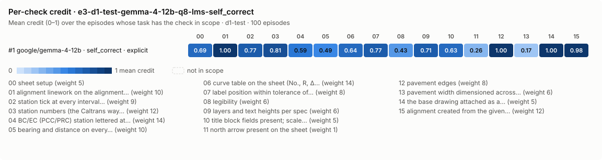

# Run `e3-d1-test-gemma-4-12b-q8-lms-self_correct`

Task set **d1-test** · 100 episodes · spec v1 (sha256:0e07d5e83c0b) · generator d1-v6 · verifier d1-verify-v7 · harness e3-v2

## Rows

Effective score: 0 on a hard fail, else the rubric score; per task over its samples, then over tasks. 95% CI: bootstrap over tasks within task type (4,000 resamples, seed 0).

| # | Row | Effort | Effective | 95% CI | Rubric | Hard-fail | Clean | Submit | Steps (med / p90) | Invalid calls | Recovery | run_check | Cost / sheet | Tasks × k |
|---:|---|---|---:|---|---:|---:|---:|---:|---|---:|---:|---:|---:|---|
| 1 | google/gemma-4-12b · self_correct · explicit | thinking on | **66.2** | 61.0–71.6 | 72.7 | 10% | 40% | 82% | 19 / 64 | 18% | 52% | 1.3 | – | 100 × 1 |

## Per-check credit

Mean credit (0–1) over the episodes whose task has the check in scope; – where none did.

| Check | Weight | #1 |
|---|---:|---:|
| D1-00 sheet setup | 5 | 0.69 |
| D1-01 alignment linework on the alignment… | 10 | 1.00 |
| D1-02 station tick at every interval station… | 9 | 0.77 |
| D1-03 station numbers (the Caltrans way… | 12 | 0.81 |
| D1-04 BC/EC (PCC/PRC) station lettered at… | 14 | 0.59 |
| D1-05 bearing and distance on every tangent… | 10 | 0.49 |
| D1-06 curve table on the sheet (No., R, Δ, T… | 14 | 0.64 |
| D1-07 label position within tolerance of the… | 8 | 0.77 |
| D1-08 legibility | 6 | 0.43 |
| D1-09 layers and text heights per spec | 6 | 0.71 |
| D1-10 title block fields present; scale… | 5 | 0.63 |
| D1-11 north arrow present on the sheet | 1 | 0.26 |
| D1-12 pavement edges | 8 | 1.00 |
| D1-13 pavement width dimensioned across each… | 6 | 0.17 |
| D1-14 the base drawing attached as a… | 5 | 1.00 |
| D1-15 alignment created from the given… | 12 | 0.98 |

## Failure taxonomy

Share of episodes with at least one finding in the category (findings per episode).

| Category | #1 | Codes |
|---|---:|---|
| completeness | 40% (3.5) | missing 280, missing_field 65 |
| value | 22% (1.0) | wrong_value 50, wrong_field 50 |
| anchoring | 17% (1.6) | duplicate 159, unanchored 5 |
| placement | 8% (0.7) | not_visible 44, misplaced 23 |
| legibility | 31% (2.8) | overlap 219, off_sheet 44, clipped 18 |
| standards | 27% (3.6) | wrong_height 255, wrong_layer 72, wrong_layer_props 33 |
| sheet_setup | 7% (0.1) | not_fitted 10, viewport_scale 1 |

### Tool use and termination

| | #1 |
|---|---:|
| tool calls | 2865 |
| invalid-call rate | 18% |
| other fault rate | 6% |
| recovery rate | 52% |
| coordinate path share | 8% |
| stopped without calling submit | 16% |
| Δ effective after last run_check | +1.5 (n 62) |
| ended budget:faults | 11 |
| ended budget:turn_time | 5 |
| ended budget:wall_clock | 2 |
| ended submit | 82 |
| error budget_exhausted | 8 |
| error command_failed | 149 |
| error invalid_params | 511 |
| error query_failed | 1 |

## By task type and sheet count

| Task type | #1 |
|---|---:|
| annotate-base | 64.0 (n 7) |
| annotate-sheet | 37.0 (n 7) |
| attach-reference | 100.0 (n 7) |
| bearings | 52.0 (n 7) |
| create-alignment | 83.3 (n 6) |
| curve-callouts | 16.7 (n 6) |
| curve-table | 100.0 (n 6) |
| draw-alignment | 100.0 (n 6) |
| layer-setup | 84.4 (n 6) |
| pavement | 57.5 (n 6) |
| pavement-edges | 100.0 (n 6) |
| pavement-widths | 0.0 (n 6) |
| plan-sheet | 41.1 (n 6) |
| sheet-setup | 77.3 (n 6) |
| stationing | 72.2 (n 6) |
| title-block | 76.4 (n 6) |
| 1 sheet | 68.5 (n 53) |
| 2 sheets | 63.8 (n 47) |

## Interval sizing

The v0.1 target is a 95% half-width under 5 points. Tasks needed assumes the half-width shrinks as 1/√tasks at this row's spread.

| Row | Tasks | Half-width | Unstratified | Within-task SD | Tasks for the target |
|---|---:|---:|---:|---:|---:|
| google/gemma-4-12b · self_correct · explicit | 100 | 5.3 | 8.0 | – | 112 |

_Generated by `python -m roaddraft.eval report` (e4-v1); do not edit._
