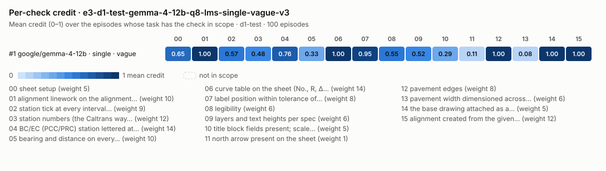

# Run `e3-d1-test-gemma-4-12b-q8-lms-single-vague-v3`

Task set **d1-test** · 100 episodes · spec v1 (sha256:0e07d5e83c0b) · generator d1-v6 · verifier d1-verify-v8 · harness e3-v3

## Rows

Effective score: 0 on a hard fail, else the rubric score; per task over its samples, then over tasks. 95% CI: bootstrap over tasks within task type (4,000 resamples, seed 0).

| # | Row | Effort | Effective | 95% CI | Rubric | Hard-fail | Clean | Submit | Steps (med / p90) | Invalid calls | Recovery | run_check | Cost / sheet | Tasks × k |
|---:|---|---|---:|---|---:|---:|---:|---:|---|---:|---:|---:|---:|---|
| 1 | google/gemma-4-12b · single · vague | thinking on | **67.2** | 63.6–70.7 | 72.3 | 9% | 32% | 100% | 8 / 23 | 2% | 68% | 0.0 | – | 100 × 1 |

Repaired calls (harness e3-v3): a one-item list where the schema takes one value was read as the value, noted to the model in the result's warnings, and is counted here and not as an invalid call: google/gemma-4-12b · single · vague 9% of its calls.

## Per-check credit

Mean credit (0–1) over the episodes whose task has the check in scope; – where none did.

| Check | Weight | #1 |
|---|---:|---:|
| D1-00 sheet setup | 5 | 0.65 |
| D1-01 alignment linework on the alignment… | 10 | 1.00 |
| D1-02 station tick at every interval station… | 9 | 0.57 |
| D1-03 station numbers (the Caltrans way… | 12 | 0.48 |
| D1-04 BC/EC (PCC/PRC) station lettered at… | 14 | 0.76 |
| D1-05 bearing and distance on every tangent… | 10 | 0.33 |
| D1-06 curve table on the sheet (No., R, Δ, T… | 14 | 1.00 |
| D1-07 label position within tolerance of the… | 8 | 0.95 |
| D1-08 legibility | 6 | 0.55 |
| D1-09 layers and text heights per spec | 6 | 0.52 |
| D1-10 title block fields present; scale… | 5 | 0.29 |
| D1-11 north arrow present on the sheet | 1 | 0.11 |
| D1-12 pavement edges | 8 | 1.00 |
| D1-13 pavement width dimensioned across each… | 6 | 0.08 |
| D1-14 the base drawing attached as a… | 5 | 1.00 |
| D1-15 alignment created from the given… | 12 | 1.00 |

## Failure taxonomy

Share of episodes with at least one finding in the category (findings per episode).

| Category | #1 | Codes |
|---|---:|---|
| completeness | 39% (6.0) | missing 438, missing_field 163 |
| value | 15% (0.4) | wrong_value 29, wrong_field 15 |
| anchoring | 10% (0.7) | duplicate 71 |
| placement | 6% (0.5) | not_visible 44, misplaced 2 |
| legibility | 29% (2.3) | overlap 187, off_sheet 25, clipped 20 |
| standards | 47% (5.7) | wrong_layer 568 |
| sheet_setup | 7% (0.1) | not_fitted 8 |

### Tool use and termination

| | #1 |
|---|---:|
| tool calls | 1227 |
| invalid-call rate | 2% |
| other fault rate | 8% |
| recovery rate | 68% |
| coordinate path share | 1% |
| stopped without calling submit | 16% |
| Δ effective after last run_check | – |
| ended submit | 100 |
| error command_failed | 92 |
| error invalid_params | 20 |
| error query_failed | 2 |

## By task type and sheet count

| Task type | #1 |
|---|---:|
| annotate-base | 30.4 (n 7) |
| annotate-sheet | 47.9 (n 7) |
| attach-reference | 100.0 (n 7) |
| bearings | 77.1 (n 7) |
| create-alignment | 100.0 (n 6) |
| curve-callouts | 82.3 (n 6) |
| curve-table | 51.3 (n 6) |
| draw-alignment | 100.0 (n 6) |
| layer-setup | 97.9 (n 6) |
| pavement | 57.7 (n 6) |
| pavement-edges | 92.9 (n 6) |
| pavement-widths | 0.0 (n 6) |
| plan-sheet | 37.9 (n 6) |
| sheet-setup | 37.4 (n 6) |
| stationing | 90.5 (n 6) |
| title-block | 74.1 (n 6) |
| 1 sheet | 71.0 (n 53) |
| 2 sheets | 63.0 (n 47) |

## Interval sizing

The v0.1 target is a 95% half-width under 5 points. Tasks needed assumes the half-width shrinks as 1/√tasks at this row's spread.

| Row | Tasks | Half-width | Unstratified | Within-task SD | Tasks for the target |
|---|---:|---:|---:|---:|---:|
| google/gemma-4-12b · single · vague | 100 | 3.6 | 6.8 | – | 52 |

_Generated by `python -m roaddraft.eval report` (e4-v2); do not edit._
