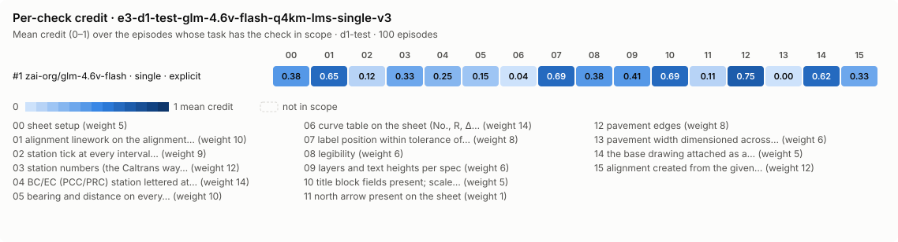

# Run `e3-d1-test-glm-4.6v-flash-q4km-lms-single-v3`

Task set **d1-test** · 100 episodes · spec v1 (sha256:0e07d5e83c0b) · generator d1-v6 · verifier d1-verify-v8 · harness e3-v3

> **Partial:** covers 100 of the set's 100 tasks; published and listed, ranked once the run holds them all. Not run: .

## Rows

Effective score: 0 on a hard fail, else the rubric score; per task over its samples, then over tasks. 95% CI: bootstrap over tasks within task type (4,000 resamples, seed 0).

| # | Row | Effort | Effective | 95% CI | Rubric | Hard-fail | Clean | Submit | Steps (med / p90) | Invalid calls | Recovery | run_check | Cost / sheet | Tasks × k |
|---:|---|---|---:|---|---:|---:|---:|---:|---|---:|---:|---:|---:|---|
| 1 | zai-org/glm-4.6v-flash · single · explicit | default | **33.9** | 28.6–39.2 | 45.6 | 19% | 17% | 100% | 17 / 56 | 0% | 10% | 0.0 | – | 99 × 1 (1 errored) |

## Per-check credit

Mean credit (0–1) over the episodes whose task has the check in scope; – where none did.

| Check | Weight | #1 |
|---|---:|---:|
| D1-00 sheet setup | 5 | 0.38 |
| D1-01 alignment linework on the alignment… | 10 | 0.65 |
| D1-02 station tick at every interval station… | 9 | 0.12 |
| D1-03 station numbers (the Caltrans way… | 12 | 0.33 |
| D1-04 BC/EC (PCC/PRC) station lettered at… | 14 | 0.25 |
| D1-05 bearing and distance on every tangent… | 10 | 0.15 |
| D1-06 curve table on the sheet (No., R, Δ, T… | 14 | 0.04 |
| D1-07 label position within tolerance of the… | 8 | 0.69 |
| D1-08 legibility | 6 | 0.38 |
| D1-09 layers and text heights per spec | 6 | 0.41 |
| D1-10 title block fields present; scale… | 5 | 0.69 |
| D1-11 north arrow present on the sheet | 1 | 0.11 |
| D1-12 pavement edges | 8 | 0.75 |
| D1-13 pavement width dimensioned across each… | 6 | 0.00 |
| D1-14 the base drawing attached as a… | 5 | 0.62 |
| D1-15 alignment created from the given… | 12 | 0.33 |

## Failure taxonomy

Share of episodes with at least one finding in the category (findings per episode).

| Category | #1 | Codes |
|---|---:|---|
| completeness | 63% (8.8) | missing 839, missing_field 31 |
| value | 22% (1.4) | wrong_value 87, extra_linework 28, geometry_mismatch 13, wrong_field 6 |
| anchoring | 17% (1.0) | unanchored 61, duplicate 35 |
| placement | 17% (1.4) | misplaced 94, not_visible 40 |
| legibility | 14% (2.0) | overlap 147, off_sheet 44, clipped 5 |
| standards | 29% (2.7) | wrong_height 240, wrong_layer 20, wrong_layer_props 10 |
| sheet_setup | 11% (0.3) | sheet_missing 18, not_fitted 10, viewport_scale 2 |

### Tool use and termination

| | #1 |
|---|---:|
| tool calls | 2361 |
| invalid-call rate | 0% |
| other fault rate | 40% |
| recovery rate | 10% |
| coordinate path share | 23% |
| stopped without calling submit | 3% |
| Δ effective after last run_check | – |
| ended error | 1 |
| ended submit | 99 |
| error command_failed | 855 |
| error invalid_params | 3 |
| error nothing_to_redo | 6 |
| error query_failed | 92 |

## By task type and sheet count

| Task type | #1 |
|---|---:|
| annotate-base | 25.6 (n 7) |
| annotate-sheet | 9.6 (n 7) |
| attach-reference | 62.5 (n 6) |
| bearings | 36.0 (n 7) |
| create-alignment | 16.7 (n 6) |
| curve-callouts | 6.9 (n 6) |
| curve-table | 0.0 (n 6) |
| draw-alignment | 83.3 (n 6) |
| layer-setup | 100.0 (n 6) |
| pavement | 35.9 (n 6) |
| pavement-edges | 16.7 (n 6) |
| pavement-widths | 0.0 (n 6) |
| plan-sheet | 21.0 (n 6) |
| sheet-setup | 70.0 (n 6) |
| stationing | 24.3 (n 6) |
| title-block | 38.9 (n 6) |
| 1 sheet | 30.8 (n 53) |
| 2 sheets | 37.5 (n 46) |

## Interval sizing

The v0.1 target is a 95% half-width under 5 points. Tasks needed assumes the half-width shrinks as 1/√tasks at this row's spread.

| Row | Tasks | Half-width | Unstratified | Within-task SD | Tasks for the target |
|---|---:|---:|---:|---:|---:|
| zai-org/glm-4.6v-flash · single · explicit | 99 | 5.3 | 7.8 | – | 111 |

_Generated by `python -m roaddraft.eval report` (e4-v2); do not edit._
