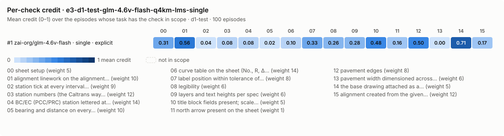

# Run `e3-d1-test-glm-4.6v-flash-q4km-lms-single`

Task set **d1-test** · 100 episodes · spec v1 (sha256:0e07d5e83c0b) · generator d1-v6 · verifier d1-verify-v7 · harness e3-v2

## Rows

Effective score: 0 on a hard fail, else the rubric score; per task over its samples, then over tasks. 95% CI: bootstrap over tasks within task type (4,000 resamples, seed 0).

| # | Row | Effort | Effective | 95% CI | Rubric | Hard-fail | Clean | Submit | Steps (med / p90) | Invalid calls | Recovery | run_check | Cost / sheet | Tasks × k |
|---:|---|---|---:|---|---:|---:|---:|---:|---|---:|---:|---:|---:|---|
| 1 | zai-org/glm-4.6v-flash · single · explicit | default | **28.5** | 23.4–33.7 | 30.6 | 9% | 13% | 78% | 10 / 29 | 1% | 5% | 0.0 | – | 100 × 1 |

## Per-check credit

Mean credit (0–1) over the episodes whose task has the check in scope; – where none did.

| Check | Weight | #1 |
|---|---:|---:|
| D1-00 sheet setup | 5 | 0.31 |
| D1-01 alignment linework on the alignment… | 10 | 0.56 |
| D1-02 station tick at every interval station… | 9 | 0.04 |
| D1-03 station numbers (the Caltrans way… | 12 | 0.08 |
| D1-04 BC/EC (PCC/PRC) station lettered at… | 14 | 0.08 |
| D1-05 bearing and distance on every tangent… | 10 | 0.02 |
| D1-06 curve table on the sheet (No., R, Δ, T… | 14 | 0.10 |
| D1-07 label position within tolerance of the… | 8 | 0.33 |
| D1-08 legibility | 6 | 0.26 |
| D1-09 layers and text heights per spec | 6 | 0.28 |
| D1-10 title block fields present; scale… | 5 | 0.48 |
| D1-11 north arrow present on the sheet | 1 | 0.16 |
| D1-12 pavement edges | 8 | 0.50 |
| D1-13 pavement width dimensioned across each… | 6 | 0.00 |
| D1-14 the base drawing attached as a… | 5 | 0.71 |
| D1-15 alignment created from the given… | 12 | 0.17 |

## Failure taxonomy

Share of episodes with at least one finding in the category (findings per episode).

| Category | #1 | Codes |
|---|---:|---|
| completeness | 76% (12.1) | missing 1101, missing_field 111 |
| value | 11% (0.8) | wrong_value 41, geometry_mismatch 28, wrong_field 5, extra_linework 4 |
| anchoring | 4% (0.8) | unanchored 71, duplicate 4 |
| placement | 5% (0.9) | misplaced 47, not_visible 45 |
| legibility | 6% (1.1) | overlap 59, off_sheet 48 |
| standards | 25% (2.0) | wrong_height 139, wrong_layer 46, wrong_layer_props 15 |
| sheet_setup | 12% (0.3) | sheet_missing 13, not_fitted 12, viewport_scale 2 |

### Tool use and termination

| | #1 |
|---|---:|
| tool calls | 1371 |
| invalid-call rate | 1% |
| other fault rate | 36% |
| recovery rate | 5% |
| coordinate path share | 22% |
| stopped without calling submit | 1% |
| Δ effective after last run_check | – |
| ended budget:faults | 19 |
| ended budget:turn_time | 1 |
| ended budget:wall_clock | 2 |
| ended submit | 78 |
| error budget_exhausted | 17 |
| error command_failed | 419 |
| error invalid_params | 7 |
| error nothing_to_redo | 11 |
| error nothing_to_undo | 2 |
| error query_failed | 41 |

## By task type and sheet count

| Task type | #1 |
|---|---:|
| annotate-base | 11.2 (n 7) |
| annotate-sheet | 2.7 (n 7) |
| attach-reference | 71.4 (n 7) |
| bearings | 0.0 (n 7) |
| create-alignment | 16.7 (n 6) |
| curve-callouts | 0.0 (n 6) |
| curve-table | 0.0 (n 6) |
| draw-alignment | 83.3 (n 6) |
| layer-setup | 93.8 (n 6) |
| pavement | 35.9 (n 6) |
| pavement-edges | 33.3 (n 6) |
| pavement-widths | 0.0 (n 6) |
| plan-sheet | 14.1 (n 6) |
| sheet-setup | 48.4 (n 6) |
| stationing | 24.4 (n 6) |
| title-block | 25.5 (n 6) |
| 1 sheet | 26.9 (n 53) |
| 2 sheets | 30.3 (n 47) |

## Interval sizing

The v0.1 target is a 95% half-width under 5 points. Tasks needed assumes the half-width shrinks as 1/√tasks at this row's spread.

| Row | Tasks | Half-width | Unstratified | Within-task SD | Tasks for the target |
|---|---:|---:|---:|---:|---:|
| zai-org/glm-4.6v-flash · single · explicit | 100 | 5.2 | 8.0 | – | 107 |

_Generated by `python -m roaddraft.eval report` (e4-v1); do not edit._
