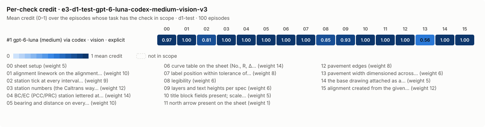

# Run `e3-d1-test-gpt-6-luna-codex-medium-vision-v3`

Task set **d1-test** · 100 episodes · spec v1 (sha256:0e07d5e83c0b) · generator d1-v6 · verifier d1-verify-v8 · harness e3-v3

## Rows

Effective score: 0 on a hard fail, else the rubric score; per task over its samples, then over tasks. 95% CI: bootstrap over tasks within task type (4,000 resamples, seed 0).

| # | Row | Effort | Effective | 95% CI | Rubric | Hard-fail | Clean | Submit | Steps (med / p90) | Invalid calls | Recovery | run_check | Cost / sheet | Tasks × k |
|---:|---|---|---:|---|---:|---:|---:|---:|---|---:|---:|---:|---:|---|
| 1 | gpt-6-luna (medium) via codex · vision · explicit | medium | **93.7** | 91.6–96.2 | 93.7 | 0% | 78% | 100% | 12 / 25 | 0% | 59% | 1.1 | – | 100 × 1 |

## Per-check credit

Mean credit (0–1) over the episodes whose task has the check in scope; – where none did.

| Check | Weight | #1 |
|---|---:|---:|
| D1-00 sheet setup | 5 | 0.97 |
| D1-01 alignment linework on the alignment… | 10 | 1.00 |
| D1-02 station tick at every interval station… | 9 | 0.81 |
| D1-03 station numbers (the Caltrans way… | 12 | 1.00 |
| D1-04 BC/EC (PCC/PRC) station lettered at… | 14 | 1.00 |
| D1-05 bearing and distance on every tangent… | 10 | 1.00 |
| D1-06 curve table on the sheet (No., R, Δ, T… | 14 | 1.00 |
| D1-07 label position within tolerance of the… | 8 | 1.00 |
| D1-08 legibility | 6 | 0.85 |
| D1-09 layers and text heights per spec | 6 | 0.93 |
| D1-10 title block fields present; scale… | 5 | 1.00 |
| D1-11 north arrow present on the sheet | 1 | 1.00 |
| D1-12 pavement edges | 8 | 1.00 |
| D1-13 pavement width dimensioned across each… | 6 | 0.56 |
| D1-14 the base drawing attached as a… | 5 | 1.00 |
| D1-15 alignment created from the given… | 12 | 1.00 |

## Failure taxonomy

Share of episodes with at least one finding in the category (findings per episode).

| Category | #1 | Codes |
|---|---:|---|
| completeness | 12% (0.5) | missing 50 |
| value | 0% (0.0) |  |
| anchoring | 4% (0.1) | duplicate 14 |
| placement | 5% (0.4) | misplaced 37 |
| legibility | 8% (0.4) | overlap 33, off_sheet 3, clipped 3 |
| standards | 9% (0.5) | wrong_height 43, wrong_layer_props 6 |
| sheet_setup | 0% (0.0) |  |

### Tool use and termination

| | #1 |
|---|---:|
| tool calls | 1389 |
| invalid-call rate | 0% |
| other fault rate | 2% |
| recovery rate | 59% |
| coordinate path share | 1% |
| stopped without calling submit | 9% |
| Δ effective after last run_check | +1.9 (n 90) |
| ended submit | 100 |
| error command_failed | 13 |
| error invalid_params | 5 |
| error query_failed | 16 |

## By task type and sheet count

| Task type | #1 |
|---|---:|
| annotate-base | 95.2 (n 7) |
| annotate-sheet | 96.7 (n 7) |
| attach-reference | 100.0 (n 7) |
| bearings | 96.3 (n 7) |
| create-alignment | 100.0 (n 6) |
| curve-callouts | 100.0 (n 6) |
| curve-table | 100.0 (n 6) |
| draw-alignment | 100.0 (n 6) |
| layer-setup | 100.0 (n 6) |
| pavement | 87.7 (n 6) |
| pavement-edges | 100.0 (n 6) |
| pavement-widths | 29.2 (n 6) |
| plan-sheet | 97.6 (n 6) |
| sheet-setup | 100.0 (n 6) |
| stationing | 94.5 (n 6) |
| title-block | 100.0 (n 6) |
| 1 sheet | 93.3 (n 53) |
| 2 sheets | 94.1 (n 47) |

## Interval sizing

The v0.1 target is a 95% half-width under 5 points. Tasks needed assumes the half-width shrinks as 1/√tasks at this row's spread.

| Row | Tasks | Half-width | Unstratified | Within-task SD | Tasks for the target |
|---|---:|---:|---:|---:|---:|
| gpt-6-luna (medium) via codex · vision · explicit | 100 | 2.3 | 3.9 | – | 21 |

_Generated by `python -m roaddraft.eval report` (e4-v1); do not edit._
