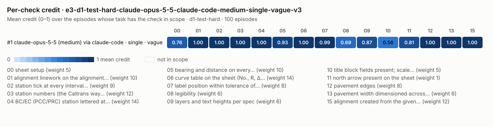

# Run `e3-d1-test-hard-claude-opus-5-5-claude-code-medium-single-vague-v3`

Task set **d1-test-hard** · 100 episodes · spec v1 (sha256:0e07d5e83c0b) · generator d1-v6 · verifier d1-verify-v8 · harness e3-v3

## Rows

Effective score: 0 on a hard fail, else the rubric score; per task over its samples, then over tasks. 95% CI: bootstrap over tasks within task type (4,000 resamples, seed 0).

| # | Row | Effort | Effective | 95% CI | Rubric | Hard-fail | Clean | Submit | Steps (med / p90) | Invalid calls | Recovery | run_check | Cost / sheet | Tasks × k |
|---:|---|---|---:|---|---:|---:|---:|---:|---|---:|---:|---:|---:|---|
| 1 | claude-opus-5-5 (medium) via claude-code · single · vague | medium | **93.7** | 93.1–94.3 | 93.7 | 0% | 6% | 100% | 41 / 58 | 0% | 78% | 0.0 | $1.09 | 100 × 1 |

## Per-check credit

Mean credit (0–1) over the episodes whose task has the check in scope; – where none did.

| Check | Weight | #1 |
|---|---:|---:|
| D1-00 sheet setup | 5 | 0.76 |
| D1-01 alignment linework on the alignment… | 10 | 1.00 |
| D1-02 station tick at every interval station… | 9 | 1.00 |
| D1-03 station numbers (the Caltrans way… | 12 | 1.00 |
| D1-04 BC/EC (PCC/PRC) station lettered at… | 14 | 1.00 |
| D1-05 bearing and distance on every tangent… | 10 | 0.93 |
| D1-06 curve table on the sheet (No., R, Δ, T… | 14 | 1.00 |
| D1-07 label position within tolerance of the… | 8 | 0.99 |
| D1-08 legibility | 6 | 0.69 |
| D1-09 layers and text heights per spec | 6 | 0.87 |
| D1-10 title block fields present; scale… | 5 | 0.56 |
| D1-11 north arrow present on the sheet | 1 | 0.81 |
| D1-12 pavement edges | 8 | 1.00 |
| D1-13 pavement width dimensioned across each… | 6 | 1.00 |
| D1-15 alignment created from the given… | 12 | 1.00 |

## Failure taxonomy

Share of episodes with at least one finding in the category (findings per episode).

| Category | #1 | Codes |
|---|---:|---|
| completeness | 81% (13.5) | missing_field 884, missing 464 |
| value | 1% (0.0) | wrong_value 1 |
| anchoring | 9% (0.1) | duplicate 7, unanchored 6 |
| placement | 37% (0.5) | misplaced 44, not_visible 8 |
| legibility | 65% (1.3) | clipped 109, off_sheet 13, overlap 8, upside_down 1 |
| standards | 83% (19.1) | wrong_layer 1911 |
| sheet_setup | 30% (0.4) | not_fitted 40 |

### Tool use and termination

| | #1 |
|---|---:|
| tool calls | 4224 |
| invalid-call rate | 0% |
| other fault rate | 3% |
| recovery rate | 78% |
| coordinate path share | 1% |
| stopped without calling submit | 0% |
| Δ effective after last run_check | – |
| ended submit | 100 |
| error command_failed | 109 |
| error invalid_params | 3 |

## By task type and sheet count

| Task type | #1 |
|---|---:|
| annotate-base | 94.2 (n 20) |
| base-plan-sheet | 94.4 (n 20) |
| create-plan-sheet | 94.2 (n 20) |
| plan-sheet | 94.6 (n 20) |
| plan-sheet-pavement | 91.1 (n 20) |
| 2 sheets | 93.7 (n 48) |
| 3 sheets | 93.8 (n 52) |

## Interval sizing

The v0.1 target is a 95% half-width under 5 points. Tasks needed assumes the half-width shrinks as 1/√tasks at this row's spread.

| Row | Tasks | Half-width | Unstratified | Within-task SD | Tasks for the target |
|---|---:|---:|---:|---:|---:|
| claude-opus-5-5 (medium) via claude-code · single · vague | 100 | 0.6 | 0.7 | – | 2 |

Prices from the table checked 2026-10-06.

_Generated by `python -m roaddraft.eval report` (e4-v2); do not edit._
