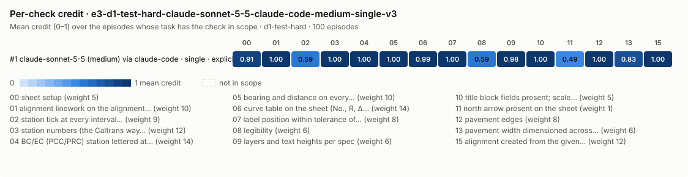

# Run `e3-d1-test-hard-claude-sonnet-5-5-claude-code-medium-single-v3`

Task set **d1-test-hard** · 100 episodes · spec v1 (sha256:0e07d5e83c0b) · generator d1-v6 · verifier d1-verify-v8 · harness e3-v3

## Rows

Effective score: 0 on a hard fail, else the rubric score; per task over its samples, then over tasks. 95% CI: bootstrap over tasks within task type (4,000 resamples, seed 0).

| # | Row | Effort | Effective | 95% CI | Rubric | Hard-fail | Clean | Submit | Steps (med / p90) | Invalid calls | Recovery | run_check | Cost / sheet | Tasks × k |
|---:|---|---|---:|---|---:|---:|---:|---:|---|---:|---:|---:|---:|---|
| 1 | claude-sonnet-5-5 (medium) via claude-code · single · explicit | medium | **90.8** | 87.8–93.0 | 92.5 | 2% | 8% | 100% | 44 / 67 | 0% | 70% | 0.0 | $0.956 | 100 × 1 |

## Per-check credit

Mean credit (0–1) over the episodes whose task has the check in scope; – where none did.

| Check | Weight | #1 |
|---|---:|---:|
| D1-00 sheet setup | 5 | 0.91 |
| D1-01 alignment linework on the alignment… | 10 | 1.00 |
| D1-02 station tick at every interval station… | 9 | 0.59 |
| D1-03 station numbers (the Caltrans way… | 12 | 1.00 |
| D1-04 BC/EC (PCC/PRC) station lettered at… | 14 | 1.00 |
| D1-05 bearing and distance on every tangent… | 10 | 1.00 |
| D1-06 curve table on the sheet (No., R, Δ, T… | 14 | 0.99 |
| D1-07 label position within tolerance of the… | 8 | 1.00 |
| D1-08 legibility | 6 | 0.59 |
| D1-09 layers and text heights per spec | 6 | 0.98 |
| D1-10 title block fields present; scale… | 5 | 1.00 |
| D1-11 north arrow present on the sheet | 1 | 0.49 |
| D1-12 pavement edges | 8 | 1.00 |
| D1-13 pavement width dimensioned across each… | 6 | 0.83 |
| D1-15 alignment created from the given… | 12 | 1.00 |

## Failure taxonomy

Share of episodes with at least one finding in the category (findings per episode).

| Category | #1 | Codes |
|---|---:|---|
| completeness | 83% (6.3) | missing 635 |
| value | 2% (0.0) | wrong_value 2 |
| anchoring | 58% (2.1) | unanchored 209, duplicate 2 |
| placement | 40% (6.7) | misplaced 672, not_visible 2 |
| legibility | 60% (2.9) | off_sheet 213, overlap 51, clipped 30 |
| standards | 60% (1.9) | wrong_layer_props 191 |
| sheet_setup | 1% (0.0) | not_fitted 1 |

### Tool use and termination

| | #1 |
|---|---:|
| tool calls | 4631 |
| invalid-call rate | 0% |
| other fault rate | 2% |
| recovery rate | 70% |
| coordinate path share | 14% |
| stopped without calling submit | 3% |
| Δ effective after last run_check | – |
| ended submit | 100 |
| error command_failed | 88 |
| error invalid_params | 1 |
| error query_failed | 3 |

## By task type and sheet count

| Task type | #1 |
|---|---:|
| annotate-base | 87.6 (n 20) |
| base-plan-sheet | 85.4 (n 20) |
| create-plan-sheet | 95.5 (n 20) |
| plan-sheet | 93.5 (n 20) |
| plan-sheet-pavement | 91.8 (n 20) |
| 2 sheets | 91.3 (n 48) |
| 3 sheets | 90.3 (n 52) |

## Interval sizing

The v0.1 target is a 95% half-width under 5 points. Tasks needed assumes the half-width shrinks as 1/√tasks at this row's spread.

| Row | Tasks | Half-width | Unstratified | Within-task SD | Tasks for the target |
|---|---:|---:|---:|---:|---:|
| claude-sonnet-5-5 (medium) via claude-code · single · explicit | 100 | 2.6 | 2.8 | – | 28 |

Prices from the table checked 2026-10-06.

_Generated by `python -m roaddraft.eval report` (e4-v1); do not edit._
