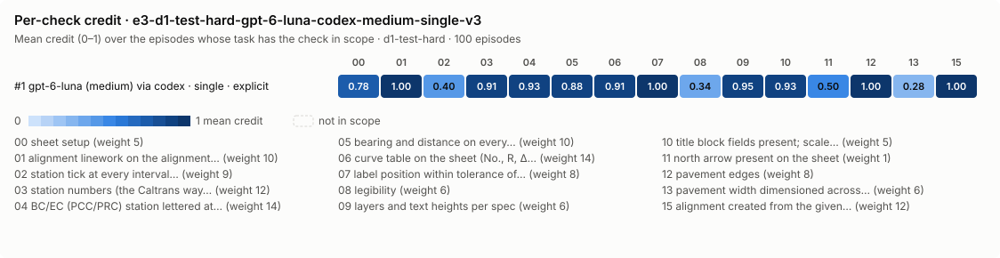

# Run `e3-d1-test-hard-gpt-6-luna-codex-medium-single-v3`

Task set **d1-test-hard** · 100 episodes · spec v1 (sha256:0e07d5e83c0b) · generator d1-v6 · verifier d1-verify-v8 · harness e3-v3

## Rows

Effective score: 0 on a hard fail, else the rubric score; per task over its samples, then over tasks. 95% CI: bootstrap over tasks within task type (4,000 resamples, seed 0).

| # | Row | Effort | Effective | 95% CI | Rubric | Hard-fail | Clean | Submit | Steps (med / p90) | Invalid calls | Recovery | run_check | Cost / sheet | Tasks × k |
|---:|---|---|---:|---|---:|---:|---:|---:|---|---:|---:|---:|---:|---|
| 1 | gpt-6-luna (medium) via codex · single · explicit | medium | **56.3** | 48.4–63.7 | 83.6 | 33% | 12% | 100% | 44 / 75 | 1% | 46% | 0.0 | – | 100 × 1 |

## Per-check credit

Mean credit (0–1) over the episodes whose task has the check in scope; – where none did.

| Check | Weight | #1 |
|---|---:|---:|
| D1-00 sheet setup | 5 | 0.78 |
| D1-01 alignment linework on the alignment… | 10 | 1.00 |
| D1-02 station tick at every interval station… | 9 | 0.40 |
| D1-03 station numbers (the Caltrans way… | 12 | 0.91 |
| D1-04 BC/EC (PCC/PRC) station lettered at… | 14 | 0.93 |
| D1-05 bearing and distance on every tangent… | 10 | 0.88 |
| D1-06 curve table on the sheet (No., R, Δ, T… | 14 | 0.91 |
| D1-07 label position within tolerance of the… | 8 | 1.00 |
| D1-08 legibility | 6 | 0.34 |
| D1-09 layers and text heights per spec | 6 | 0.95 |
| D1-10 title block fields present; scale… | 5 | 0.93 |
| D1-11 north arrow present on the sheet | 1 | 0.50 |
| D1-12 pavement edges | 8 | 1.00 |
| D1-13 pavement width dimensioned across each… | 6 | 0.28 |
| D1-15 alignment created from the given… | 12 | 1.00 |

## Failure taxonomy

Share of episodes with at least one finding in the category (findings per episode).

| Category | #1 | Codes |
|---|---:|---|
| completeness | 80% (17.1) | missing 1595, missing_field 112 |
| value | 36% (0.9) | wrong_value 64, extra_linework 18, wrong_field 8 |
| anchoring | 62% (5.0) | duplicate 427, unanchored 77 |
| placement | 53% (8.4) | misplaced 711, not_visible 128 |
| legibility | 74% (9.5) | overlap 720, off_sheet 182, clipped 47 |
| standards | 64% (3.3) | wrong_layer_props 156, wrong_height 130, wrong_layer 45 |
| sheet_setup | 23% (0.5) | not_fitted 42, sheet_missing 6, viewport_scale 6 |

### Tool use and termination

| | #1 |
|---|---:|
| tool calls | 4604 |
| invalid-call rate | 1% |
| other fault rate | 3% |
| recovery rate | 46% |
| coordinate path share | 10% |
| stopped without calling submit | 4% |
| Δ effective after last run_check | – |
| ended submit | 100 |
| error command_failed | 134 |
| error invalid_params | 40 |
| error query_failed | 24 |

## By task type and sheet count

| Task type | #1 |
|---|---:|
| annotate-base | 81.0 (n 20) |
| base-plan-sheet | 52.0 (n 20) |
| create-plan-sheet | 63.2 (n 20) |
| plan-sheet | 45.0 (n 20) |
| plan-sheet-pavement | 40.1 (n 20) |
| 2 sheets | 56.1 (n 48) |
| 3 sheets | 56.4 (n 52) |

## Interval sizing

The v0.1 target is a 95% half-width under 5 points. Tasks needed assumes the half-width shrinks as 1/√tasks at this row's spread.

| Row | Tasks | Half-width | Unstratified | Within-task SD | Tasks for the target |
|---|---:|---:|---:|---:|---:|
| gpt-6-luna (medium) via codex · single · explicit | 100 | 7.6 | 7.8 | – | 234 |

_Generated by `python -m roaddraft.eval report` (e4-v1); do not edit._
