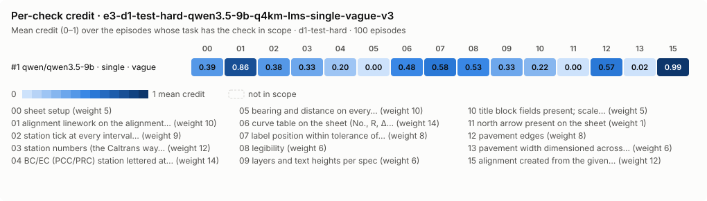

# Run `e3-d1-test-hard-qwen3.5-9b-q4km-lms-single-vague-v3`

Task set **d1-test-hard** · 100 episodes · spec v1 (sha256:0e07d5e83c0b) · generator d1-v6 · verifier d1-verify-v8 · harness e3-v3

## Rows

Effective score: 0 on a hard fail, else the rubric score; per task over its samples, then over tasks. 95% CI: bootstrap over tasks within task type (4,000 resamples, seed 0).

| # | Row | Effort | Effective | 95% CI | Rubric | Hard-fail | Clean | Submit | Steps (med / p90) | Invalid calls | Recovery | run_check | Cost / sheet | Tasks × k |
|---:|---|---|---:|---|---:|---:|---:|---:|---|---:|---:|---:|---:|---|
| 1 | qwen/qwen3.5-9b · single · vague | default | **9.4** | 6.4–12.7 | 37.7 | 65% | 0% | 96% | 62 / 133 | 0% | 30% | 0.0 | – | 100 × 1 |

## Per-check credit

Mean credit (0–1) over the episodes whose task has the check in scope; – where none did.

| Check | Weight | #1 |
|---|---:|---:|
| D1-00 sheet setup | 5 | 0.39 |
| D1-01 alignment linework on the alignment… | 10 | 0.86 |
| D1-02 station tick at every interval station… | 9 | 0.38 |
| D1-03 station numbers (the Caltrans way… | 12 | 0.33 |
| D1-04 BC/EC (PCC/PRC) station lettered at… | 14 | 0.20 |
| D1-05 bearing and distance on every tangent… | 10 | 0.00 |
| D1-06 curve table on the sheet (No., R, Δ, T… | 14 | 0.48 |
| D1-07 label position within tolerance of the… | 8 | 0.58 |
| D1-08 legibility | 6 | 0.53 |
| D1-09 layers and text heights per spec | 6 | 0.33 |
| D1-10 title block fields present; scale… | 5 | 0.22 |
| D1-11 north arrow present on the sheet | 1 | 0.00 |
| D1-12 pavement edges | 8 | 0.57 |
| D1-13 pavement width dimensioned across each… | 6 | 0.02 |
| D1-15 alignment created from the given… | 12 | 0.99 |

## Failure taxonomy

Share of episodes with at least one finding in the category (findings per episode).

| Category | #1 | Codes |
|---|---:|---|
| completeness | 100% (68.1) | missing 5557, missing_field 1250 |
| value | 69% (4.7) | wrong_value 285, geometry_mismatch 91, wrong_field 55, extra_linework 35 |
| anchoring | 36% (9.3) | unanchored 675, duplicate 173, anchor_inconsistent 82 |
| placement | 36% (3.9) | not_visible 319, misplaced 72 |
| legibility | 59% (6.4) | overlap 476, off_sheet 133, clipped 27 |
| standards | 76% (24.6) | wrong_layer 2337, wrong_height 122 |
| sheet_setup | 68% (2.7) | sheet_missing 131, not_fitted 124, viewport_scale 14 |

### Tool use and termination

| | #1 |
|---|---:|
| tool calls | 6804 |
| invalid-call rate | 0% |
| other fault rate | 11% |
| recovery rate | 30% |
| coordinate path share | 1% |
| stopped without calling submit | 12% |
| Δ effective after last run_check | – |
| ended budget:output_tokens | 2 |
| ended budget:steps | 2 |
| ended submit | 96 |
| error budget_exhausted | 2 |
| error command_failed | 718 |
| error query_failed | 61 |

## By task type and sheet count

| Task type | #1 |
|---|---:|
| annotate-base | 0.0 (n 20) |
| base-plan-sheet | 11.5 (n 20) |
| create-plan-sheet | 11.2 (n 20) |
| plan-sheet | 8.1 (n 20) |
| plan-sheet-pavement | 16.2 (n 20) |
| 2 sheets | 6.0 (n 48) |
| 3 sheets | 12.6 (n 52) |

## Interval sizing

The v0.1 target is a 95% half-width under 5 points. Tasks needed assumes the half-width shrinks as 1/√tasks at this row's spread.

| Row | Tasks | Half-width | Unstratified | Within-task SD | Tasks for the target |
|---|---:|---:|---:|---:|---:|
| qwen/qwen3.5-9b · single · vague | 100 | 3.1 | 3.3 | – | 40 |

_Generated by `python -m roaddraft.eval report` (e4-v2); do not edit._
