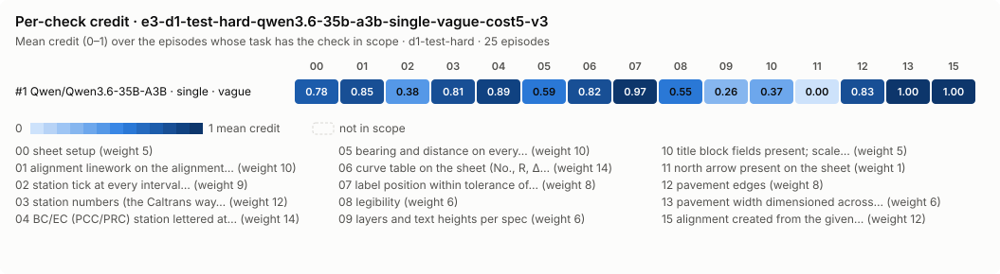

# Run `e3-d1-test-hard-qwen3.6-35b-a3b-single-vague-cost5-v3`

Task set **d1-test-hard** · 25 episodes · spec v1 (sha256:0e07d5e83c0b) · generator d1-v6 · verifier d1-verify-v8 · harness e3-v3

## Rows

Effective score: 0 on a hard fail, else the rubric score; per task over its samples, then over tasks. 95% CI: bootstrap over tasks within task type (4,000 resamples, seed 0).

| # | Row | Effort | Effective | 95% CI | Rubric | Hard-fail | Clean | Submit | Steps (med / p90) | Invalid calls | Recovery | run_check | Cost / sheet | Tasks × k |
|---:|---|---|---:|---|---:|---:|---:|---:|---|---:|---:|---:|---:|---|
| 1 | Qwen/Qwen3.6-35B-A3B · single · vague | thinking on (default) | **41.7** | 29.1–54.2 | 71.1 | 44% | 0% | 100% | 77 / 114 | 0% | 48% | 0.0 | – | 25 × 1 |

## Per-check credit

Mean credit (0–1) over the episodes whose task has the check in scope; – where none did.

| Check | Weight | #1 |
|---|---:|---:|
| D1-00 sheet setup | 5 | 0.78 |
| D1-01 alignment linework on the alignment… | 10 | 0.85 |
| D1-02 station tick at every interval station… | 9 | 0.38 |
| D1-03 station numbers (the Caltrans way… | 12 | 0.81 |
| D1-04 BC/EC (PCC/PRC) station lettered at… | 14 | 0.89 |
| D1-05 bearing and distance on every tangent… | 10 | 0.59 |
| D1-06 curve table on the sheet (No., R, Δ, T… | 14 | 0.82 |
| D1-07 label position within tolerance of the… | 8 | 0.97 |
| D1-08 legibility | 6 | 0.55 |
| D1-09 layers and text heights per spec | 6 | 0.26 |
| D1-10 title block fields present; scale… | 5 | 0.37 |
| D1-11 north arrow present on the sheet | 1 | 0.00 |
| D1-12 pavement edges | 8 | 0.83 |
| D1-13 pavement width dimensioned across each… | 6 | 1.00 |
| D1-15 alignment created from the given… | 12 | 1.00 |

## Failure taxonomy

Share of episodes with at least one finding in the category (findings per episode).

| Category | #1 | Codes |
|---|---:|---|
| completeness | 100% (45.6) | missing 848, missing_field 293 |
| value | 60% (2.4) | wrong_value 36, wrong_field 24 |
| anchoring | 64% (2.7) | duplicate 68 |
| placement | 8% (0.7) | misplaced 18 |
| legibility | 52% (4.0) | overlap 77, off_sheet 17, clipped 5 |
| standards | 100% (44.6) | wrong_layer 1105, wrong_height 11 |
| sheet_setup | 4% (0.1) | not_fitted 2 |

### Tool use and termination

| | #1 |
|---|---:|
| tool calls | 1975 |
| invalid-call rate | 0% |
| other fault rate | 5% |
| recovery rate | 48% |
| coordinate path share | 0% |
| stopped without calling submit | 0% |
| Δ effective after last run_check | – |
| ended submit | 25 |
| error command_failed | 94 |
| error invalid_params | 1 |
| error query_failed | 10 |

## By task type and sheet count

| Task type | #1 |
|---|---:|
| annotate-base | 28.7 (n 5) |
| base-plan-sheet | 57.2 (n 5) |
| create-plan-sheet | 45.6 (n 5) |
| plan-sheet | 63.8 (n 5) |
| plan-sheet-pavement | 13.4 (n 5) |
| 2 sheets | 47.8 (n 11) |
| 3 sheets | 37.0 (n 14) |

## Interval sizing

The v0.1 target is a 95% half-width under 5 points. Tasks needed assumes the half-width shrinks as 1/√tasks at this row's spread.

| Row | Tasks | Half-width | Unstratified | Within-task SD | Tasks for the target |
|---|---:|---:|---:|---:|---:|
| Qwen/Qwen3.6-35B-A3B · single · vague | 25 | 12.5 | 14.6 | – | 158 |

_Generated by `python -m roaddraft.eval report` (e4-v2); do not edit._
