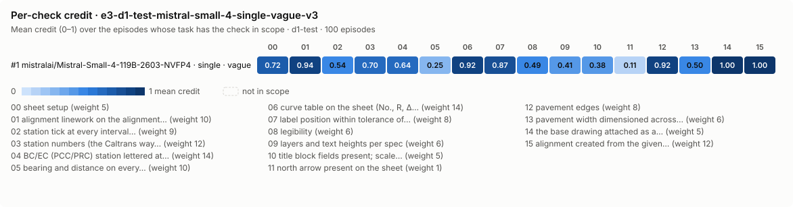

# Run `e3-d1-test-mistral-small-4-single-vague-v3`

Task set **d1-test** · 100 episodes · spec v1 (sha256:0e07d5e83c0b) · generator d1-v6 · verifier d1-verify-v8 · harness e3-v3

## Rows

Effective score: 0 on a hard fail, else the rubric score; per task over its samples, then over tasks. 95% CI: bootstrap over tasks within task type (4,000 resamples, seed 0).

| # | Row | Effort | Effective | 95% CI | Rubric | Hard-fail | Clean | Submit | Steps (med / p90) | Invalid calls | Recovery | run_check | Cost / sheet | Tasks × k |
|---:|---|---|---:|---|---:|---:|---:|---:|---|---:|---:|---:|---:|---|
| 1 | mistralai/Mistral-Small-4-119B-2603-NVFP4 · single · vague | high | **64.0** | 58.6–69.4 | 69.8 | 10% | 27% | 100% | 10 / 23 | 1% | 43% | 0.0 | – | 100 × 1 |

## Per-check credit

Mean credit (0–1) over the episodes whose task has the check in scope; – where none did.

| Check | Weight | #1 |
|---|---:|---:|
| D1-00 sheet setup | 5 | 0.72 |
| D1-01 alignment linework on the alignment… | 10 | 0.94 |
| D1-02 station tick at every interval station… | 9 | 0.54 |
| D1-03 station numbers (the Caltrans way… | 12 | 0.70 |
| D1-04 BC/EC (PCC/PRC) station lettered at… | 14 | 0.64 |
| D1-05 bearing and distance on every tangent… | 10 | 0.25 |
| D1-06 curve table on the sheet (No., R, Δ, T… | 14 | 0.92 |
| D1-07 label position within tolerance of the… | 8 | 0.87 |
| D1-08 legibility | 6 | 0.49 |
| D1-09 layers and text heights per spec | 6 | 0.41 |
| D1-10 title block fields present; scale… | 5 | 0.38 |
| D1-11 north arrow present on the sheet | 1 | 0.11 |
| D1-12 pavement edges | 8 | 0.92 |
| D1-13 pavement width dimensioned across each… | 6 | 0.50 |
| D1-14 the base drawing attached as a… | 5 | 1.00 |
| D1-15 alignment created from the given… | 12 | 1.00 |

## Failure taxonomy

Share of episodes with at least one finding in the category (findings per episode).

| Category | #1 | Codes |
|---|---:|---|
| completeness | 31% (6.1) | missing 470, missing_field 143 |
| value | 15% (0.7) | extra_linework 23, wrong_value 19, geometry_mismatch 14, wrong_field 9 |
| anchoring | 10% (1.0) | unanchored 59, duplicate 43 |
| placement | 4% (0.1) | not_visible 9, misplaced 2 |
| legibility | 42% (2.3) | overlap 159, off_sheet 66, clipped 6 |
| standards | 51% (6.9) | wrong_layer 681, wrong_height 7 |
| sheet_setup | 6% (0.1) | not_fitted 5, sheet_missing 4, viewport_scale 1 |

### Tool use and termination

| | #1 |
|---|---:|
| tool calls | 1232 |
| invalid-call rate | 1% |
| other fault rate | 12% |
| recovery rate | 43% |
| coordinate path share | 3% |
| stopped without calling submit | 0% |
| Δ effective after last run_check | – |
| ended submit | 100 |
| error command_failed | 150 |
| error invalid_params | 11 |
| error query_failed | 1 |

## By task type and sheet count

| Task type | #1 |
|---|---:|
| annotate-base | 42.3 (n 7) |
| annotate-sheet | 55.1 (n 7) |
| attach-reference | 100.0 (n 7) |
| bearings | 75.7 (n 7) |
| create-alignment | 72.6 (n 6) |
| curve-callouts | 54.9 (n 6) |
| curve-table | 52.2 (n 6) |
| draw-alignment | 87.5 (n 6) |
| layer-setup | 99.0 (n 6) |
| pavement | 44.8 (n 6) |
| pavement-edges | 83.3 (n 6) |
| pavement-widths | 33.3 (n 6) |
| plan-sheet | 42.5 (n 6) |
| sheet-setup | 47.4 (n 6) |
| stationing | 83.8 (n 6) |
| title-block | 46.8 (n 6) |
| 1 sheet | 71.4 (n 53) |
| 2 sheets | 55.6 (n 47) |

## Interval sizing

The v0.1 target is a 95% half-width under 5 points. Tasks needed assumes the half-width shrinks as 1/√tasks at this row's spread.

| Row | Tasks | Half-width | Unstratified | Within-task SD | Tasks for the target |
|---|---:|---:|---:|---:|---:|
| mistralai/Mistral-Small-4-119B-2603-NVFP4 · single · vague | 100 | 5.4 | 6.9 | – | 117 |

_Generated by `python -m roaddraft.eval report` (e4-v2); do not edit._
