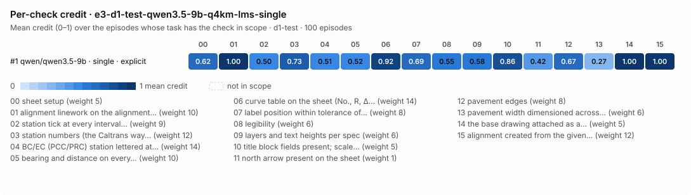

# Run `e3-d1-test-qwen3.5-9b-q4km-lms-single`

Task set **d1-test** · 100 episodes · spec v1 (sha256:0e07d5e83c0b) · generator d1-v6 · verifier d1-verify-v7 · harness e3-v2

## Rows

Effective score: 0 on a hard fail, else the rubric score; per task over its samples, then over tasks. 95% CI: bootstrap over tasks within task type (4,000 resamples, seed 0).

| # | Row | Effort | Effective | 95% CI | Rubric | Hard-fail | Clean | Submit | Steps (med / p90) | Invalid calls | Recovery | run_check | Cost / sheet | Tasks × k |
|---:|---|---|---:|---|---:|---:|---:|---:|---|---:|---:|---:|---:|---|
| 1 | qwen/qwen3.5-9b · single · explicit | default | **62.5** | 57.2–67.8 | 69.4 | 15% | 30% | 90% | 18 / 72 | 0% | 44% | 0.0 | – | 100 × 1 |

## Per-check credit

Mean credit (0–1) over the episodes whose task has the check in scope; – where none did.

| Check | Weight | #1 |
|---|---:|---:|
| D1-00 sheet setup | 5 | 0.62 |
| D1-01 alignment linework on the alignment… | 10 | 1.00 |
| D1-02 station tick at every interval station… | 9 | 0.50 |
| D1-03 station numbers (the Caltrans way… | 12 | 0.73 |
| D1-04 BC/EC (PCC/PRC) station lettered at… | 14 | 0.51 |
| D1-05 bearing and distance on every tangent… | 10 | 0.52 |
| D1-06 curve table on the sheet (No., R, Δ, T… | 14 | 0.92 |
| D1-07 label position within tolerance of the… | 8 | 0.69 |
| D1-08 legibility | 6 | 0.55 |
| D1-09 layers and text heights per spec | 6 | 0.58 |
| D1-10 title block fields present; scale… | 5 | 0.86 |
| D1-11 north arrow present on the sheet | 1 | 0.42 |
| D1-12 pavement edges | 8 | 0.67 |
| D1-13 pavement width dimensioned across each… | 6 | 0.27 |
| D1-14 the base drawing attached as a… | 5 | 1.00 |
| D1-15 alignment created from the given… | 12 | 1.00 |

## Failure taxonomy

Share of episodes with at least one finding in the category (findings per episode).

| Category | #1 | Codes |
|---|---:|---|
| completeness | 48% (4.2) | missing 398, missing_field 27 |
| value | 18% (0.7) | geometry_mismatch 37, wrong_value 24, wrong_field 7 |
| anchoring | 13% (2.9) | unanchored 241, duplicate 47, anchor_inconsistent 1 |
| placement | 8% (0.7) | misplaced 62, not_visible 4 |
| legibility | 24% (1.5) | overlap 103, off_sheet 32, clipped 14 |
| standards | 36% (4.7) | wrong_height 395, wrong_layer 54, wrong_layer_props 20 |
| sheet_setup | 8% (0.1) | not_fitted 10, sheet_missing 2 |

### Tool use and termination

| | #1 |
|---|---:|
| tool calls | 2886 |
| invalid-call rate | 0% |
| other fault rate | 8% |
| recovery rate | 44% |
| coordinate path share | 7% |
| stopped without calling submit | 4% |
| Δ effective after last run_check | – |
| ended budget:turn_time | 4 |
| ended budget:wall_clock | 6 |
| ended submit | 90 |
| error budget_exhausted | 6 |
| error command_failed | 185 |
| error invalid_params | 1 |
| error query_failed | 37 |

## By task type and sheet count

| Task type | #1 |
|---|---:|
| annotate-base | 35.3 (n 7) |
| annotate-sheet | 51.8 (n 7) |
| attach-reference | 100.0 (n 7) |
| bearings | 48.9 (n 7) |
| create-alignment | 100.0 (n 6) |
| curve-callouts | 0.0 (n 6) |
| curve-table | 73.7 (n 6) |
| draw-alignment | 100.0 (n 6) |
| layer-setup | 100.0 (n 6) |
| pavement | 70.3 (n 6) |
| pavement-edges | 33.3 (n 6) |
| pavement-widths | 9.7 (n 6) |
| plan-sheet | 45.2 (n 6) |
| sheet-setup | 75.3 (n 6) |
| stationing | 88.7 (n 6) |
| title-block | 69.9 (n 6) |
| 1 sheet | 64.2 (n 53) |
| 2 sheets | 60.6 (n 47) |

## Interval sizing

The v0.1 target is a 95% half-width under 5 points. Tasks needed assumes the half-width shrinks as 1/√tasks at this row's spread.

| Row | Tasks | Half-width | Unstratified | Within-task SD | Tasks for the target |
|---|---:|---:|---:|---:|---:|
| qwen/qwen3.5-9b · single · explicit | 100 | 5.3 | 8.0 | – | 113 |

_Generated by `python -m roaddraft.eval report` (e4-v1); do not edit._
