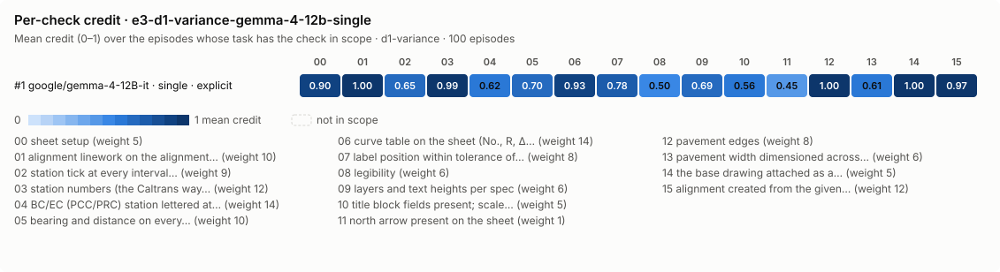

# Run `e3-d1-variance-gemma-4-12b-single`

Task set **d1-variance** · 100 episodes · spec v1 (sha256:0e07d5e83c0b) · generator d1-v6 · verifier d1-verify-v5 · harness e3-v2

## Rows

Effective score: 0 on a hard fail, else the rubric score; per task over its samples, then over tasks. 95% CI: bootstrap over tasks within task type (4,000 resamples, seed 0).

| # | Row | Effort | Effective | 95% CI | Rubric | Hard-fail | Clean | Submit | Steps (med / p90) | Invalid calls | Recovery | run_check | Cost / sheet | Tasks × k |
|---:|---|---|---:|---|---:|---:|---:|---:|---|---:|---:|---:|---:|---|
| 1 | google/gemma-4-12B-it · single · explicit | thinking on | **69.3** | 66.4–72.3 | 78.9 | 12% | 32% | 99% | 10 / 30 | 5% | 78% | 0.0 | – | 20 × 3–5 (10 errored) |

## Per-check credit

Mean credit (0–1) over the episodes whose task has the check in scope; – where none did.

| Check | Weight | #1 |
|---|---:|---:|
| D1-00 sheet setup | 5 | 0.90 |
| D1-01 alignment linework on the alignment… | 10 | 1.00 |
| D1-02 station tick at every interval station… | 9 | 0.65 |
| D1-03 station numbers (the Caltrans way… | 12 | 0.99 |
| D1-04 BC/EC (PCC/PRC) station lettered at… | 14 | 0.62 |
| D1-05 bearing and distance on every tangent… | 10 | 0.70 |
| D1-06 curve table on the sheet (No., R, Δ, T… | 14 | 0.93 |
| D1-07 label position within tolerance of the… | 8 | 0.78 |
| D1-08 legibility | 6 | 0.50 |
| D1-09 layers and text heights per spec | 6 | 0.69 |
| D1-10 title block fields present; scale… | 5 | 0.56 |
| D1-11 north arrow present on the sheet | 1 | 0.45 |
| D1-12 pavement edges | 8 | 1.00 |
| D1-13 pavement width dimensioned across each… | 6 | 0.61 |
| D1-14 the base drawing attached as a… | 5 | 1.00 |
| D1-15 alignment created from the given… | 12 | 0.97 |

## Failure taxonomy

Share of episodes with at least one finding in the category (findings per episode).

| Category | #1 | Codes |
|---|---:|---|
| completeness | 46% (2.4) | missing 167, missing_field 50 |
| value | 28% (0.8) | wrong_field 39, wrong_value 37 |
| anchoring | 26% (1.6) | duplicate 124, unanchored 20 |
| placement | 6% (0.3) | misplaced 21, not_visible 6 |
| legibility | 34% (2.1) | overlap 104, off_sheet 86, clipped 2 |
| standards | 31% (2.8) | wrong_height 238, wrong_layer 12, wrong_layer_props 1 |
| sheet_setup | 2% (0.0) | not_fitted 2 |

### Tool use and termination

| | #1 |
|---|---:|
| tool calls | 1249 |
| invalid-call rate | 5% |
| other fault rate | 11% |
| recovery rate | 78% |
| coordinate path share | 1% |
| stopped without calling submit | 17% |
| Δ effective after last run_check | – |
| ended budget:faults | 1 |
| ended error | 10 |
| ended submit | 89 |
| error command_failed | 131 |
| error invalid_params | 62 |
| error query_failed | 5 |

## By task type and sheet count

| Task type | #1 |
|---|---:|
| annotate-base | 70.3 (n 8) |
| annotate-sheet | 38.4 (n 10) |
| attach-reference | 100.0 (n 7) |
| bearings | 42.3 (n 10) |
| create-alignment | 80.0 (n 5) |
| curve-callouts | 17.4 (n 5) |
| curve-table | 95.7 (n 4) |
| draw-alignment | 100.0 (n 5) |
| layer-setup | 100.0 (n 4) |
| pavement | 87.1 (n 5) |
| pavement-edges | 100.0 (n 5) |
| pavement-widths | 29.4 (n 4) |
| plan-sheet | 67.1 (n 5) |
| sheet-setup | 94.5 (n 5) |
| stationing | 31.2 (n 3) |
| title-block | 82.2 (n 5) |
| 1 sheet | 60.4 (n 54) |
| 2 sheets | 82.8 (n 36) |

## Interval sizing

The v0.1 target is a 95% half-width under 5 points. Tasks needed assumes the half-width shrinks as 1/√tasks at this row's spread.

| Row | Tasks | Half-width | Unstratified | Within-task SD | Tasks for the target |
|---|---:|---:|---:|---:|---:|
| google/gemma-4-12B-it · single · explicit | 20 | 3.0 | 12.8 | 23.0 | 7 |

_Generated by `python -m roaddraft.eval report` (e4-v1); do not edit._
