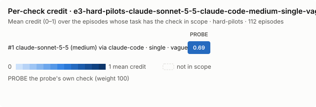

# Run `e3-hard-pilots-claude-sonnet-5-5-claude-code-medium-single-vague-v3`

Task set **hard-pilots** · 112 episodes · spec v1 (sha256:0e07d5e83c0b) · generator probe-b34493be3004 · verifier pilot-check-5326511dd41e · harness e3-v3

## Rows

Effective score: 0 on a hard fail, else the rubric score; per task over its samples, then over tasks. 95% CI: bootstrap over tasks within task type (4,000 resamples, seed 0).

| # | Row | Effort | Effective | 95% CI | Rubric | Hard-fail | Clean | Submit | Steps (med / p90) | Invalid calls | Recovery | run_check | Cost / sheet | Tasks × k |
|---:|---|---|---:|---|---:|---:|---:|---:|---|---:|---:|---:|---:|---|
| 1 | claude-sonnet-5-5 (medium) via claude-code · single · vague | medium | **24.1** | 18.8–28.6 | 69.0 | 76% | 24% | 100% | 18 / 35 | 0% | 46% | 0.0 | $0.643 | 112 × 1 |

## Per-check credit

Mean credit (0–1) over the episodes whose task has the check in scope; – where none did.

| Check | Weight | #1 |
|---|---:|---:|
| PROBE the probe's own check | 100 | 0.69 |

## Failure taxonomy

Share of episodes with at least one finding in the category (findings per episode).

| Category | #1 | Codes |
|---|---:|---|
| completeness | 0% (0.0) |  |
| value | 0% (0.0) |  |
| anchoring | 0% (0.0) |  |
| placement | 0% (0.0) |  |
| legibility | 0% (0.0) |  |
| standards | 0% (0.0) |  |
| sheet_setup | 0% (0.0) |  |

### Tool use and termination

| | #1 |
|---|---:|
| tool calls | 2307 |
| invalid-call rate | 0% |
| other fault rate | 1% |
| recovery rate | 46% |
| coordinate path share | 23% |
| stopped without calling submit | 72% |
| Δ effective after last run_check | – |
| ended submit | 112 |
| error command_failed | 18 |
| error invalid_params | 2 |
| error query_failed | 4 |
| error tool_error | 2 |

## By task type and sheet count

| Task type | #1 |
|---|---:|
| pilot-crowded-annotation | 0.0 (n 13) |
| pilot-plan-and-profile | 0.0 (n 5) |
| pilot-plan-reading | 75.0 (n 8) |
| pilot-plan-set | 0.0 (n 1) |
| pilot-qa-review | 22.2 (n 9) |
| pilot-redline-understanding | 10.0 (n 10) |
| pilot-redlines | 0.0 (n 12) |
| pilot-redraw-from-scan | 60.0 (n 5) |
| pilot-sheet-breaks | 0.0 (n 8) |
| pilot-sources-disagree | 100.0 (n 8) |
| pilot-striping | 66.7 (n 6) |
| pilot-survey-traps | 42.9 (n 7) |
| pilot-twisted-sheet | 0.0 (n 15) |
| pilot-typical-section | 0.0 (n 5) |
| 1 sheet | 24.1 (n 112) |

## Interval sizing

The v0.1 target is a 95% half-width under 5 points. Tasks needed assumes the half-width shrinks as 1/√tasks at this row's spread.

| Row | Tasks | Half-width | Unstratified | Within-task SD | Tasks for the target |
|---|---:|---:|---:|---:|---:|
| claude-sonnet-5-5 (medium) via claude-code · single · vague | 112 | 4.9 | 8.0 | – | 109 |

Prices from the table checked 2026-10-06.

_Generated by `python -m roaddraft.eval report` (e4-v2); do not edit._
