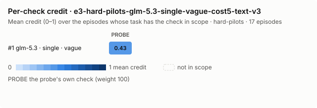

# Run `e3-hard-pilots-glm-5.3-single-vague-cost5-text-v3`

Task set **hard-pilots** · 17 episodes · spec v1 (sha256:0e07d5e83c0b) · generator probe-b34493be3004 · verifier pilot-check-5326511dd41e · harness e3-v3

> **Partial:** covers 17 of the set's 66 tasks; published and listed, ranked once the run holds them all. Not run: `PR-p01-redraw-alignment-cflpnp-6be3825829`, `PR-p01-redraw-alignment-fdot915-61ec40366e`, `PR-p01-redraw-alignment-ppm045-6df0c690c6`, `PR-p01-redraw-alignment-ppm050-2affbea890`, `PR-p01-redraw-alignment-wfl20-0f20641de0`, `PR-p03-grid-ground-wfl20-5e26b4f209`, `PR-p03-intl-feet-ppm047-e1eecf7e85`, `PR-p05-breaks-fdot918-a687bccf17`, `PR-p06-plan-profile-cflpnp-82943e212c`, `PR-p06-plan-profile-fdot915-334f506092`, `PR-p06-plan-profile-wfl14-d1d4f82363`, `PR-p06-plan-profile-wfl18-4d5c00f692` and 37 more.

## Rows

Effective score: 0 on a hard fail, else the rubric score; per task over its samples, then over tasks. 95% CI: bootstrap over tasks within task type (4,000 resamples, seed 0).

| # | Row | Effort | Effective | 95% CI | Rubric | Hard-fail | Clean | Submit | Steps (med / p90) | Invalid calls | Recovery | run_check | Cost / sheet | Tasks × k |
|---:|---|---|---:|---|---:|---:|---:|---:|---|---:|---:|---:|---:|---|
| 1 | glm-5.3 · single · vague | default | **11.8** | 0.0–29.4 | 43.5 | 88% | 12% | 82% | 47 / 478 | 1% | 39% | 0.0 | $2.61 | 17 × 1 |

## Per-check credit

Mean credit (0–1) over the episodes whose task has the check in scope; – where none did.

| Check | Weight | #1 |
|---|---:|---:|
| PROBE the probe's own check | 100 | 0.43 |

## Failure taxonomy

Share of episodes with at least one finding in the category (findings per episode).

| Category | #1 | Codes |
|---|---:|---|
| completeness | 0% (0.0) |  |
| value | 0% (0.0) |  |
| anchoring | 0% (0.0) |  |
| placement | 0% (0.0) |  |
| legibility | 0% (0.0) |  |
| standards | 0% (0.0) |  |
| sheet_setup | 0% (0.0) |  |

### Tool use and termination

| | #1 |
|---|---:|
| tool calls | 2364 |
| invalid-call rate | 1% |
| other fault rate | 6% |
| recovery rate | 39% |
| coordinate path share | 2% |
| stopped without calling submit | 65% |
| Δ effective after last run_check | – |
| ended budget:context | 2 |
| ended budget:turn_time | 1 |
| ended submit | 14 |
| error command_failed | 46 |
| error invalid_params | 18 |
| error query_failed | 96 |
| error tool_error | 3 |

## By task type and sheet count

| Task type | #1 |
|---|---:|
| pilot-crowded-annotation | 0.0 (n 5) |
| pilot-sheet-breaks | 25.0 (n 4) |
| pilot-sources-disagree | 20.0 (n 5) |
| pilot-survey-traps | 0.0 (n 3) |
| 1 sheet | 11.8 (n 17) |

## Interval sizing

The v0.1 target is a 95% half-width under 5 points. Tasks needed assumes the half-width shrinks as 1/√tasks at this row's spread.

| Row | Tasks | Half-width | Unstratified | Within-task SD | Tasks for the target |
|---|---:|---:|---:|---:|---:|
| glm-5.3 · single · vague | 17 | 14.7 | 14.7 | – | 148 |

Prices from the table checked 2026-10-06.

_Generated by `python -m roaddraft.eval report` (e4-v2); do not edit._
