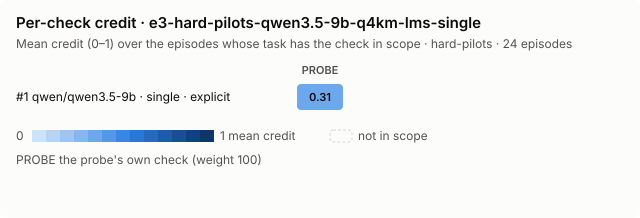

# Run `e3-hard-pilots-qwen3.5-9b-q4km-lms-single`

Task set **hard-pilots** · 24 episodes · spec v1 (sha256:0e07d5e83c0b) · generator probe-d1e6c7398d83 · verifier d1-verify-v6 · harness e3-v2

> **Not rankable as it stands:** Scored under an older spec or verifier: verifier_version d1-verify-v6 (current pilot-check-a6cca462de35).

> **Partial:** covers 24 of the set's 33 tasks; published and listed, ranked once the run holds them all. Not run: `PR-p01-redraw-alignment-fdot915-ffec94e2b0`, `PR-p01-redraw-alignment-ppm045-e65c28dac2`, `PR-p15-plan-reading-cflpla-ce3b4d4984`, `PR-p15-plan-reading-ppm046-03bbd54836`, `PR-p15-plan-reading-wflp14-4b1a999e89`, `PR-p18-redline-pdf-cflpla-d2c1f97d2e`, `PR-p18-redline-pdf-fdot915-2f5730c651`, `PR-p18-redline-pdf-ppm045-a0c3d4e54f`, `PR-p18-redline-pdf-wfl19-de3bd6233e`.

## Rows

Effective score: 0 on a hard fail, else the rubric score; per task over its samples, then over tasks. 95% CI: bootstrap over tasks within task type (4,000 resamples, seed 0).

| # | Row | Effort | Effective | 95% CI | Rubric | Hard-fail | Clean | Submit | Steps (med / p90) | Invalid calls | Recovery | run_check | Cost / sheet | Tasks × k |
|---:|---|---|---:|---|---:|---:|---:|---:|---|---:|---:|---:|---:|---|
| 1 | qwen/qwen3.5-9b · single · explicit | default | **8.7** | 0.0–17.4 | 31.4 | 91% | 9% | 83% | 35 / 70 | 0% | 28% | 0.0 | – | 23 × 1 (1 errored) |

## Per-check credit

Mean credit (0–1) over the episodes whose task has the check in scope; – where none did.

| Check | Weight | #1 |
|---|---:|---:|
| PROBE the probe's own check | 100 | 0.31 |

## Failure taxonomy

Share of episodes with at least one finding in the category (findings per episode).

| Category | #1 | Codes |
|---|---:|---|
| completeness | 0% (0.0) |  |
| value | 0% (0.0) |  |
| anchoring | 0% (0.0) |  |
| placement | 0% (0.0) |  |
| legibility | 0% (0.0) |  |
| standards | 0% (0.0) |  |
| sheet_setup | 0% (0.0) |  |

### Tool use and termination

| | #1 |
|---|---:|
| tool calls | 1024 |
| invalid-call rate | 0% |
| other fault rate | 11% |
| recovery rate | 28% |
| coordinate path share | 67% |
| stopped without calling submit | 17% |
| Δ effective after last run_check | – |
| ended budget:wall_clock | 4 |
| ended error | 1 |
| ended submit | 19 |
| error budget_exhausted | 4 |
| error command_failed | 85 |
| error invalid_params | 2 |
| error query_failed | 20 |

## By task type and sheet count

| Task type | #1 |
|---|---:|
| pilot-crowded-annotation | 0.0 (n 2) |
| pilot-plan-and-profile | 0.0 (n 1) |
| pilot-plan-set | 0.0 (n 1) |
| pilot-qa-review | 33.3 (n 3) |
| pilot-redlines | 0.0 (n 2) |
| pilot-sheet-breaks | 0.0 (n 2) |
| pilot-sources-disagree | 33.3 (n 3) |
| pilot-striping | 0.0 (n 2) |
| pilot-survey-traps | 0.0 (n 3) |
| pilot-twisted-sheet | 0.0 (n 2) |
| pilot-typical-section | 0.0 (n 2) |
| 1 sheet | 8.7 (n 23) |

## Interval sizing

The v0.1 target is a 95% half-width under 5 points. Tasks needed assumes the half-width shrinks as 1/√tasks at this row's spread.

| Row | Tasks | Half-width | Unstratified | Within-task SD | Tasks for the target |
|---|---:|---:|---:|---:|---:|
| qwen/qwen3.5-9b · single · explicit | 23 | 8.7 | 10.9 | – | 70 |

_Generated by `python -m roaddraft.eval report` (e4-v1); do not edit._
