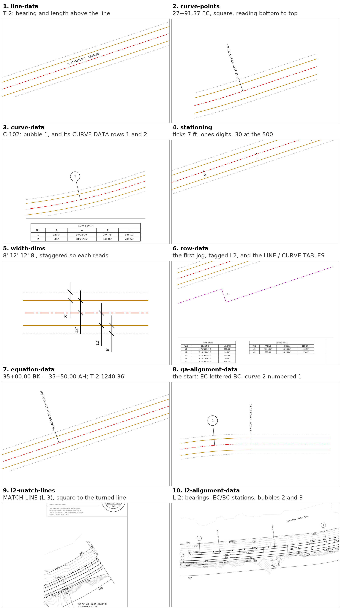

# Line and curve data: ten probes for a third tier

*Proposal, 2026-10-05. The numbers were measured on the fixtures with a scratch prototype that drew the
SR-100 rungs on paper through the reference.*

*Status, 2026-10-05: all ten are built, in `src/roaddraft/probes/tier3.py` (`python -m roaddraft.probes
list --tag tier3`). With them come the plotted-sheet reader (`probes/plotted.py`), the notation parsers
(`probes/notation.py`), four new starts (`sheets-eq`, `sheets-row`, `sheets-qa`, `l2`), and
`tests/test_probes_tier3.py` (36 tests). Robert decided: BC and EC everywhere, and the other issues fixed
as recommended. The engine now letters BC/EC and reads square labels bottom to top, L-2 is rebuilt, the
checks judge as plotted, stationing keeps 16 stations, and the L-2 builders live in
`roaddraft.probes.l2`. No model has run them yet.*

## Why this batch

A Caltrans layout must show "stationing equations, distances and bearings of all tangents, stations of all
curve points and curve data" for every station line. Curve numbers run consecutively along a line and are not
restarted on the next sheet (ppm-text p. 2-85, pdf 114). The layout checklist puts the bearing and distance
above the alignment line (p. 2-89, pdf 118) and asks for the traveled way and shoulders to be dimensioned
(p. 2-90, pdf 119). Stationing gets a tick every 100 ft, 7.0 ft long at 1" = 50', with the whole number only at
500 ft stations and the annotation below the line (p. 2-8, pdf 21). BC and EC text and match lines read bottom
to top (p. 2-4, pdf 17).

None of the 23 probes asks for any of it. The nearest is `pc-by-station`, a single PC callout.

The engine already exposes everything this work needs, but only for reading. Through `DESIGN:SR-100`,
`get_design_data` returns every tangent's bearing and length, every curve's Δ, R, T, L, E, M and chord, and
every curve point's station. Every command that would letter that data refuses a referenced alignment:
`place_label`, `place_curve_table`, `annotate_stationing` (alignment mode and referenced `path_ids` both) and
`export_landxml` all fault in the sheet file. That leaves an agent two routes, and both were checked to work:

- **Compose it.** Read with `get_design_data` and `station_to_xy sheet=`, then letter with `place_text`,
  `draw_line`, `draw_circle` and `place_table` on paper. The prototype drew all of C-102 this way in about
  70 calls, 48 of them for the stationing.
- **Copy the design in.** Build `create_alignment` in the sheet file from the PIs that `get_design_data` returns
  exactly. The engine's own labelers then work: `place_label` through the viewport, `place_curve_table`, and
  `annotate_stationing` in the sheet file's model space. This is the Civil 3D data-shortcut pattern, and the
  fault hint already suggests it ("bring the design into this document").

The checks judge the sheet **as plotted**, so both routes score the same. Each check reads what was added on
the paper and in the sheet file's own model space through each viewport, as paper inches. The rules are the
same as before: score from disk, never from the report. Each probe gets a scripted `solve` that passes its own
check and an untouched start that fails it. Traps get tests that prove they fail with a message saying why, and
an alternate correct route gets a test that proves it passes.

*Each probe's scripted solution as it plots (qa-alignment-data shows its start, with two of the planted
errors). Rendered by the engine from the solved documents. Those documents are kept as finished projects
that open in RoadDraft, each with its journal, PDF and DXF, in `benchmarks/probe_references/<probe>/`.*

## A finding from designing them: perpendicular labels read the wrong way (fixed)

`core/geometry.upright` folds every rotation into (−90°, 90°]. So `place_label rotation=perpendicular` reads
**top to bottom** whenever the line climbs to the right on the sheet.

- On SR-100 that happens at PT-1 and PC-2: 108.43° becomes −71.57°.
- On L-2 it happens at all five curve points, which sit between 95° and 116° on paper.

The published L-2 letters all five bottom to top, the PCC at 115.6° included. The rebuild in
`examples/caltrans_l2` uses `place_label` and letters all five top to bottom, so it differs from the sheet it
reproduces. `curve-points` would catch the engine's own labeler: an agent that takes the copy route fails 2 of
SR-100's 4 points unless it overrides the rotation. See decision 1.

*Fixed 2026-10-05.* `geometry.reading_up` folds square text into (−45°, 135°], so it reads bottom to top
until it leans more than 45° past vertical. `place_label rotation=perpendicular` uses it, on sheets and in
the model, and the rebuilt L-2 now matches the published sheet. `along` labels, stationing and dimensions
keep `upright`.

A second engine finding came out of building `equation-data`. `station_to_xy` answered the back station
of an equation (35+00.00 on a 35+00.00 BK = 35+50.00 AH line) with "does not exist on this alignment
(10+00.00 to 57+25.25)". The Phase-1 rule that the equation point reads by its ahead station stays,
because a test pins it. The fault now names the point and says how to reach it: ask for 35+50.00, pass
`region=1`, or use EQ-1.

## The ten

| # | probe | start | the gap it targets | effort |
|---|---|---|---|---|
| 1 | `line-data` | sheets | tangent data through a reference, lettered along and above the line | S |
| 2 | `curve-points` | sheets | stations to the hundredth, square to the line, reading bottom to top | S |
| 3 | `curve-data` | sheets | a table per sheet, scoped to that sheet, numbered along the line; bubbles aimed at curves | M |
| 4 | `stationing` | sheets | Caltrans stationing conventions, held for 16 stations | M |
| 5 | `width-dims` | sheets | dimensioning model geometry from paper (`measure_scale`), legibly | M |
| 6 | `row-data` | **sheets-row** | line and curve tags plus tables measured from raw linework | M |
| 7 | `equation-data` | **sheets-eq** | station arithmetic across an equation | S |
| 8 | `qa-alignment-data` | **sheets-qa** | finding five planted errors in finished alignment data, and restraint | M |
| 9 | `l2-match-lines` | **l2** | match lines square to the line on a twisted, clipped real sheet | M |
| 10 | `l2-alignment-data` | **l2** | the whole job on Caltrans L-2: twist, PCC, numbering that starts at 2, a busy sheet | M |

Shared pieces add one more M (next section). Effort uses tier 2's scale: S is an afternoon, M a day, L several.
Probes 1 to 5 use the existing `sheets` start, so they compare directly with the 23. Four new starts appear in
bold.

### On the SR-100 plan set (twist 0, two curves, three tangents)

Per sheet: C-101 shows T-1 and PC-1 (24+05.27) and 38% of curve 1. C-102 shows T-2, PT-1 (27+91.37),
PC-2 (40+31.72), 62% of curve 1 and 49% of curve 2. C-103 shows T-3, PT-2 (43+21.30) and 51% of curve 2.

**1. `line-data` (S).** *On sheets C-101 through C-103, letter the line data of SR-100. For every tangent, on
the sheet that shows it, letter its bearing and its length as one line of text, for example
N 45°00'00" E 1234.56'. Set it just above the centerline and parallel to it, reading left to right, clear of
all linework.*

The check, for each tangent on its sheet (three in all):
- The text parses to the bearing (±1") and the length (±0.01 ft): T-1 N 90°00'00" E 1405.27', T-2
  N 71°33'54" E 1240.36', T-3 N 90°00'00" E 1353.95'.
- It is parallel to the tangent on paper (±1°) and upright.
- Its centre projects inside the tangent's visible span.
- It sits on the left of the line, within 1 in of it, and does not cross it.
- It clears all linework by 0.02 in. Tier 2's 0.05 in would leave a 0.04 in window for 0.10 in text between
  the centerline and the edge of pavement, which are 0.24 in apart.

Traps:
- PI-to-PI lengths (1600.00, 1581.14, 1500.00).
- The back bearing (S 71°33'54" W).
- Text below the line or horizontal.
- Text across the edge of pavement.
- A T-2 label on C-101, which does not show T-2.

**2. `curve-points` (S).** *On sheets C-101 through C-103, letter the station of every curve point of SR-100
that the sheet shows, each BC and each EC, the Caltrans way. Give the station to the hundredth followed by BC
or EC (12+34.56 BC). Letter it along the line square to the centerline through that point, on the left of the
centerline, reading bottom to top.*

The check covers four points. Each needs a text with the exact station and the right word, at the paper
direction + 90° (±1°, not folded). The point must lie within the text's height band, widened by 0.03 in, so a
baseline on an extension line, a centred text and a top-aligned text all pass. The text must sit on the left
and must not cover the point. The published L-2 letters it this way: baseline on an extension line from the
point, starting outside the roadway.

Traps:
- Upright folding at PT-1 and PC-2, including from `place_label`.
- 24+05 for 24+05.27 (Haiku did exactly this on Sep 22).
- BC and EC swapped.
- PT-1 lettered on C-101.

**3. `curve-data` (M).** *Add SR-100's curve data to sheets C-101 through C-103. On each sheet, place a CURVE
DATA table with columns No., R, Δ, T and L listing every curve that sheet shows. On the plan, mark each of those
curves with its number in a circle, with a leader to the curve. Number the curves 1, 2, … in order along
SR-100; a curve keeps its number on every sheet. Keep the table clear of the roadway.*

The check:
- The table rows are exactly {1}, {1, 2} and {2} on the three sheets.
  - Curve 1: R 1200', Δ 18°26'06", T 194.73', L 386.10'.
  - Curve 2: R 900', Δ 18°26'06", T 146.05', L 289.58'.
  - Tolerances: R to the foot (Caltrans tables print whole feet), Δ ±1", T and L ±0.01 ft.
- A row can be a `Table` row or texts that share a baseline, so a hand-built table counts.
- Each bubble is a circle of 0.1–0.4 in holding the number. Its leader chain starts at the circle and its tip
  lands within 1 ft of the curve, on the part the sheet shows.

Traps:
- Both curves listed on every sheet.
- C-103's curve numbered 1.
- E or M in the T column (15.70', 15.50').
- Δ written as 18.43°.
- R taken from the 20 ft shoulder (1220', 880').
- A bubble aimed at the chord's midpoint, 15.5 ft off the arc.

**4. `stationing` (M).** *Station SR-100 on sheet C-102 the Caltrans way, at every 100 ft station the sheet
shows. Draw a tick 7 ft long at plot scale across the centerline, square to it and centred on it. Below the
line, letter the whole station number at multiples of 500 ft (30, 35, 40) and only the ones digit elsewhere
(6, 7, 8, 9, 1, 2, …), reading left to right.*

The check covers 16 stations, 26+00 through 41+00, all at least 0.25 in inside the window. 41+00 is on curve 2,
so its tick is radial.
- Tick: crosses the centerline within 1 ft of the station point, perpendicular ±2°, 0.14 in ±0.02 in long,
  centred within 0.02 in.
- Label: the exact lettering, on the right side within 0.4 in of the point, centred along the line ±0.15 in.

Traps:
- 26+00 lettering.
- Full numbers everywhere.
- Labels above the line.
- Ticks 7 in long, or 14 ft long from a half-length confusion.
- The 500s missed.

Composed by hand this is about 48 calls. The copy route (`annotate_stationing` with `tick_half_len` 3.5 and a
negative `label_offset`, then 16 `modify_entity` edits to the lettering) is about 20. See decision 4.

**5. `width-dims` (M).** *On sheet C-101 at SR-100 station 17+00, dimension the roadway across, from outside
edge of shoulder to outside edge of shoulder: the left shoulder, the two lanes and the right shoulder, each
reading its width in feet (8', 12', 12', 8'). Every number must be readable: no two may overlap.*

The check covers each band. It wants either a dimension whose measured points lie on the band's two lines
(within 1 ft as plotted, within 25 ft of 17+00, measured across ±3°) and whose text reads the width (±0.5 ft),
or a hand-drawn segment across the band with a text within 0.3 in of it. The four texts must not overlap.

Traps:
- A paper `place_dimension` without `measure_scale` reads `0.24` and `0.16`. Measured in the prototype.
- 20' from the centerline to the shoulder, or 24' edge to edge.
- Dimensions along the road.
- The engine's own layout for spans this short (0.24 in and 0.16 in). It pushes each text outside its
  extension lines and the texts collide, so the agent has to stagger the dimensions (as the solution in the
  figure does) or letter the widths Caltrans-style, the way L-2 does at its left edge.

### On new SR-100 starts

**6. `row-data` (M), start `sheets-row`.** The design file gains right-of-way lines on V-ROW as raw lines and
arcs, with no anchor records. The left line sits at 50 ft. The right line sits at 50 ft except between 30+00 and
36+00, where it jogs out to 80 ft.

*On sheet C-102, letter the line and curve data of the right-hand right of way line (right of the stationing
direction) the way a right of way map does. Tag each straight piece the sheet shows L1, L2, … and each curved
piece C1, C2, …, numbered in order along SR-100 and set beside its piece. Add a LINE TABLE (tag, bearing,
length) and a CURVE TABLE (tag, radius, delta, length) giving each piece's full geometry, not just the part on
this sheet.*

The sheet shows seven pieces:

| tag | geometry |
|---|---|
| C1 | R 1250.00', Δ 18°26'06", L 402.19' |
| L1 | N 71°33'54" E 208.63' |
| L2 | S 18°26'06" E 30.00' |
| L3 | N 71°33'54" E 600.00' |
| L4 | N 18°26'06" W 30.00' |
| L5 | N 71°33'54" E 431.72' |
| C2 | R 850.00', Δ 18°26'06", L 273.49' |

Each tag must be nearer its own piece (as plotted) than any other line and within 0.5 in of it. Each table
row must match its piece; a bearing may be quoted in either direction.

Traps:
- Centerline radii (1200', 900') or the shoulder's.
- Lengths of only the visible part.
- The left R/W line.
- Jogs left untagged.

`measure` gives a raw line's bearing from its two ends, so no hand trigonometry is needed. The probe
discovers whether the agent knows that.

**7. `equation-data` (S), start `sheets-eq`.** SR-100 with 35+00.00 BK = 35+50.00 AH, which falls on T-2 on
C-102.

*SR-100 has a station equation, on sheet C-102. On that sheet, letter it the Caltrans way, with its back and
ahead stations to the hundredth and BK and AH, square to the centerline at the equation and reading bottom to
top. Then letter the bearing and length of the tangent it falls on, above the line and parallel to it, and the
station of the BC of the next curve, lettered the way the equation is.*

The check wants:
- Both stations with BK and AH, at the equation point.
- T-2 at **1240.36'**.
- BC **40+81.72**.

Traps:
- The length from stations: 40+81.72 − 27+91.37 = 1290.35'.
- The BC without the equation: 40+31.72.
- The equation lettered 50 ft ahead of where it is, by treating 35+50 as a raw station.

The engine already refuses the gap (`station 35+20.00 does not exist ... gap between 35+00.00 BK and
35+50.00 AH`), so this measures reading, not tooling.

**8. `qa-alignment-data` (M), start `sheets-qa`.** The solves of 1 to 3, with five errors planted, one of each
kind:

| sheet | planted | truth |
|---|---|---|
| C-101 | BC lettered 24+50.27 | 24+05.27 |
| C-102 | T-2 length 1581.14', the PI-to-PI distance | 1240.36' |
| C-102 | T and L swapped in curve 2's table row | 146.05', 289.58' |
| C-103 | curve 2 numbered 1 in its table and its bubble | 2 |
| C-103 | PT-2 lettered 43+21.30 BC | EC |

*Sheets C-101 through C-103 already carry SR-100's alignment data: the bearing and length of each tangent, the
BC and EC stations, curve numbers and CURVE DATA tables. Check every item against the design and correct
whatever is wrong. Change nothing that is right.*

The check wants:
- Each planted error gone and its truth in place.
- Every right item unchanged in value and place (0.05 in), so retyping one identically passes.
- Nothing doubled.

This is `draft-fix-the-drawing` for annotation. It is also the alignment-data counterpart of the seeded L-2
variants built for stacheck, which plant errors in station-and-offset callouts.

### On Caltrans L-2 (twist −6.457°, clipped reference, ~3,000 model entities)

Start `l2` is the L-2 build with the alignment data stripped by layer: V-ANNO-ALGN in the model, and
S-ANNO-CURV and S-ANNO-MTCH on the sheet. That leaves stationing, the 14 callouts, notes, the north arrow and
existing ground.

**9. `l2-match-lines` (M).** *Sheet L-2 shows the "SR70" line from 574+50 to 589+50; the layout continues on
sheet L-1 back of 574+50 and on L-3 ahead of 589+50. Draw the two match lines on L-2: each square to the "SR70"
line at its station, running at least 40 ft past the centerline on both sides, and lettered along the line
MATCH LINE with the adjoining sheet in parentheses: MATCH LINE (L-1), MATCH LINE (L-3).*

The check wants, for each match line:
- A segment within 1 ft of the station point.
- Square to the line on paper (±1°).
- Reaching −40 ft and +40 ft.
- A parallel text within 0.5 in reading MATCH LINE and the right sheet.

On paper the line runs at 0.14° at 574+50 and 33.27° at 589+50. So a vertical match line is right at L-1 and
33° wrong at L-3, and one square to the *model* direction is 6.46° wrong at both.

Traps:
- Twist ignored.
- Lines drawn at the window edge.
- L-1 and L-3 swapped.

**10. `l2-alignment-data` (M, the capstone).** *Sheet L-2 has lost its alignment data. Put it back the way a
Caltrans layout shows it, for the "SR70" line as this sheet shows it: the bearing and length of each tangent,
the station of each curve point, each curve's number in a circle on the plan, and a CURVE DATA table (No., R,
Δ, T, L). Curve numbers continue from sheet L-1, which ends with curve 1. Nothing you add may overlap other
lettering on the sheet.*

The check wants:
- **Tangents:** T-2 230.76' N 78°30'50" E and T-3 251.23' N 66°39'57" E, parallel on paper (±1°) within
  0.6 in. Distance and bearing may be split across the line, as the published sheet does.
- **Curve points:** five, each lettered square to the line through its point (as in `curve-points`, band
  widened by 0.04 in), either reading direction: 576+16.93 EC, 578+47.69 BC, 582+85.52 EC, 585+36.75 BC and
  588+34.95 **PCC**.
- **Bubbles:** 2 to 5, with leaders to the curves.
- **Table:** rows exactly 2 to 5.
  - R 1957', 2117', 1953', 862'.
  - Δ 16°47'27", 11°50'53", 8°44'56", 21°17'31".
  - T 288.83', 219.70', 149.39', 162.03'.
  - L 573.51', 437.83', 298.20', 320.33'.
- **Legibility:** no added text overlaps any other text on the sheet, including the existing callouts, station
  digits and contour labels.

Traps:
- Numbering 1 to 4, the engine's C-1 to C-4.
- Parallel to the *model* line (6.46° off).
- BC or EC at the PCC.
- Curves 2 and 5 left out because their BC and EC are off the sheet.
- A bearing lettered below the line, where L-2's station digits are, landing on one. The published sheet fits
  N 78°30'50" E between the 7 and the 8. (The prototype's T-2 bearing, centred on its tangent, landed on the
  34+00 tick.)

## What building them needs

- **A plotted reader** (M). It returns the texts, segments, circles, table cells and dimension primitives a
  submission added to a sheet: from paper, and from the sheet file's model space through each viewport, as
  paper inches with rotation and height. Text gets oriented boxes, not `Text.bbox`'s axis-aligned one, which
  is about 0.7 in tall for a 2 in label at 18°. Tier 2's `callouts` and `paper_linework` carry over.
- **Parsers** for stations, bearings (to azimuth), DMS and feet. These are tolerant of spacing, case and
  symbol variants (`N71°33'54"E`, `N 71-33-54 E`) and strict about value.
- **Four starts.**
  - `sheets-eq`: the model with an equation.
  - `sheets-row`: the model plus V-ROW lines.
  - `sheets-qa`: the solves of 1 to 3, plus the five plants.
  - `l2`: the example builders, then the strip. It takes 18 s to build, so tests share one build per session.
- **`tests/test_probes_tier3.py`**, in the tier-2 pattern, plus one test per probe that the copy route passes
  where it should and fails where the engine's defaults are wrong.

## Decisions for Robert

1. **Perpendicular labels.** *Decided: fixed.* Make `place_label rotation=perpendicular` read bottom to top
   (PPM p. 2-4, and the published L-2), keep `along` labels upright, and rebuild L-2? The change is in `design/labels.py`
   (`compile_label` and `sheet_pose`). `geometry.upright` stays as it is for along-labels, stationing and
   dimensions. The parked D1 generator never letters perpendicular, so its pinned task ids are unaffected.

   Recommended: yes, before the first run, so the copy route is not penalised for an engine default.
   Otherwise `curve-points` measures whether an agent overrides the engine. That is a legitimate probe too, but
   a different one.
2. **Where work may live.** *Decided: as proposed.* Proposed: as plotted, on paper or in the sheet file's own model space, a copied
   design included. Work saved into the referenced design file does not count.
3. **Wording.** *Decided: BC and EC everywhere.* The engine now letters BC/EC too: `place_label`,
   stationing, the curve table's BC STA / EC STA, `resolve_anchor`'s `auto_content`, and `draft-v1`'s
   `labels.pc_pt.format`, whose new spec hash rolled the pinned D1 task ids. `BC-n` and `EC-n` are accepted
   anchors for `PC-n` and `PT-n`. Parse values, and require the words the prompt or the standard names: BC,
   EC, PCC, BK, AH, MATCH LINE. Should PC and PT pass for BC and EC? Recommended: no, since every prompt here
   names BC and EC.
   This settles tier 2's whitespace question for this batch: spacing never fails, values always can.
4. **Stationing size.** *Decided: 16.* Keep 16 stations (48 calls by hand, about 20 by the copy route), or cut to
   30+00–41+00 (12)? Recommended: 16. The loop is the point, and local models get a `--budget`.
5. **L-2 as a fixture.** *Decided: moved, to `roaddraft.probes.l2`.* Move `examples/caltrans_l2`'s builders and `existing.json` into the package (for
   example `probes/l2/`) rather than load them from `examples/`. Probe starts should not depend on an example
   folder being present.

## Recommended order

| batch | probes | why |
|---|---|---|
| A | `line-data`, `curve-points`, `curve-data`, `stationing` | the alignment data every layout needs, on the existing start; builds the plotted reader and parsers |
| B | `equation-data`, `width-dims`, `row-data` | one new skill each: equations, dimensions through a viewport, measuring raw linework |
| C | `qa-alignment-data`, `l2-match-lines`, `l2-alignment-data` | need A's solves and the L-2 start; the capstone last |

One pass of all ten is about 200 to 230 tool calls by the routes above. Build A first, then run Fable and Haiku
on it through the shell bridge before building C. Tier 2's ceiling is still unmeasured on those two, and A
alone is enough to see whether this batch discriminates.
